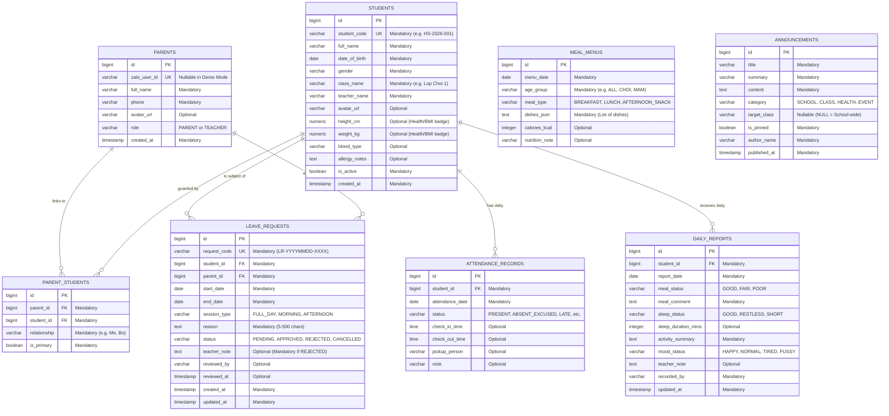

# Business Rules & Domain Data Governance — SchoolConnect

## 1. Document Control

| Attribute | Value |
| :--- | :--- |
| **Project Name** | SchoolConnect |
| **Document ID** | `DOC-01-RULES` |
| **Phase** | Phase 01 — Product Discovery & Requirement Analysis |
| **Last Updated** | 2026-11-04 |

---

## 2. Core Business Rules Catalog (`RULE-001` to `RULE-014`)

Every business rule below carries a stable identifier, enforcement layer, and status.

| Rule ID | Rule Name | Detailed Specification | Enforcement Layer | Status |
| :--- | :--- | :--- | :--- | :--- |
| **`RULE-001`** | **Guardian-Student Data Isolation** | A Parent (`ROLE_PARENT`) may only view dashboard, attendance, daily reports, and leave requests for students explicitly linked to their `parent_id` via an active record in `parent_students`. Any attempt to query or mutate `/api/v1/children/{studentId}/...` for an unlinked `studentId` must be rejected with `HTTP 403 Forbidden`. | Backend Service & Repository | `Confirmed` |
| **`RULE-002`** | **Leave Request Date Validity** | A new Leave Request must have `start_date <= end_date`. Furthermore, `start_date` must not be earlier than the current local date (`Asia/Ho_Chi_Minh`, `today`), and the total requested duration (`end_date - start_date + 1`) must not exceed `14` consecutive calendar days in a single request. | Frontend Form & Backend Validator | `Confirmed` |
| **`RULE-003`** | **Overlapping Leave Request Prevention** | A student cannot have two active (`PENDING` or `APPROVED`) leave requests whose date ranges (`[start_date, end_date]`) overlap on the same session (`FULL_DAY` overlaps with `MORNING`, `AFTERNOON`, and `FULL_DAY`; `MORNING` overlaps with `MORNING` and `FULL_DAY`; `AFTERNOON` overlaps with `AFTERNOON` and `FULL_DAY`). Overlapping submissions must be rejected with `HTTP 409 Conflict`. | Backend Service (Transactional Check) | `Confirmed` |
| **`RULE-004`** | **Idempotent / Double-Submit Prevention** | Rapid duplicate clicks on the "Submit Leave Request" button must not create duplicate records. The Frontend must disable the submit button while a request is in flight, and the Backend overlap check (`RULE-003`) within a database transaction prevents duplicate concurrent insertions. | Frontend UI State & DB Transaction | `Confirmed` |
| **`RULE-005`** | **Leave Request State Machine** | Valid statuses for `leave_requests` are `PENDING`, `APPROVED`, `REJECTED`, and `CANCELLED`. - Initial state upon creation is always `PENDING`. - Only `PENDING` requests can transition to `CANCELLED` (by the owning `ROLE_PARENT`). - Only `PENDING` requests can transition to `APPROVED` or `REJECTED` (by `ROLE_TEACHER`). - Terminal states (`APPROVED`, `REJECTED`, `CANCELLED`) are immutable and cannot be transitioned again (`HTTP 400/409`). | Backend Domain Service | `Confirmed` |
| **`RULE-006`** | **Parent Cancellation Constraint** | A Parent can only cancel a leave request that belongs to a student linked to that Parent AND is currently in `PENDING` status. Once a Teacher has `APPROVED` or `REJECTED` the request, the Parent cannot cancel it via the app. | Backend Service | `Confirmed` |
| **`RULE-007`** | **Teacher Review Authorization & Audit** | Only users operating under `ROLE_TEACHER` (via Teacher Demo Mode or Teacher JWT) can approve or reject leave requests (`PATCH /api/v1/teacher/leave-requests/{id}/review`). When reviewing, the system must record `reviewed_by` (Teacher name/ID), `reviewed_at` (UTC/local timestamp), and optional `teacher_note` (required if status is `REJECTED`). | Backend Controller & Service | `Confirmed` |
| **`RULE-008`** | **Rejection Reason Requirement** | When a Teacher rejects a leave request (`status = REJECTED`), a non-empty `teacher_note` (minimum 5 characters, maximum 500 characters) explaining the reason for rejection is mandatory. For `APPROVED`, `teacher_note` is optional (defaults to `"Nhà trường đã ghi nhận đơn xin nghỉ của bé."` if omitted). | Frontend Teacher Modal & Backend Validator | `Confirmed` |
| **`RULE-009`** | **Leave Reason Length & Sanitization** | The Parent's `reason` field on a leave request is mandatory, must be trimmed of leading/trailing whitespace, contain between `5` and `500` characters, and be sanitized against HTML/script injection (XSS). | Frontend Form & Jakarta Validation | `Confirmed` |
| **`RULE-010`** | **Unique Request Code Generation** | Every created leave request must be assigned a human-readable, unique `request_code` following the format `LR-YYYYMMDD-XXXX` (e.g., `LR-20261104-0001`) for easy reference by parents and teachers during demo verification. | Backend Service | `Confirmed` |
| **`RULE-011`** | **Attendance Status Taxonomy** | Daily attendance records (`attendance_records`) use standardized statuses: `PRESENT` (*Có mặt*), `ABSENT_EXCUSED` (*Nghỉ có phép*), `ABSENT_UNEXCUSED` (*Nghỉ không phép*), `LATE` (*Đi muộn*), and `NOT_MARKED` (*Chưa điểm danh*). At most one attendance record may exist per `(student_id, attendance_date)`. | Database Unique Constraint & Backend | `Confirmed` |
| **`RULE-012`** | **Meal Menu Session Structure** | School meal menus (`meal_menus`) are organized by `menu_date` and `meal_type` (`BREAKFAST` – *Bữa sáng*, `LUNCH` – *Bữa trưa*, `AFTERNOON_SNACK` – *Bữa xế*), including dish names, nutritional summary (calories/highlights), and allergy notes. | Database & API Contract | `Confirmed` |
| **`RULE-013`** | **Dual Authentication Governance** | In `DEMO_MODE` (enabled via configuration for development/testing), the system allows instant switching between pre-seeded `ROLE_PARENT` (`Trần Thu Hà`) and `ROLE_TEACHER` (`Cô Lê Thanh Thảo`) accounts. In `ZALO_AUTH` mode, the Backend verifies the Zalo Access Token against `https://graph.zalo.me/v2.0/me` using HMAC-SHA256 `appsecret_proof` before issuing an internal signed JWT. | Backend Auth Module | `Confirmed` |
| **`RULE-014`** | **Synthetic Data & Visual Originality** | All student, parent, teacher, and health data must be 100% synthetic (`CF-06`). UI components and visual layout must be original to `SchoolConnect` and must never imitate the 5 reference screenshots (`CF-05`). | Seed Data & Frontend Design System | `Confirmed` |

---

## 3. Domain Data Model & Entity Governance (`DATA-001` to `DATA-008`)

### 3.1. Entity Relationship Diagram (Mermaid ERD)

---

### 3.2. Entity Ownership, Constraints & Lifecycle Matrix

| Data ID | Entity (`Table`) | Data Owner / Steward | Mandatory Attributes | Uniqueness & Validation Constraints | Lifecycle, Retention & Audit |
| :--- | :--- | :--- | :--- | :--- | :--- |
| **`DATA-001`** | `parents` | School Admin / Auth System | `id`, `full_name`, `phone`, `role`, `created_at` | `UNIQUE(zalo_user_id)` when non-null; `UNIQUE(phone)`; `role IN ('PARENT', 'TEACHER')` | Created during onboarding/seed; soft-deactivated only; never hard-deleted if linked to students. |
| **`DATA-002`** | `students` | School Administration | `id`, `student_code`, `full_name`, `date_of_birth`, `gender`, `class_name`, `teacher_name`, `is_active`, `created_at` | `UNIQUE(student_code)`; `height_cm > 0`, `weight_kg > 0` when present | Created per school year; retained throughout enrollment; read-only for parents. |
| **`DATA-003`** | `parent_students` | School Administration | `id`, `parent_id`, `student_id`, `relationship`, `is_primary` | `UNIQUE(parent_id, student_id)`; Foreign keys with `ON DELETE RESTRICT` | Defines authorization boundary (`RULE-001`). |
| **`DATA-004`** | `attendance_records` | Homeroom Teacher | `id`, `student_id`, `attendance_date`, `status` | `UNIQUE(student_id, attendance_date)`; `status IN ('PRESENT','ABSENT_EXCUSED','ABSENT_UNEXCUSED','LATE','NOT_MARKED')` | Recorded daily; historical records retained for full academic year. |
| **`DATA-005`** | `daily_reports` | Homeroom Teacher | `id`, `student_id`, `report_date`, `meal_status`, `meal_comment`, `sleep_status`, `activity_summary`, `mood_status`, `recorded_by`, `updated_at` | `UNIQUE(student_id, report_date)` | Created daily per student; tracks `recorded_by` and `updated_at` for auditability. |
| **`DATA-006`** | `meal_menus` | School Kitchen / Nutritionist | `id`, `menu_date`, `age_group`, `meal_type`, `dishes_json` | `UNIQUE(menu_date, age_group, meal_type)`; `meal_type IN ('BREAKFAST','LUNCH','AFTERNOON_SNACK')` | Published weekly; immutable for past dates. |
| **`DATA-007`** | `announcements` | School Admin / Teacher | `id`, `title`, `summary`, `content`, `category`, `is_pinned`, `author_name`, `published_at` | `category IN ('SCHOOL','CLASS','HEALTH','EVENT')` | Ordered by `is_pinned DESC, published_at DESC`. |
| **`DATA-008`** | `leave_requests` | Parent (Creator) & Teacher (Reviewer) | `id`, `request_code`, `student_id`, `parent_id`, `start_date`, `end_date`, `session_type`, `reason`, `status`, `created_at`, `updated_at` | `UNIQUE(request_code)`; `start_date <= end_date`; `status IN ('PENDING','APPROVED','REJECTED','CANCELLED')` | Full audit trail: `created_at` (submission), `updated_at` (last change), `reviewed_by` & `reviewed_at` (teacher decision). No hard delete allowed (`CANCELLED` state used instead). |

