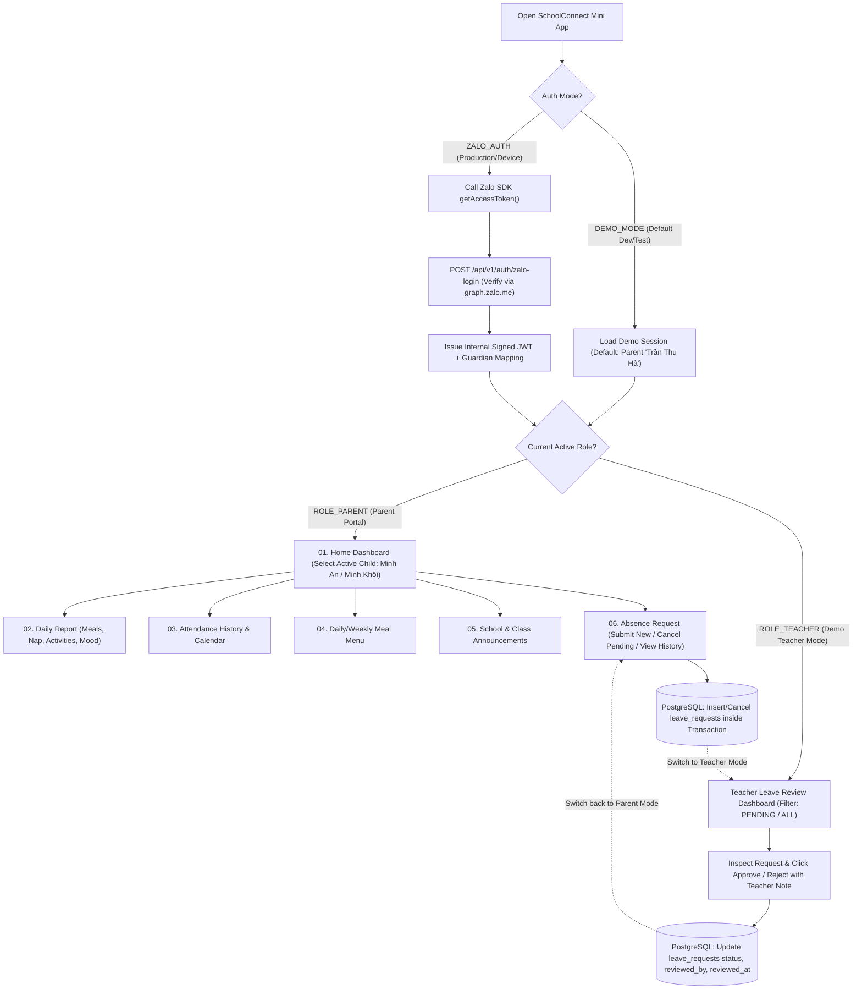
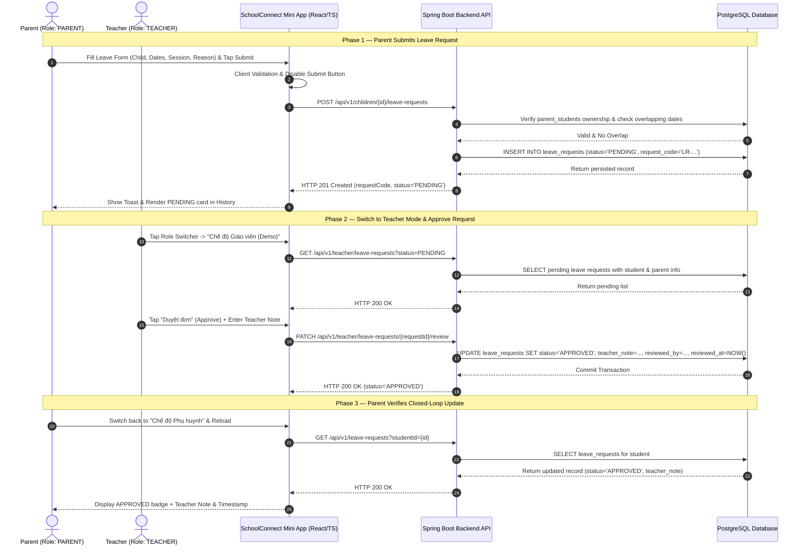

# User Journeys & Business Workflows — SchoolConnect

## 1. Document Control

| Attribute | Value |
| :--- | :--- |
| **Project Name** | SchoolConnect |
| **Document ID** | `DOC-01-FLOWS` |
| **Phase** | Phase 01 — Product Discovery & Requirement Analysis |
| **Last Updated** | 2026-11-04 |

---

## 2. End-to-End System Interaction Overview

---

## 3. Detailed Use Case Specifications

### 3.1. `UC-01` — Dual-Mode Authentication & Demo Role Switching
- **Actors:** Parent (`ROLE_PARENT`), Teacher (`ROLE_TEACHER`), Evaluator (`EVALUATOR`), Zalo Platform (`STK-05`).
- **Preconditions:**
  - User opens the SchoolConnect Mini App (inside Zalo or local browser preview) and Backend API is reachable.
- **Main Flow (`DEMO_MODE` & Role Switching):**
  1. Application boots and checks authentication state.
  2. When running in `DEMO_MODE` (or when the user taps **"Trải nghiệm nhanh (Demo)"**), Frontend requests a demo session token from `POST /api/v1/auth/demo-session` with `role = "PARENT"`.
  3. Backend loads the seeded parent account (`Trần Thu Hà`, linked to `Nguyễn Minh An` and `Nguyễn Minh Khôi`), generates a valid JWT/session context, and returns the user profile along with the list of linked children.
  4. At any time during the demonstration, the user taps the **Role Switcher Pill** (`Đang xem: Phụ huynh` -> `Chuyển sang: Giáo viên duyệt đơn`).
  5. Frontend calls `POST /api/v1/auth/demo-session` with `role = "TEACHER"`, receives the Teacher session (`Cô Lê Thanh Thảo`), and transitions immediately to the **Teacher Leave Review View**.
- **Alternative Flow (`AF-01`: Real Zalo Login `ZALO_AUTH`):**
  1. When `ZALO_AUTH` is triggered on a Zalo device with a bound Mini App ID, Frontend invokes `getAccessToken()` from `zmp-sdk`.
  2. Frontend sends the token to `POST /api/v1/auth/zalo-login`.
  3. Backend computes `appsecret_proof` (HMAC-SHA256) and verifies the token against `https://graph.zalo.me/v2.0/me`.
  4. Backend matches `zalo_user_id` to `parents.zalo_user_id` and returns the internal JWT.
- **Failure & Exception Scenarios:**
  - **`EX-01` (Zalo SDK Unavailable in Browser / Unbound App ID):** System gracefully catches the SDK error, displays a clear non-crashing notice, and falls back to `DEMO_MODE` automatically so the evaluator is never blocked.
  - **`EX-02` (Unlinked Zalo Account):** Backend returns `HTTP 403` with code `GUARDIAN_NOT_LINKED`; Frontend offers a one-tap button to switch into `DEMO_MODE`.
- **Postconditions:** User holds an active authenticated context (`ROLE_PARENT` or `ROLE_TEACHER`).
- **Data Changes:** None (read/token issuance only).

---

### 3.2. `UC-02` — View Home Dashboard & Switch Active Child
- **Actor:** Parent (`ROLE_PARENT`).
- **Preconditions:** User is authenticated as `ROLE_PARENT` with at least one linked child in `parent_students`.
- **Main Flow:**
  1. Frontend calls `GET /api/v1/parent/children` to retrieve the parent's linked children (`Nguyễn Minh An` – Lớp Chồi 1, and `Nguyễn Minh Khôi` – Lớp Mầm 2).
  2. By default, the first child (`Nguyễn Minh An`) is selected as the active child.
  3. Frontend calls `GET /api/v1/children/{studentId}/dashboard`.
  4. Backend verifies guardian ownership (`RULE-001`) and returns:
     - Student profile summary (Name, Class, Homeroom Teacher, Age/DOB, Height/Weight/BMI badge, Allergy note).
     - Today's attendance snapshot (`status`, `check_in_time`).
     - Today's daily report highlights (Meal status, Sleep status, Mood status).
     - Count of active/pending leave requests.
     - Latest 2 pinned/recent school announcements.
  5. Parent taps the **Child Switcher** chip at the top of the Home Dashboard and selects `Nguyễn Minh Khôi`.
  6. Frontend updates the active `studentId` in state and re-fetches `/api/v1/children/{studentId}/dashboard`.
- **Failure & Exception Scenarios:**
  - **`EX-01` (Unauthorized `studentId`):** If a request is made for a `studentId` not linked to the authenticated parent, Backend returns `HTTP 403 Forbidden`.
  - **`EX-02` (Backend Offline / Timeout):** Frontend displays an error banner with a **"Thử lại (Retry)"** button instead of a blank screen.
- **Postconditions:** Dashboard accurately reflects the selected child's real-time PostgreSQL data.
- **Data Changes:** None (Read-only).

---

### 3.3. `UC-03` — Inspect Daily Report, Attendance, Meal Menu & Announcements
- **Actor:** Parent (`ROLE_PARENT`).
- **Preconditions:** Active child is selected.
- **Main Flow:**
  1. **Daily Report (`02. Daily Report`):** Parent navigates to Daily Report -> Frontend calls `GET /api/v1/children/{studentId}/daily-reports?date=YYYY-MM-DD` (or recent history list) -> Displays structured cards for Meals (`meal_status`, `meal_comment`), Sleep (`sleep_status`, `sleep_duration_mins`), Activities (`activity_summary`), Mood (`mood_status`), and Teacher's note (`teacher_note`).
  2. **Attendance (`03. Attendance`):** Parent navigates to Attendance -> Frontend calls `GET /api/v1/children/{studentId}/attendance?month=YYYY-MM` -> Displays monthly summary metrics (Total Present days, Excused Absent days, Late days) and chronological attendance log with check-in/check-out times and pickup person.
  3. **Meal Menu (`04. Meal Menu`):** Parent navigates to Meal Menu -> Frontend calls `GET /api/v1/meal-menus?date=YYYY-MM-DD` (or weekly range) -> Displays Breakfast (`Bữa sáng`), Lunch (`Bữa trưa`), and Afternoon Snack (`Bữa xế`) dishes, kcal estimate, and nutrition notes.
  4. **Announcements (`05. Announcements`):** Parent navigates to Announcements -> Frontend calls `GET /api/v1/announcements?className=...` -> Displays pinned notices and categorized announcements (`SCHOOL`, `CLASS`, `HEALTH`, `EVENT`); tapping an item opens the full announcement detail view.
- **Alternative Flow (`AF-01`: Empty Date Selection):**
  - If the parent selects a weekend or future date with no Daily Report or Meal Menu recorded, the UI renders a clear, friendly **Empty State** (*"Chưa có dữ liệu nhật ký/thực đơn cho ngày đã chọn"*).
- **Postconditions:** Parent views accurate, date-filtered preschool records.
- **Data Changes:** None (Read-only).

---

### 3.4. `UC-04` — Submit & Cancel Student Leave Request (Parent Write Flow)
- **Actor:** Parent (`ROLE_PARENT`).
- **Preconditions:** Authenticated as `ROLE_PARENT`; active child (`studentId`) is selected.
- **Main Flow (Submit Leave Request):**
  1. Parent opens `06. Absence Request` screen and taps **"Tạo đơn xin nghỉ"**.
  2. Form pre-fills the currently selected child (`Nguyễn Minh An – Lớp Chồi 1`).
  3. Parent selects `startDate`, `endDate`, `sessionType` (`FULL_DAY` / `MORNING` / `AFTERNOON`), and enters `reason` (e.g., `"Bé bị sốt nhẹ sau tiêm phòng, gia đình xin cho bé nghỉ 1 ngày để theo dõi."`).
  4. Parent taps **"Gửi đơn xin nghỉ"**.
  5. Frontend validates inputs locally (`RULE-002`, `RULE-009`), disables the submit button (`RULE-004`), shows a loading spinner, and sends `POST /api/v1/children/{studentId}/leave-requests`.
  6. Backend executes inside an `@Transactional` boundary:
     - Verifies guardian-student relationship (`RULE-001`).
     - Validates date rules (`RULE-002`) and reason length (`RULE-009`).
     - Queries `leave_requests` to ensure no overlapping `PENDING` or `APPROVED` request exists for the student (`RULE-003`).
     - Generates unique `request_code` (`LR-YYYYMMDD-XXXX`, `RULE-010`).
     - Persists record with `status = 'PENDING'` into PostgreSQL.
  7. Backend returns `HTTP 201 Created` with the created leave request object.
  8. Frontend displays a success toast containing the `request_code` and refreshes the Leave Request History list, showing the new request at the top with a `PENDING` (*Chờ duyệt*) badge.
- **Alternative Flow (`AF-01`: Parent Cancels a Pending Leave Request):**
  1. On a leave request item with `status == 'PENDING'`, Parent taps **"Hủy đơn" (`Cancel`)** and confirms.
  2. Frontend calls `PATCH /api/v1/leave-requests/{requestId}/cancel`.
  3. Backend verifies parent ownership and checks that current status is `PENDING` (`RULE-005`, `RULE-006`).
  4. Backend updates `status = 'CANCELLED'` and `updated_at = NOW()`.
  5. UI updates the badge to `CANCELLED` (*Đã hủy*).
- **Failure & Exception Scenarios:**
  - **`EX-01` (Invalid Dates / Short Reason):** Frontend highlights the invalid field inline; if bypassed, Backend returns `HTTP 400 Bad Request` with structured field error messages.
  - **`EX-02` (Overlapping Leave Request):** Backend returns `HTTP 409 Conflict` (*"Học sinh đã có đơn xin nghỉ trùng thời gian này"*); Frontend displays the conflict message clearly.
- **Postconditions:** Leave request is durably stored in PostgreSQL and survives full page/app refresh.
- **Data Changes:** `INSERT` or `UPDATE` on `leave_requests` table.

---

### 3.5. `UC-05` — Teacher Reviews (Approves / Rejects) Leave Request (`OQ-02` Closed-Loop Flow)
- **Actor:** Homeroom Teacher (`ROLE_TEACHER`) / Evaluator in Teacher Demo Mode.
- **Preconditions:** User switches to `ROLE_TEACHER` mode; at least one `PENDING` leave request exists in PostgreSQL.
- **Main Flow:**
  1. Teacher opens the **Teacher Leave Review Dashboard** (`Quản lý đơn xin nghỉ - Giáo viên`).
  2. Frontend calls `GET /api/v1/teacher/leave-requests?status=PENDING` (with tab filter for `Tất cả`, `Chờ duyệt`, `Đã duyệt`, `Từ chối`).
  3. Teacher views the newly created leave request (`LR-YYYYMMDD-XXXX` for `Nguyễn Minh An`, submitted by `Trần Thu Hà`).
  4. Teacher taps **"Duyệt đơn" (`Approve`)** or **"Từ chối" (`Reject`)** and optionally enters `teacherNote` (mandatory if rejecting per `RULE-008`, e.g., `"Cô đã ghi nhận, chúc bé mau khỏe nhé!"`).
  5. Frontend calls `PATCH /api/v1/teacher/leave-requests/{requestId}/review` with `{ "status": "APPROVED", "teacherNote": "..." }`.
  6. Backend verifies `ROLE_TEACHER` permission (`RULE-007`), ensures current status is `PENDING` (`RULE-005`), and updates `status`, `teacher_note`, `reviewed_by = "Cô Lê Thanh Thảo"`, `reviewed_at = NOW()`, and `updated_at = NOW()`.
  7. When `status == "APPROVED"`, if an attendance record for the student on `start_date` exists or is queried, the system can also reflect excused absence context on the dashboard.
  8. Evaluator switches back to **Parent Mode** (`ROLE_PARENT`) and views `06. Absence Request`: the request now displays `APPROVED` (*Đã duyệt*), the teacher's name (`Cô Lê Thanh Thảo`), review timestamp, and the teacher's note.

