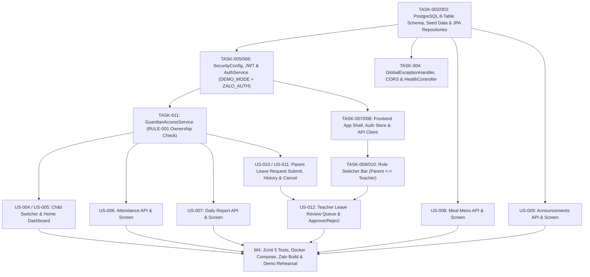

# Dependency Register & Management Plan — SchoolConnect

## 1. Document Control

| Attribute | Value |
| :--- | :--- |
| **Project Name** | SchoolConnect |
| **Document ID** | `DOC-02-DEPENDENCIES` |
| **Phase** | Phase 04 — Implementation Planning & Engineering Breakdown (Updated) |
| **Last Updated** | 2026-11-04 |

---

## 2. Internal Backlog & Architectural Dependency Graph

---

## 3. Comprehensive Dependency Matrix (`DEP-001` to `DEP-010`)

| Dep ID | Dependency Type | Source / Upstream Item | Dependent / Downstream Item | Description & Criticality | Status & Mitigation / Resolution |
| :--- | :--- | :--- | :--- | :--- | :--- |
| **`DEP-001`** | **Technical (Runtime)** | Local Java 21 JDK (`21.0.5`) & Node.js (`v24.16.0`) | Spring Boot 3.x Backend (`EPIC-001`) & React/TS Frontend | Mandatory runtime environments for compiling and running Backend and Frontend. | **`SATISFIED`:** Verified installed on local workstation in Phase 00. |
| **`DEP-002`** | **Technical (Database)** | PostgreSQL (`17.0.5` local or Docker `postgres:16-alpine`) | All Backend Repositories (`US-001` through `US-012`) | Relational database required for schema initialization, seed data, and ACID transactions. | **`SATISFIED`:** Both local `psql` (v17.0.5) and Docker are installed; Backend will support both local PostgreSQL and `docker-compose` PostgreSQL. |
| **`DEP-003`** | **Technical (Build Tool)** | Gradle Wrapper (`./gradlew`) & Maven Central / npm Registry | `TASK-001` (Backend Init) & `TASK-007` (Frontend Init) | Required to download Spring Boot 3.x dependencies and React/ZaUI packages. | **`READY`:** Will generate standard Gradle Wrapper and `package.json` in Phase 03/04. |
| **`DEP-004`** | **Internal Architecture** | `GuardianAccessService` (`TASK-011`, `RULE-001`) | `US-005` (Dashboard), `US-006` (Attendance), `US-007` (Daily Report), `US-010` (Leave Request) | All student-scoped endpoints depend on verifying `(parent_id, student_id)` ownership in `parent_students` first. | **`PLANNED IN M1`:** Scheduled in Sprint 1 prior to any student-scoped feature endpoints. |
| **`DEP-005`** | **Internal Workflow** | Parent Leave Request Creation (`US-010`) & Role Switcher (`US-003`) | Teacher Leave Review (`US-012`) | Teacher review workflow depends on the `leave_requests` entity/service and the ability to switch to `ROLE_TEACHER`. | **`PLANNED IN M1 & M3`:** Role Switcher is built in `M1` (`US-003`), and `US-010` precedes `US-012` in `M3`. |
| **`DEP-006`** | **External Platform (Zalo)** | Zalo Developer Account & Mini App ID (`OQ-04`) | `ZALO_AUTH` live token exchange & Zalo Testing QR Deployment | Needed when deploying the Mini App package to Zalo Testing servers or verifying real Zalo Access Tokens. | **`DECOUPLED VIA DEMO_MODE`:** `DEMO_MODE` removes this as a hard blocker for functional demo; personal Zalo Developer account can create a Testing Mini App ID without enterprise verification. |
| **`DEP-007`** | **Infrastructure (Network/HTTPS)** | HTTPS Endpoint & CORS (`https://h5.zdn.vn`) | Zalo Mobile WebView calling Spring Boot Backend API | Zalo Mini App container blocks plain `http://` calls on physical devices and sends `OPTIONS` preflight requests. | **`PLANNED IN M1 & M4`:** `CorsConfig` is built in `M1`; HTTPS tunnel (`Cloudflare Tunnel` / `ngrok` or Cloud PaaS) + local Web/Zalo Studio demo mode prepared in `M4`. |
| **`DEP-008`** | **Business / Stakeholder** | TitKul Director Zalo Account Whitelisting (`Option A` vs `Option B`) | Evaluator scanning Zalo Testing QR on their own phone | Zalo restricts Testing Mini Apps to whitelisted Developer/Admin accounts. | **`MITIGATED`:** Prepare both `Option A` (add Director's Zalo account to Developer group) and `Option B` (live screen projection + interactive web preview + backup video). |
| **`DEP-009`** | **Data Dependency** | Synthetic Seed Data (`seed.sql`) | All Read Screens (`US-004` to `US-009`) & Initial Teacher Queue (`US-012`) | Without rich, realistic seed data for both children (`Minh An` & `Minh Khôi`), read screens would look empty during the demo. | **`PLANNED IN M1`:** Comprehensive idempotent seed script runs automatically on Backend startup (`TASK-002`). |
| **`DEP-010`** | **Schedule Dependency** | Approval Gates (Phase 02 -> Phase 03 Architecture -> Phase 04 Engineering Plan) | Final Demo Readiness by **2026-11-05 15:00 GMT+7** | Implementation must begin promptly after Phase 04 sign-off to preserve the 90-minute rehearsal buffer before 15:00 tomorrow. | **`ACTIVE`:** Streamlined documentation and vertical slice plan ready for rapid execution. |

---

## 4. Library, Package & Shared-File Dependency Matrix

### 4.1. Backend Gradle Dependencies (`backend/build.gradle`)
| Dependency Artifact | Scope | Purpose & Dependent Layer |
| :--- | :--- | :--- |
| `org.springframework.boot:spring-boot-starter-web` | `implementation` | REST Controllers (`controller/`), Jackson JSON, Embedded Tomcat. |
| `org.springframework.boot:spring-boot-starter-data-jpa` | `implementation` | Hibernate ORM, `JpaRepository` (`repository/`, `entity/`), HikariCP, `@Transactional`. |
| `org.springframework.boot:spring-boot-starter-validation` | `implementation` | Jakarta Bean Validation (`@Valid`, `@NotBlank`, `@Size`) on `dto/`. |
| `org.springframework.boot:spring-boot-starter-security` | `implementation` | `SecurityFilterChain`, `JwtAuthenticationFilter`, RBAC (`security/`). |
| `io.jsonwebtoken:jjwt-api` / `jjwt-impl` / `jjwt-jackson` (`0.12.6`) | `implementation` / `runtimeOnly` | HMAC-SHA256 JWT token signing and parsing (`JwtTokenProvider`). |
| `org.springdoc:springdoc-openapi-starter-webmvc-ui` (`2.6.0`) | `implementation` | Interactive Swagger UI (`/swagger-ui.html`) and OpenAPI 3.0 spec (`config/OpenApiConfig`). |
| `org.postgresql:postgresql` | `runtimeOnly` | PostgreSQL JDBC Driver. |
| `org.springframework.boot:spring-boot-starter-test` & `spring-security-test` | `testImplementation` | JUnit 5, Mockito, MockMvc for unit and integration testing (`TASK-031`). |

### 4.2. Frontend npm Dependencies (`frontend/package.json`)
| Package | Scope | Purpose |
| :--- | :--- | :--- |
| `react`, `react-dom` (`^18.3.1`) | `dependencies` | UI rendering engine & Context state store (`AppContext`). |
| `zmp-sdk` (`^2.x`) | `dependencies` | Zalo Mini App bridge (`getAccessToken`, user context) wrapped in `zaloSdkAdapter.ts`. |
| `zmp-ui` (`^1.x`) / `lucide-react` | `dependencies` | Mobile UI primitives and crisp vector icons for the SchoolConnect Design System. |
| `typescript`, `vite`, `@vitejs/plugin-react` | `devDependencies` | TypeScript compiler & fast development/production bundler. |

### 4.3. Shared-File Coordination & Anti-Collision Rules
| Shared Component / File | Modifying Tasks | Coordination Rule |
| :--- | :--- | :--- |
| `LeaveRequestService.java` | `TASK-023` (Create/List), `TASK-026` (Cancel), `TASK-028` (Teacher Review) | **Single Sequential Pass:** Must not be edited in parallel; implement all 3 methods cohesively in `EM-03`. |
| `ParentStudentController.java` | `TASK-011` (`/parent/children`), `TASK-013` (`/children/{id}/dashboard`) | **Single Sequential Pass** in `EM-01`. |
| `App.tsx` & `AppContext.tsx` | `TASK-008`, `TASK-010`, `TASK-012` | Locked and completed during `EM-01` (`VS-01`) before individual screen components (`TASK-014`..`TASK-030`) are plugged in. |

