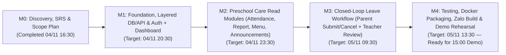

# Incremental Delivery Roadmap & Release Milestones — SchoolConnect

## 1. Document Control

| Attribute | Value |
| :--- | :--- |
| **Project Name** | SchoolConnect |
| **Document ID** | `DOC-02-ROADMAP` |
| **Phase** | Phase 02 — Product Scope, MVP & Delivery Planning |
| **Target Final Delivery** | **2026-11-05 15:00 (GMT+7)** |
| **Last Updated** | 2026-11-04 |

---

## 2. Roadmap Strategy & Visual Timeline

Given the confirmed live evaluation deadline at **15:00 tomorrow (2026-11-05)** (~22.5 hours from Phase 02 planning), the 6-day conceptual roadmap from `Requirements.docx` is compressed into **4 Deliverable-Driven Vertical Slice Milestones (`M1` through `M4`)**. Each milestone produces a working, testable increment.

---

## 3. Detailed Milestone Specifications (`M1` to `M4`)

### Milestone 1 (`M1`) — Platform Foundation, Dual Auth & Multi-Child Home Dashboard (`Vertical Slice 1`)
- **Objective:** Establish the complete **Layered Architecture** Spring Boot Backend (`controller -> service -> repository -> entity/dto`), PostgreSQL 8-table schema with synthetic seed data, Dual Authentication (`DEMO_MODE` + `ZALO_AUTH`), Role Switcher (`Parent` <-> `Teacher`), and `01. Home Dashboard` with Multi-Child switching.
- **Scope:** `EPIC-001` (`US-001`, `US-002`, `US-003`) & `EPIC-002` (`US-004`, `US-005`) — Tasks `TASK-001` through `TASK-014`.
- **Deliverables:**
  1. Running Spring Boot 3.x (Java 21) Backend connected to PostgreSQL.
  2. Initialized 8 database tables (`parents`, `students`, `parent_students`, `attendance_records`, `daily_reports`, `meal_menus`, `announcements`, `leave_requests`) + realistic seed data.
  3. `/api/v1/health`, `/swagger-ui.html`, `/api/v1/auth/**`, `/api/v1/parent/children`, and `/api/v1/children/{id}/dashboard` endpoints operational.
  4. React + TypeScript + ZaUI Mini App Shell with Role Switcher, Child Switcher (`Minh An` / `Minh Khôi`), and `01. Home Dashboard` screen.
- **Dependencies:** Local JDK 21, Node.js 24, PostgreSQL 17 / Docker.
- **Completion Criteria (Milestone Acceptance Criteria):**
  - `GET /api/v1/health` returns `200 OK` (`database: "UP"`).
  - Mini App boots directly into `DEMO_MODE` (`Trần Thu Hà`) in `< 2000ms` (`AC-001`).
  - Switching between `Nguyễn Minh An` (`id=1`) and `Nguyễn Minh Khôi` (`id=2`) updates Dashboard profile, class, and BMI cards (`AC-004`, `AC-005`).
  - Requesting `/api/v1/children/999/dashboard` returns `HTTP 403 Forbidden` (`AC-006`).
- **Demo Plan:** Open Mini App, show `Minh An`'s Dashboard, switch to `Minh Khôi`, toggle Role Switcher to Teacher Mode and back, and show Swagger UI `/api/v1/health`.
- **Risks:** Gradle dependency download latency (`RSK-006`), CORS preflight misconfiguration (`RSK-002`).
- **Responsible Person:** Nguyen Vo Hoang Khang (`Nguyễn Võ Hoàng Khang`) + AI Engineering Assistant.

---

### Milestone 2 (`M2`) — Preschool Daily Care Read Modules (`Vertical Slice 2 & 3`)
- **Objective:** Deliver the 4 core preschool information screens (`02. Daily Report`, `03. Attendance`, `04. Meal Menu`, `05. Announcements`) end-to-end from PostgreSQL through the Layered Backend to the Mobile UI.
- **Scope:** `EPIC-003` (`US-006`, `US-007`) & `EPIC-004` (`US-008`, `US-009`) — Tasks `TASK-015` through `TASK-022`.
- **Deliverables:**
  1. Layered Backend controllers, services, DTOs, and repositories for `Attendance`, `DailyReport`, `MealMenu`, and `Announcement`.
  2. Frontend screens `02. Daily Report`, `03. Attendance`, `04. Meal Menu`, and `05. Announcements` with date/category filters, Loading skeletons, Empty states, and Error states.
- **Dependencies:** Completion of `M1`.
- **Completion Criteria (Milestone Acceptance Criteria):**
  - `03. Attendance` displays accurate summary counts (`Present`, `Excused`, `Late`) and daily check-in/out logs (`AC-007`).
  - `02. Daily Report` renders Meal, Sleep, Activity, and Mood cards for seeded dates (`AC-008`) and renders the Empty State when selecting an unrecorded Sunday date (`AC-009`).
  - `04. Meal Menu` displays `BREAKFAST`, `LUNCH`, and `AFTERNOON_SNACK` dishes with kcal and nutrition notes (`AC-010`).
  - `05. Announcements` renders pinned notices first and opens full announcement details on tap (`AC-011`).
- **Demo Plan:** Walk through a parent's morning-to-evening check: check attendance -> check what `Minh An` ate and how long she napped in Daily Report -> inspect weekly Meal Menu -> read a pinned school health notice.
- **Risks:** UI overflow on narrow mobile screens (`RSK-004`).
- **Responsible Person:** Nguyen Vo Hoang Khang (`Nguyễn Võ Hoàng Khang`) + AI Engineering Assistant.

---

### Milestone 3 (`M3`) — Closed-Loop Transactional Leave Workflow: Parent & Teacher (`Vertical Slice 4`)
- **Objective:** Complete the flagship transactional workflow where a Parent creates/cancels a leave request (`06. Absence Request`) and a Teacher reviews (`Approves` / `Rejects`) it with a teacher note in `Demo Teacher Mode`.
- **Scope:** `EPIC-005` (`US-010`, `US-011`, `US-012`) — Tasks `TASK-023` through `TASK-030`.
- **Deliverables:**
  1. `LeaveRequestController`, `TeacherLeaveRequestController`, and `@Transactional` `LeaveRequestService` enforcing `RULE-001` through `RULE-010`.
  2. Parent `06. Absence Request` screen (Creation form + History list + Cancel `PENDING` action).
  3. Teacher `Leave Request Review Dashboard` screen (Filter tabs `Chờ duyệt` / `Đã duyệt` / `Từ chối` / `Tất cả` + Approve/Reject modal with teacher note validation).
- **Dependencies:** Completion of `M1` (Role Switcher & Guardian Isolation).
- **Completion Criteria (Milestone Acceptance Criteria):**
  - Submitting a valid leave request persists in PostgreSQL with code `LR-YYYYMMDD-XXXX`, returns `201 Created`, and survives page reload (`AC-012`).
  - Overlapping date/session submissions return `HTTP 409 Conflict` (`AC-013`).
  - Parent can cancel a `PENDING` request (`AC-014`).
  - Switching to `ROLE_TEACHER` allows approving (`APPROVED`) or rejecting (`REJECTED` with mandatory note `>= 5` chars) a `PENDING` request, immediately updating the Parent's view (`AC-015`, `AC-016`, `AC-017`).
- **Demo Plan:** Execute the complete 5-step Closed-Loop Sequence (Parent submits -> Verify `PENDING` -> Switch to Teacher -> Approve with note -> Switch to Parent & Reload -> Verify `APPROVED`).
- **Risks:** Date timezone discrepancies between browser and server (`RSK-007`).
- **Responsible Person:** Nguyen Vo Hoang Khang (`Nguyễn Võ Hoàng Khang`) + AI Engineering Assistant.

---

### Milestone 4 (`M4`) — Verification, Docker Packaging, Zalo Testing Readiness & Demo Rehearsal
- **Objective:** Verify all automated tests, package the full stack with `docker-compose.yml`, validate Zalo Mini App build/config, finalize documentation (`README.md` & `demo-script.md`), and complete final rehearsal before **15:00 on 2026-11-05**.
- **Scope:** Cross-cutting Tasks `TASK-031` through `TASK-036`.
- **Deliverables:**
  1. Automated Backend Unit & Integration Tests (`JUnit 5`) passing 100%.
  2. Production-clean Frontend build (`npm run build`) + Zalo Mini App `app-config.json`.
  3. `infra/docker-compose.yml` + Backend `Dockerfile`.
  4. Root `README.md` (15 standard sections) + `docs/demo-script.md` (10-minute Director script).
- **Dependencies:** Completion of `M1`, `M2`, `M3`.
- **Completion Criteria (Milestone Acceptance Criteria):**
  - All 19 Acceptance Criteria (`AC-001` through `AC-019`) verified `PASS`.
  - Zero compiler, linter, or runtime console errors.
  - System ready for live demonstration at **13:30 on 2026-11-05** (90-minute safety buffer before the 15:00 meeting).
- **Demo Plan:** Full 10-minute dress rehearsal following `docs/demo-script.md`.
- **Risks:** Network/tunnel instability during live demo (`RSK-008`).
- **Responsible Person:** Nguyen Vo Hoang Khang (`Nguyễn Võ Hoàng Khang`) + AI Engineering Assistant.

