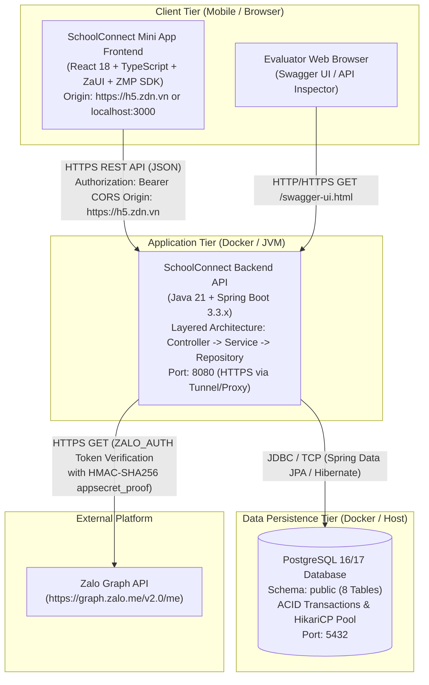
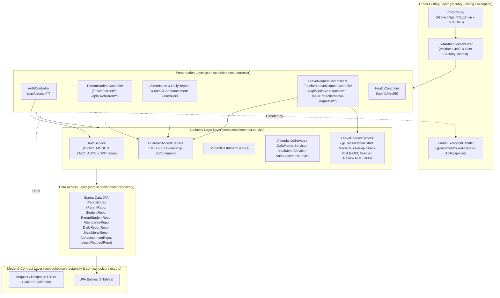

# System Architecture & Technical Design — SchoolConnect

## 1. Document Control

| Attribute | Value |
| :--- | :--- |
| **Project Name** | SchoolConnect |
| **Document ID** | `DOC-03-ARCHITECTURE` |
| **Phase** | Phase 03 — System Architecture & Technical Design |
| **Selected Backend Architecture** | **Layered Monolithic Architecture** (`controller` -> `service` -> `repository` -> `entity` / `dto`) |
| **Last Updated** | 2026-11-04 |

---

## 2. Evaluation of Architecture Options & Technical Trade-offs

In accordance with architectural discipline, six candidate architecture styles were evaluated against the project's drivers (**24-hour delivery window**, **single full-stack developer**, **preschool CRUD + transactional leave workflow**, and **clarity for Evaluator code review**):

| Architecture Option | Pros | Cons / Technical Trade-offs | Fit for SchoolConnect | Decision |
| :--- | :--- | :--- | :--- | :--- |
| **1. Layered Monolithic Architecture (`Controller -> Service -> Repository -> Entity/DTO`)** | - Fastest development velocity.<br>- Immediately familiar to every Java Spring Boot engineer and evaluator.<br>- Direct ACID `@Transactional` joins across `parents`, `students`, and `leave_requests`.<br>- Single deployable JAR & Docker container. | - As a team grows beyond 15+ developers, horizontal package layers require discipline to prevent bloated services. | **Optimal (`10/10`)** | **SELECTED** *(Confirmed by Project Owner)* |
| **2. Modular Monolith Architecture** | - Strong domain-package encapsulation (`auth`, `student`, `leave`). | - Adds cross-module DTO/facade mapping overhead that slows down a 24-hour MVP with 8 tightly related tables. | Good (`7/10`) | Superseded in favor of **Layered Architecture** per Owner directive. |
| **3. Microservices Architecture** | - Independent deployment and polyglot scaling per service. | - Massive operational overhead (API Gateway, service discovery, distributed tracing, eventual consistency); violates `SRC-001` (`P67`). | Poor (`1/10`) | **Rejected** |
| **4. Serverless Architecture (FaaS)** | - Pay-per-invocation auto-scaling. | - JVM cold-start latency (`2–5s`) hurts live demo UX; harder to package deterministically with `docker-compose`. | Poor (`2/10`) | **Rejected** |
| **5. Event-Driven Architecture (Kafka / RabbitMQ)** | - Decoupled asynchronous processing for high-throughput streams. | - Unnecessary infrastructure complexity for synchronous parent-teacher CRUD interactions (`SRC-001` `P67`). | Poor (`1/10`) | **Rejected** |
| **6. Hybrid Architecture (Zalo Mini App SPA + Layered REST Backend)** | - Combines Zalo edge static hosting for Frontend with stateful container hosting for Spring Boot + PostgreSQL. | - Requires strict CORS and HTTPS coordination between `https://h5.zdn.vn` and Backend API. | **Optimal Deployment Model** | **SELECTED** (Frontend on Zalo/Web + Layered Monolith Backend) |

> **Core Architectural Principle:** We strictly exclude Redis, Kafka, Elasticsearch, Microservices, and Kubernetes. Every component in the architecture directly serves a confirmed business requirement (`BR-001` through `BR-005`).

---

## 3. Container Architecture (C4 Level 2 Diagram)



---

## 4. Component Architecture — Backend Layered Design (C4 Level 3)

The Spring Boot Backend is structured into **8 horizontal technical layers/packages** under `com.schoolconnect`:



---

## 5. Communication Patterns & Main Execution Flows

### 5.1. Synchronous REST over HTTPS Pattern
- All communication between the Zalo Mini App Frontend and the Spring Boot Backend uses stateless **JSON over HTTP/HTTPS** following RESTful resource conventions under `/api/v1/...`.
- Every API response (both success and error) uses a uniform envelope (`ApiResponse<T>`):
  ```json
  {
    "success": true,
    "message": "Operation completed successfully",
    "data": { ... },
    "errorCode": null,
    "timestamp": "2026-11-04T16:45:00+07:00"
  }
  ```

### 5.2. Main Execution Flow 1: Dual Authentication & Role Switch (`DEMO_MODE` & `ZALO_AUTH`)
1. **App Startup:** Frontend initializes and checks if a valid token exists in memory/storage.
2. **Default `DEMO_MODE` Bootstrap:** Frontend calls `POST /api/v1/auth/demo-session` with `{ "role": "PARENT" }`.
3. `AuthController` delegates to `AuthService.createDemoSession("PARENT")`, which loads the seeded parent `Trần Thu Hà` (`id=1`), generates a signed JWT containing claims `sub="1"`, `role="ROLE_PARENT"`, `fullName="Trần Thu Hà"`, and returns the token plus linked children (`Nguyễn Minh An`, `Nguyễn Minh Khôi`).
4. **Live Role Switching (`OQ-02`):** When the user taps the **Role Switcher Pill** (`Phụ huynh` -> `Giáo viên duyệt đơn`), Frontend calls `POST /api/v1/auth/demo-session` with `{ "role": "TEACHER" }`, receives a JWT with `role="ROLE_TEACHER"` (`Cô Lê Thanh Thảo`), and navigates to the Teacher Leave Review Queue.

### 5.3. Main Execution Flow 2: Transactional Leave Request Submission & Teacher Approval
1. **Parent Submission:** Parent fills `startDate`, `endDate`, `sessionType`, and `reason` and submits `POST /api/v1/children/{studentId}/leave-requests`.
2. **Controller & Validation:** `LeaveRequestController` validates `@Valid CreateLeaveRequestDto` via Jakarta Validation (`@NotNull`, `@Size(min=5, max=500)`).
3. **Service & Ownership Check:** `LeaveRequestService.createLeaveRequest()` runs inside `@Transactional`:
   - Calls `guardianAccessService.verifyParentOwnsStudent(parentId, studentId)` (`RULE-001`).
   - Validates `today <= startDate <= endDate` in `Asia/Ho_Chi_Minh` timezone (`RULE-002`).
   - Calls `leaveRequestRepository.findOverlappingActiveRequests(...)` (`RULE-003`). If any `PENDING` or `APPROVED` request overlaps on date and session, throws `BusinessConflictException` (`HTTP 409`).
   - Generates `request_code` (`LR-YYYYMMDD-XXXX`) and saves the `LeaveRequestEntity` with `status = PENDING`.
4. **Teacher Approval:** In Teacher Mode (`ROLE_TEACHER`), teacher calls `PATCH /api/v1/teacher/leave-requests/{id}/review` with `{ "status": "APPROVED", "teacherNote": "..." }`.
5. `LeaveRequestService.reviewLeaveRequest()` verifies current status is `PENDING` (`RULE-005`), validates `teacherNote` (`RULE-008`), updates `status = APPROVED`, `reviewedBy = "Cô Lê Thanh Thảo"`, `reviewedAt = OffsetDateTime.now()`, and commits the transaction to PostgreSQL.

