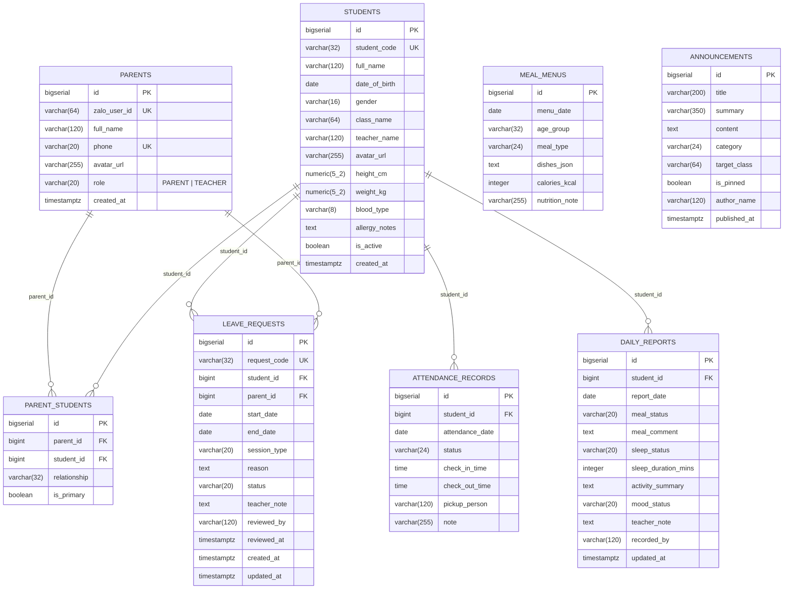

# Database Architecture & Schema Design — SchoolConnect

## 1. Document Control

| Attribute | Value |
| :--- | :--- |
| **Project Name** | SchoolConnect |
| **Document ID** | `DOC-03-DATABASE` |
| **Phase** | Phase 03 — System Architecture & Technical Design |
| **Database Engine** | **PostgreSQL 16 / 17** |
| **Last Updated** | 2026-11-04 |

---

## 2. Entity Relationship Diagram (ERD)



---

## 3. Physical PostgreSQL DDL Specification (`8 Normalized Tables`)

The schema is normalized to **Third Normal Form (3NF)** with deliberate, pragmatic choices (such as storing the list of dishes in a single meal session as a structured JSON/delimited string in `meal_menus.dishes_json` to avoid unnecessary join overhead for read-only menus).

```sql
-- 1. PARENTS (Includes Parent and Teacher Demo/Auth Accounts)
CREATE TABLE IF NOT EXISTS parents (
    id BIGSERIAL PRIMARY KEY,
    zalo_user_id VARCHAR(64) UNIQUE,
    full_name VARCHAR(120) NOT NULL,
    phone VARCHAR(20) NOT NULL UNIQUE,
    avatar_url VARCHAR(255),
    role VARCHAR(20) NOT NULL DEFAULT 'PARENT'
        CONSTRAINT chk_parents_role CHECK (role IN ('PARENT', 'TEACHER')),
    created_at TIMESTAMPTZ NOT NULL DEFAULT CURRENT_TIMESTAMP
);

-- 2. STUDENTS (Preschool Student Profiles)
CREATE TABLE IF NOT EXISTS students (
    id BIGSERIAL PRIMARY KEY,
    student_code VARCHAR(32) NOT NULL UNIQUE,
    full_name VARCHAR(120) NOT NULL,
    date_of_birth DATE NOT NULL,
    gender VARCHAR(16) NOT NULL,
    class_name VARCHAR(64) NOT NULL,
    teacher_name VARCHAR(120) NOT NULL,
    avatar_url VARCHAR(255),
    height_cm NUMERIC(5, 2) CONSTRAINT chk_students_height CHECK (height_cm IS NULL OR height_cm > 0),
    weight_kg NUMERIC(5, 2) CONSTRAINT chk_students_weight CHECK (weight_kg IS NULL OR weight_kg > 0),
    blood_type VARCHAR(8),
    allergy_notes TEXT,
    is_active BOOLEAN NOT NULL DEFAULT TRUE,
    created_at TIMESTAMPTZ NOT NULL DEFAULT CURRENT_TIMESTAMP
);

-- 3. PARENT_STUDENTS (Many-to-Many Guardian-Student Mapping for RULE-001)
CREATE TABLE IF NOT EXISTS parent_students (
    id BIGSERIAL PRIMARY KEY,
    parent_id BIGINT NOT NULL REFERENCES parents(id) ON DELETE RESTRICT,
    student_id BIGINT NOT NULL REFERENCES students(id) ON DELETE RESTRICT,
    relationship VARCHAR(32) NOT NULL,
    is_primary BOOLEAN NOT NULL DEFAULT FALSE,
    CONSTRAINT uq_parent_student UNIQUE (parent_id, student_id)
);

-- 4. ATTENDANCE_RECORDS (Daily Check-in / Check-out History)
CREATE TABLE IF NOT EXISTS attendance_records (
    id BIGSERIAL PRIMARY KEY,
    student_id BIGINT NOT NULL REFERENCES students(id) ON DELETE RESTRICT,
    attendance_date DATE NOT NULL,
    status VARCHAR(24) NOT NULL
        CONSTRAINT chk_attendance_status CHECK (status IN ('PRESENT', 'ABSENT_EXCUSED', 'ABSENT_UNEXCUSED', 'LATE', 'NOT_MARKED')),
    check_in_time TIME,
    check_out_time TIME,
    pickup_person VARCHAR(120),
    note VARCHAR(255),
    CONSTRAINT uq_student_attendance_date UNIQUE (student_id, attendance_date)
);

-- 5. DAILY_REPORTS (Daily Meals, Sleep, Activities, Mood & Teacher Note)
CREATE TABLE IF NOT EXISTS daily_reports (
    id BIGSERIAL PRIMARY KEY,
    student_id BIGINT NOT NULL REFERENCES students(id) ON DELETE RESTRICT,
    report_date DATE NOT NULL,
    meal_status VARCHAR(20) NOT NULL
        CONSTRAINT chk_report_meal CHECK (meal_status IN ('GOOD', 'FAIR', 'POOR')),
    meal_comment TEXT NOT NULL,
    sleep_status VARCHAR(20) NOT NULL
        CONSTRAINT chk_report_sleep CHECK (sleep_status IN ('GOOD', 'RESTLESS', 'SHORT')),
    sleep_duration_mins INTEGER CONSTRAINT chk_sleep_mins CHECK (sleep_duration_mins IS NULL OR sleep_duration_mins >= 0),
    activity_summary TEXT NOT NULL,
    mood_status VARCHAR(20) NOT NULL
        CONSTRAINT chk_report_mood CHECK (mood_status IN ('HAPPY', 'NORMAL', 'TIRED', 'FUSSY')),
    teacher_note TEXT,
    recorded_by VARCHAR(120) NOT NULL,
    updated_at TIMESTAMPTZ NOT NULL DEFAULT CURRENT_TIMESTAMP,
    CONSTRAINT uq_student_report_date UNIQUE (student_id, report_date)
);

-- 6. MEAL_MENUS (Preschool Daily Nutritional Menus: Breakfast, Lunch, Afternoon Snack)
CREATE TABLE IF NOT EXISTS meal_menus (
    id BIGSERIAL PRIMARY KEY,
    menu_date DATE NOT NULL,
    age_group VARCHAR(32) NOT NULL DEFAULT 'ALL',
    meal_type VARCHAR(24) NOT NULL
        CONSTRAINT chk_meal_type CHECK (meal_type IN ('BREAKFAST', 'LUNCH', 'AFTERNOON_SNACK')),
    dishes_json TEXT NOT NULL,
    calories_kcal INTEGER,
    nutrition_note VARCHAR(255),
    CONSTRAINT uq_menu_date_group_type UNIQUE (menu_date, age_group, meal_type)
);

-- 7. ANNOUNCEMENTS (School-wide & Class-specific Notices)
CREATE TABLE IF NOT EXISTS announcements (
    id BIGSERIAL PRIMARY KEY,
    title VARCHAR(200) NOT NULL,
    summary VARCHAR(350) NOT NULL,
    content TEXT NOT NULL,
    category VARCHAR(24) NOT NULL
        CONSTRAINT chk_announcement_cat CHECK (category IN ('SCHOOL', 'CLASS', 'HEALTH', 'EVENT')),
    target_class VARCHAR(64),
    is_pinned BOOLEAN NOT NULL DEFAULT FALSE,
    author_name VARCHAR(120) NOT NULL,
    published_at TIMESTAMPTZ NOT NULL DEFAULT CURRENT_TIMESTAMP
);

-- 8. LEAVE_REQUESTS (Transactional Parent Leave Submission & Teacher Approval Queue)
CREATE TABLE IF NOT EXISTS leave_requests (
    id BIGSERIAL PRIMARY KEY,
    request_code VARCHAR(32) NOT NULL UNIQUE,
    student_id BIGINT NOT NULL REFERENCES students(id) ON DELETE RESTRICT,
    parent_id BIGINT NOT NULL REFERENCES parents(id) ON DELETE RESTRICT,
    start_date DATE NOT NULL,
    end_date DATE NOT NULL,
    session_type VARCHAR(20) NOT NULL
        CONSTRAINT chk_leave_session CHECK (session_type IN ('FULL_DAY', 'MORNING', 'AFTERNOON')),
    reason TEXT NOT NULL,
    status VARCHAR(20) NOT NULL DEFAULT 'PENDING'
        CONSTRAINT chk_leave_status CHECK (status IN ('PENDING', 'APPROVED', 'REJECTED', 'CANCELLED')),
    teacher_note TEXT,
    reviewed_by VARCHAR(120),
    reviewed_at TIMESTAMPTZ,
    created_at TIMESTAMPTZ NOT NULL DEFAULT CURRENT_TIMESTAMP,
    updated_at TIMESTAMPTZ NOT NULL DEFAULT CURRENT_TIMESTAMP,
    CONSTRAINT chk_leave_dates CHECK (start_date <= end_date)
);
```

---

## 4. Indexing Strategy (`Performance Optimization`)

| Index Name | Target Table & Columns | Query Pattern Accelerated |
| :--- | :--- | :--- |
| `idx_parent_students_parent` | `parent_students (parent_id, student_id)` | Accelerates `GuardianAccessService` ownership checks (`RULE-001`) and `GET /api/v1/parent/children`. |
| `idx_attendance_student_date` | `attendance_records (student_id, attendance_date DESC)` | Accelerates monthly/recent attendance queries (`GET /api/v1/children/{id}/attendance`). |
| `idx_daily_reports_student_date` | `daily_reports (student_id, report_date DESC)` | Accelerates daily journal lookups (`GET /api/v1/children/{id}/daily-reports`). |
| `idx_meal_menus_date` | `meal_menus (menu_date)` | Accelerates daily and weekly menu queries (`GET /api/v1/meal-menus`). |
| `idx_announcements_pinned_pub` | `announcements (is_pinned DESC, published_at DESC)` | Accelerates sorted announcement feed queries (`GET /api/v1/announcements`). |
| `idx_leave_requests_student_dates` | `leave_requests (student_id, status, start_date, end_date)` | Accelerates overlapping leave request detection (`RULE-003`) and parent history queries. |
| `idx_leave_requests_status_created` | `leave_requests (status, created_at DESC)` | Accelerates Teacher Leave Review Queue filtering (`GET /api/v1/teacher/leave-requests`). |

---

## 5. Migration, Seed Strategy, Retention & Audit Governance

1. **Deterministic Initialization (`schema.sql` + `data.sql`):**
   - Spring Boot's SQL initialization (`spring.sql.init.mode=always`) runs idempotent `CREATE TABLE IF NOT EXISTS` and `CREATE INDEX IF NOT EXISTS` statements followed by idempotent `INSERT ... ON CONFLICT DO NOTHING` seed statements.
   - This guarantees that whether the Evaluator runs the Backend via `docker-compose up` or `./gradlew bootRun` against local PostgreSQL 17, the 8 tables and rich synthetic seed data are automatically present on first boot while preserving newly created leave requests across restarts.
2. **Transaction & Concurrency Control:**
   - All leave request mutations (`createLeaveRequest`, `cancelLeaveRequest`, `reviewLeaveRequest`) run inside `@Transactional` (`READ_COMMITTED`), ensuring atomic validation and state transitions.
3. **Data Retention & Soft-Delete Policy:**
   - All foreign keys use `ON DELETE RESTRICT` to prevent accidental cascading deletion of historical preschool records.
   - Cancelled leave requests transition to `status = 'CANCELLED'` rather than executing a `DELETE` statement, preserving the full audit history.
4. **Audit Trail Columns:**
   - `leave_requests` records `created_at` (submission time), `updated_at` (last transition time), `reviewed_by` (Teacher identity), and `reviewed_at` (exact approval/rejection timestamp).
   - `daily_reports` records `recorded_by` and `updated_at`.

