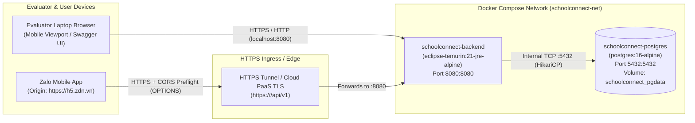

# Infrastructure & Deployment Architecture — SchoolConnect

## 1. Document Control

| Attribute | Value |
| :--- | :--- |
| **Project Name** | SchoolConnect |
| **Document ID** | `DOC-03-DEPLOYMENT` |
| **Phase** | Phase 03 & Phase 11A — System Architecture & Deployment Planning |
| **Target Demo Window** | **2026-11-05 15:00 (GMT+7)** |
| **Related Release Documents** | [`docs/07-release/deployment-guide.md`](file:///d:/Coding/TitKul_ProjectTest/SchoolConnect/docs/07-release/deployment-guide.md), [`docs/07-release/rollback-plan.md`](file:///d:/Coding/TitKul_ProjectTest/SchoolConnect/docs/07-release/rollback-plan.md) |
| **Last Updated** | `2026-11-05T11:44:00+07:00` |

---

## 2. Multi-Environment Topology

To balance engineering rigor with zero-cost operational simplicity (`OQ-05`), four environment profiles are defined:

| Dimension | 1. Development (`local-dev`) | 2. Test / Demo (`zalo-testing`) | 3. Staging (`staging` - Reference) | 4. Production (`prod` - Reference) |
| :--- | :--- | :--- | :--- | :--- |
| **Purpose** | Rapid local coding, unit/integration testing, and offline demo fallback. | Live evaluation at **15:00 on 05/11/2026** via Zalo Testing QR & Web Preview. | Pre-release verification before Zalo Live review. | Commercial multi-preschool deployment. |
| **Frontend Hosting** | Vite / ZMP Dev Server (`http://localhost:3000`) | **Zalo Testing Server** (`https://h5.zdn.vn`) + Public HTTPS Preview | Zalo Testing Version (Pinned Release) | **Zalo Live CDN** (Approved Mini App) |
| **Backend Hosting** | Local JVM (`./gradlew bootRun`) or Docker (`localhost:8080`) | Docker container exposed via **HTTPS Tunnel** (`Cloudflare Tunnel` / `ngrok`) or Cloud PaaS (`Render`/`Railway`) | Managed Container Service (1 instance) | Auto-scaled Container Service behind HTTPS Load Balancer |
| **Database Hosting** | Local PostgreSQL 17 (`localhost:5432`) or Docker `postgres:16-alpine` | Containerized PostgreSQL with persistent volume (`pgdata`) | Managed PostgreSQL with daily snapshots | Managed HA PostgreSQL with Point-in-Time Recovery (PITR) |
| **Auth Mode (`APP_AUTH_DEMO_MODE`)** | `true` (Dual Auth enabled) | `true` (Allows Evaluator Role Switching + `ZALO_AUTH`) | `true` / `false` configurable | `false` (`ZALO_AUTH` strictly enforced) |

---

## 3. Container & Network Architecture Diagram

---

## 4. Environment Variables & Secrets Matrix

Zero secrets are hardcoded in source code. The Backend reads configuration from environment variables with safe development defaults:

| Environment Variable | Description | Default (`local-dev`) | Sensitivity |
| :--- | :--- | :--- | :--- |
| `SERVER_PORT` | HTTP port for Spring Boot Backend | `8080` | Public |
| `DB_URL` | JDBC Connection URL for PostgreSQL | `jdbc:postgresql://localhost:5432/schoolconnect` | Internal |
| `DB_USERNAME` | PostgreSQL database username | `postgres` | Secret |
| `DB_PASSWORD` | PostgreSQL database password | *(Loaded from env / `.env`)* | **Secret** |
| `JWT_SECRET` | HMAC-SHA256 signing key (`>= 32` chars) | *(Loaded from env / dev fallback)* | **Secret** |
| `JWT_EXPIRATION_MS` | Internal JWT validity duration in ms | `86400000` (24 hours) | Public |
| `APP_AUTH_DEMO_MODE` | Enables `/api/v1/auth/demo-session` & Role Switcher | `true` | Internal |
| `ZALO_APP_ID` | Zalo Mini App ID (bound when deploying to Zalo) | `""` | Public |
| `ZALO_APP_SECRET` | Zalo App Secret for `appsecret_proof` HMAC | `""` | **Secret** |
| `CORS_ALLOWED_ORIGINS` | Comma-separated allowed CORS origins | `https://h5.zdn.vn,http://localhost:3000,http://localhost:5173` | Public |

---

## 5. CI/CD, Backup, Monitoring & Rollback Strategy

1. **Automated Verification Pipeline (Local & CI Ready):**
   - Step 1: Backend Compile & Static Check (`./gradlew compileJava compileTestJava`)
   - Step 2: Backend Unit & Integration Tests (`./gradlew test`)
   - Step 3: Frontend TypeScript Check & Production Bundle (`npm run build`)
   - Step 4: Docker Image Build & Compose Smoke Test (`docker compose up -d --build` -> probe `GET /api/v1/health`)
2. **Database Backup & Instant Reset Strategy:**
   - Named Docker volume `schoolconnect_pgdata` persists PostgreSQL data across container restarts.
   - Because `schema.sql` and `data.sql` are idempotent, running `docker compose down -v && docker compose up -d` performs a clean reset to the baseline synthetic dataset in `< 15 seconds` if needed before the live demo.
3. **Health Monitoring & Observability:**
   - `GET /api/v1/health` executes a live `SELECT 1` database check and reports `{ "status": "UP", "database": "UP", "demoModeEnabled": true }`.
   - Structured console logs output ISO-8601 timestamps (`Asia/Ho_Chi_Minh`), HTTP method, URI, status code, and execution latency.
4. **Rollback Strategy:**
   - **Zalo Mini App Testing:** Zalo Testing environment stores versioned snapshots (`v1.0.0`, `v1.0.1`), allowing 1-click rollback in Zalo Mini App Studio / CLI without overwriting the previous working Testing build (`SRC-001` `T286`).
   - **Backend:** Git tag + Docker image tag (`schoolconnect-backend:mvp-stable`) allows immediate rollback within 10 seconds.

