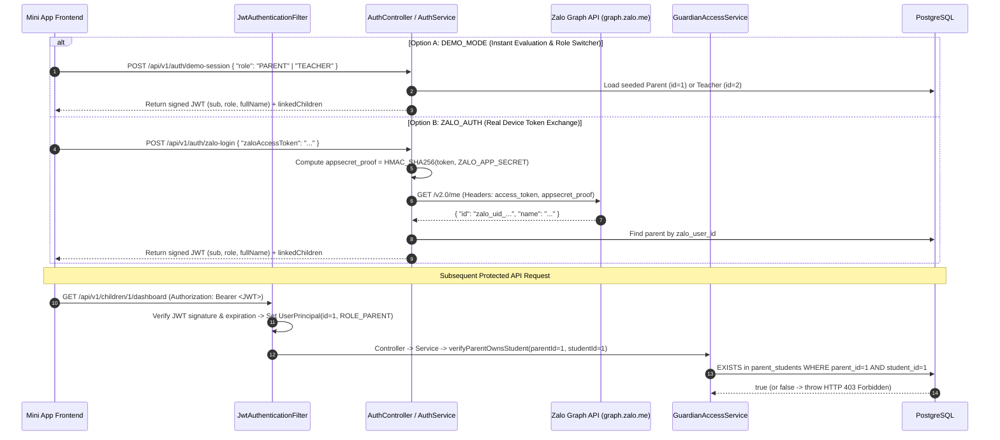

# Security & Privacy Architecture Design — SchoolConnect

## 1. Document Control

| Attribute | Value |
| :--- | :--- |
| **Project Name** | SchoolConnect |
| **Document ID** | `DOC-03-SECURITY` |
| **Phase** | Phase 03 — System Architecture & Technical Design |
| **Security Benchmark Reference** | **OWASP ASVS 5.0.0** (Application Security Verification Standard — Architecture Reference) |
| **Last Updated** | 2026-11-04 |

> **Disclaimer:** Referencing OWASP ASVS 5.0.0 guides our security architecture and verification controls; it does not constitute a claim of formal third-party security certification.

---

## 2. Threat Modeling across 10 Attack Surfaces (`STRIDE`)

| # | Attack Surface | Identified Threat | STRIDE Category | Architectural Control & Mitigation | OWASP ASVS 5.0.0 Ref |
| :--- | :--- | :--- | :--- | :--- | :--- |
| 1 | **Authentication (`ZALO_AUTH` & `DEMO_MODE`)** | Attacker spoofs `zalo_user_id` directly in request body without a valid Zalo Access Token (`SRC-001` `P148`). | Spoofing | Backend never trusts client-supplied `zalo_user_id`. In `ZALO_AUTH` mode, Backend verifies `zaloAccessToken` server-to-server against `https://graph.zalo.me/v2.0/me` with HMAC-SHA256 `appsecret_proof`. `DEMO_MODE` is controlled via environment flag `APP_AUTH_DEMO_MODE`. | `V2` (Authentication) |
| 2 | **Object-Level Authorization (IDOR on Student Data)** | Authenticated Parent A changes `{studentId}` in `/api/v1/children/{studentId}/...` to read or create records for Parent B's child. | Elevation of Privilege / Info Disclosure | Every student-scoped service method calls `guardianAccessService.verifyParentOwnsStudent(parentId, studentId)` (`RULE-001`) before querying or mutating data. Returns `HTTP 403 Forbidden` (`AC-006`). | `V4` (Access Control) |
| 3 | **Function-Level Authorization (Privilege Escalation)** | A user with `ROLE_PARENT` calls `PATCH /api/v1/teacher/leave-requests/{id}/review` to approve their own leave request. | Elevation of Privilege | Spring Security `SecurityFilterChain` + `@PreAuthorize("hasRole('TEACHER')")` restricts `/api/v1/teacher/**` exclusively to principals carrying `ROLE_TEACHER` (`RULE-007`). | `V4` (Access Control) |
| 4 | **Injection (`SQLi` & `XSS`)** | Malicious SQL or `<script>` payload submitted inside `leave_requests.reason` or `teacher_note`. | Tampering / Injection | 100% of database queries use parameterized Spring Data JPA / Hibernate JPQL bindings (zero string concatenation). Text inputs are validated (`@Size(min=5, max=500)`) and HTML-sanitized/escaped on output (`RULE-009`). | `V5` (Validation & Sanitization) |
| 5 | **File Upload & Download** | Malicious executable upload or path traversal via avatar/attachment endpoints. | Tampering / RCE | Arbitrary binary file uploads are excluded from MVP scope; student/parent avatars use pre-validated static asset identifiers or whitelisted HTTPS image URLs only. | `V12` (Files & Resources) |
| 6 | **Sensitive Data Exposure & Privacy** | Real student names, health data, or parent phone numbers leaked in demo environment (`CF-06`). | Information Disclosure | All seeded data in `data.sql` is 100% synthetic (*Trường Mầm Non Sao Mai*, *Nguyễn Minh An*, *Nguyễn Minh Khôi*). Transport uses HTTPS in Zalo Testing deployment. | `V8` (Data Protection) |
| 7 | **Session & Token Management** | Stolen or forged JWT used to impersonate users indefinitely. | Spoofing | JWTs are signed with HMAC-SHA256 (`HS256`) using a minimum 256-bit secret key (`JWT_SECRET`), include explicit `iat` and `exp` claims (e.g., 24h TTL), and are validated on every request by `JwtAuthenticationFilter`. | `V3` (Session Management) |
| 8 | **Secrets Management** | Hardcoding `JWT_SECRET`, `ZALO_APP_SECRET`, or `DB_PASSWORD` in source files or Git history. | Information Disclosure | Zero hardcoded secrets (`Rule 2.1`). All sensitive values use `${ENV_VAR:default_dev_only}` placeholders in `application.yml` and `.env.example`, with `.env` excluded in `.gitignore`. | `V14` (Configuration) |
| 9 | **External Integrations & CORS** | Overly permissive CORS (`AllowedOrigins: *` with credentials) or hanging external calls to `graph.zalo.me`. | Denial of Service / CSRF | `CorsConfig` restricts allowed origins to `https://h5.zdn.vn`, `http://localhost:*`, and configured demo domains (`AC-018`). Outbound calls to `graph.zalo.me` enforce a strict 5-second timeout. | `V13` (API & Web Service) |
| 10 | **Logging, Audit & Recovery** | Silent failures, unlogged security rejections, or irreversible data corruption. | Repudiation / DoS | Structured logs capture timestamp, HTTP method/URI, status, and correlation context without logging tokens/passwords. `leave_requests` preserves full audit fields (`created_at`, `updated_at`, `reviewed_by`, `reviewed_at`) with `ON DELETE RESTRICT`. | `V7` (Error Handling & Logging) |

---

## 3. Dual Authentication & RBAC Flow (`DEMO_MODE` + `ZALO_AUTH`)

