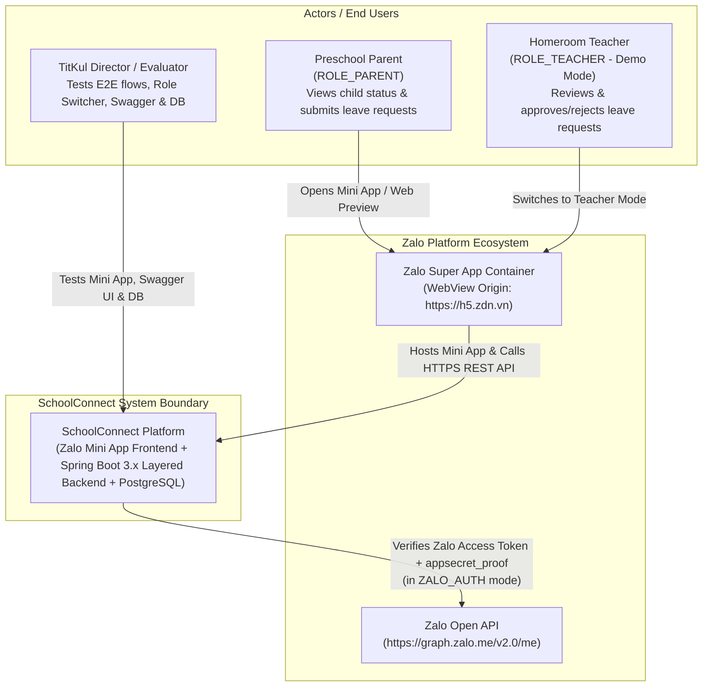

# System Context & Architecture Drivers — SchoolConnect

## 1. Document Control

| Attribute | Value |
| :--- | :--- |
| **Project Name** | SchoolConnect (Zalo Mini App — Preschool Parent & Teacher Portal) |
| **Document ID** | `DOC-03-SYSTEM-CONTEXT` |
| **Phase** | Phase 03 — System Architecture & Technical Design |
| **Backend Architecture** | **Layered Architecture** (`controller` -> `service` -> `repository` -> `entity` / `dto`) |
| **Target Demo Deadline** | **2026-11-05 15:00 (GMT+7)** |
| **Last Updated** | 2026-11-04 |

---

## 2. Architecture Drivers (`Các yếu tố định hướng kiến trúc`)

| Driver Category | Analysis & Concrete Architectural Impact |
| :--- | :--- |
| **1. Business Functionality** | Must deliver a preschool parent portal (`H2School` domain) with 6 Parent screens (`Dashboard`, `Daily Report`, `Attendance`, `Meal Menu`, `Announcements`, `Absence Request`) plus a closed-loop **Teacher Leave Review Mode** (`OQ-02`) and **Multi-Child Switcher** (`OQ-06`). |
| **2. Expected Traffic & Usage** | **Evaluation Phase:** `1–10` concurrent users during live demonstration and testing (`p95 <= 500ms` local/regional target). **Future Production Profile:** Bursty daily traffic at preschool drop-off (`07:00–08:30`), post-lunch/nap check (`11:30–14:00`), and pick-up (`16:00–17:30`). Stateless backend design allows horizontal scaling when transitioning to production. |
| **3. Data Volume** | **MVP Demo:** 8 normalized relational tables with ~50–100 high-quality synthetic seed rows (`2` parents/teachers, `2` students, `14` attendance records, `10` daily reports, `15` meal menus, `6` announcements, `4+` leave requests). **Production Growth:** Linear growth (~250 attendance & daily report rows per student per school year), easily handled by a single indexed PostgreSQL instance for hundreds of preschools. |
| **4. Availability & Reliability** | **Critical Window:** 100% availability required at **15:00 on 2026-11-05**. Achieved by decoupling Zalo platform dependencies via `DEMO_MODE` and supporting both local Docker Compose and HTTPS Tunnel / Cloud PaaS access. All mutations (`leave_requests`) run inside ACID `@Transactional` boundaries. |
| **5. Security & Privacy** | Strict **Guardian-Student Data Isolation (`RULE-001`)** to prevent IDOR across children; role-based authorization (`ROLE_PARENT` vs `ROLE_TEACHER`); HMAC-SHA256 `appsecret_proof` verification for Zalo tokens; zero hardcoded secrets; 100% synthetic demo data (`CF-06`). |
| **6. Integration Requirements** | - **Zalo Mini App WebView & SDK (`zmp-sdk`):** Runs under origin `https://h5.zdn.vn`, requiring strict HTTPS and CORS `OPTIONS` preflight support. - **Zalo Open API (`graph.zalo.me/v2.0/me`):** Server-to-server profile verification in `ZALO_AUTH` mode. - **OpenAPI / Swagger UI:** Interactive API inspection for the Technical Evaluator. |
| **7. Development Speed** | Must be completely built, tested, and packaged prior to **2026-11-05 15:00 (GMT+7)**. Choosing **Spring Boot 3.x Layered Architecture** and **React + TypeScript + ZaUI** maximizes velocity and eliminates unnecessary boilerplate. |
| **8. Maintenance Complexity** | Clear separation of layers (`controller`, `service`, `repository`, `entity`, `dto`, `security`, `config`, `exception`) ensures any developer or evaluator can navigate the codebase within 2 minutes. |
| **9. Deployment Cost** | Near-zero cost (`$0`): self-contained `docker-compose.yml` (PostgreSQL + Spring Boot) plus free Zalo Testing environment and optional free HTTPS tunnel (`Cloudflare Tunnel` / `ngrok`). |
| **10. Future Extensibility** | Clean DTO boundaries and normalized many-to-many guardian mapping (`parent_students`) allow adding Zalo OA push notifications (ZNS), teacher daily report creation, and tuition billing in future releases without schema rewrites. |

---

## 3. System Context (C4 Level 1 Diagram)

---

## 4. Integration Boundaries & External Dependencies

| Boundary ID | External System / Dependency | Protocol & Direction | Purpose | Failure / Fallback Strategy |
| :--- | :--- | :--- | :--- | :--- |
| **`EXT-01`** | **Zalo Mini App Container (`zmp-sdk`)** | JS Bridge (In-App) | Provides Mini App lifecycle, viewport adaptation, and `getAccessToken()` on mobile devices. | When running in a standard desktop/mobile browser or without a bound App ID, SDK calls are wrapped in a `try/catch` adapter that automatically activates `DEMO_MODE`. |
| **`EXT-02`** | **Zalo Graph API (`graph.zalo.me`)** | Outbound HTTPS `GET` from Backend | Verifies user's Zalo Access Token using `access_token` header and `appsecret_proof` (HMAC-SHA256). | 5-second connection/read timeout; if unreachable or in `DEMO_MODE`, `/api/v1/auth/demo-session` issues internal JWT tokens directly without calling external network. |
| **`EXT-03`** | **PostgreSQL Database (`v16/v17`)** | Inbound TCP (`JDBC` port `5432`) from Backend | Primary ACID relational store for all 8 domain tables. | Managed via HikariCP connection pool; health status exposed via `GET /api/v1/health`. |
| **`EXT-04`** | **Swagger UI (`springdoc-openapi`)** | Inbound HTTP/HTTPS (`GET /swagger-ui.html`) | Allows Evaluator to inspect and execute REST endpoints directly from the browser. | Embedded directly inside the Spring Boot artifact; zero external runtime dependency. |

