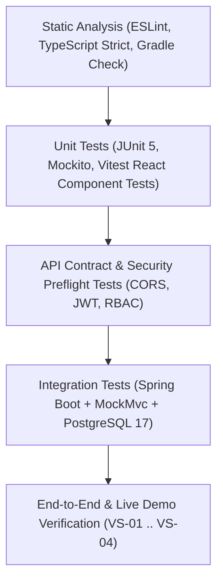

# Test Strategy & Quality Assurance Plan — SchoolConnect

## 1. Document Control

| Attribute | Value |
| :--- | :--- |
| **Project Name** | SchoolConnect (*Zalo Mini App — Preschool Parent & Teacher Portal*) |
| **Document ID** | `DOC-04-TEST-STRATEGY` |
| **Phase** | Phase 07B — Test Execution & Defect Analysis |
| **Author** | Senior QA Engineer & Test Automation Architect |
| **Target Standards** | ISO/IEC/IEEE 29119 Software Testing, OWASP ASVS 5.0.0 |
| **Base Branch** | `main` |
| **Last Updated** | 2026-11-04 |

---

## 2. Test Objectives & Scope

### 2.1. Objectives
- Verify that SchoolConnect satisfies all approved requirements (`FR-001` through `FR-012`), business rules (`RULE-001` through `RULE-014`), and acceptance criteria (`AC-001` through `AC-019`).
- Ensure high reliability, zero data cross-leakage between parents/students (`RULE-001`), transaction rollback integrity (`RULE-003`, `RULE-005`), and secure integration with Zalo Mini App WebView (`Origin: https://h5.zdn.vn`).
- Identify defects, test state contamination issues, and security vulnerabilities prior to User Acceptance Testing (UAT).

### 2.2. In-Scope Testing
- **Backend Service Unit Testing:** Isolated testing of domain logic (`LeaveRequestService`, `StudentDashboardService`, `AttendanceService`) using JUnit 5 and Mockito.
- **Backend Integration Testing:** Full-stack testing against real PostgreSQL 17 instances using Spring Boot `@AutoConfigureMockMvc` and Spring Data JPA.
- **API Contract Verification:** Verifying request validation (`Jakarta Validation`), HTTP status codes, standard JSON envelopes (`ApiResponse<T>`), and error payloads.
- **Frontend Component & State Testing:** Vitest and React Testing Library tests for role switching, multi-child switching, and 4-state asynchronous UI rendering (`Loading`, `Success`, `Empty`, `Error`).
- **Static Quality & Security Scanning:** ESLint with strict zero-warning policy (`--max-warnings 0`), TypeScript strict compiler checks (`tsc --noEmit`), and OWASP ASVS 5.0.0 alignment review.
- **CORS & Preflight Testing:** Verification of `OPTIONS` preflight headers for Zalo CDN webview origins (`https://h5.zdn.vn`).

### 2.3. Out-of-Scope for Current Phase
- Stress testing beyond 500 concurrent virtual users (deferred to pre-launch capacity planning).
- Live payment gateway testing (SchoolConnect MVP has zero financial transactions in scope).

---

## 3. Test Levels & Testing Pyramid

| Level | Focus | Tooling / Harness | Environment |
| :--- | :--- | :--- | :--- |
| **Static Checks** | Linter, typing, dependency safety | ESLint 8.57, TypeScript 5.6, Gradle 8.10.2 | Local & GitHub Actions CI |
| **Unit Testing** | Domain rules, date math, BMI formula, mock boundaries | JUnit 5, Mockito 5, Vitest 2.1 | In-memory JVM & JSDOM |
| **API & Security** | Status codes, error payloads, JWT parsing, CORS preflight | Spring MockMvc, Java HTTP Client | Spring Context with `test` profile |
| **Integration** | DB schema, constraints, sequences, `@Transactional` boundaries | Spring Boot Test + Local PostgreSQL 17 | `schoolconnect` DB on `localhost:5432` |
| **Manual / E2E** | Parent/Teacher workflow, Child switcher, form usability | Chrome DevTools, Zalo Mini App Simulator | Local Vite Dev Server (`localhost:3000`) |

---

## 4. Test Environment & Test Data Governance

### 4.1. Test Environment Specification
- **OS:** Windows 10/11 x86_64
- **JDK:** Java 21.0.5 (GraalVM / Oracle HotSpot 64-Bit)
- **Node.js:** v24.16.0 / npm 11.13.0
- **Database:** PostgreSQL 17.5 running on `127.0.0.1:5432` with database `schoolconnect`
- **Application Port:** Backend `8080`, Frontend `3000`
- **Active Spring Profiles:** `test` (disables external config pollution; overrides connection parameters)

### 4.2. Test Data Isolation & Idempotency Rules
1. **100% Synthetic Data Guarantee (`CF-06`):** All seeded parents, teachers, and students in `data.sql` use fictional personas.
2. **Deterministic Sequence Sync:** After seed execution, `SELECT setval(...)` aligns sequences with max IDs.
3. **Integration Test Teardown Requirement:** Integration tests that perform state mutations (`INSERT`, `UPDATE`) must clean up created rows or run within transactional rollback boundaries to prevent state contamination in subsequent runs.

---

## 5. Quality Gate Criteria (Pass/Fail Thresholds)

- **Unit Tests:** 100% Pass rate required.
- **Static Analysis:** 0 ESLint warnings, 0 TypeScript compilation errors.
- **Acceptance Criteria Verification:** All 19 acceptance criteria (`AC-001` through `AC-019`) verified with evidence.
- **Security Baseline:** Zero Critical or High severity vulnerabilities allowed in production paths.

