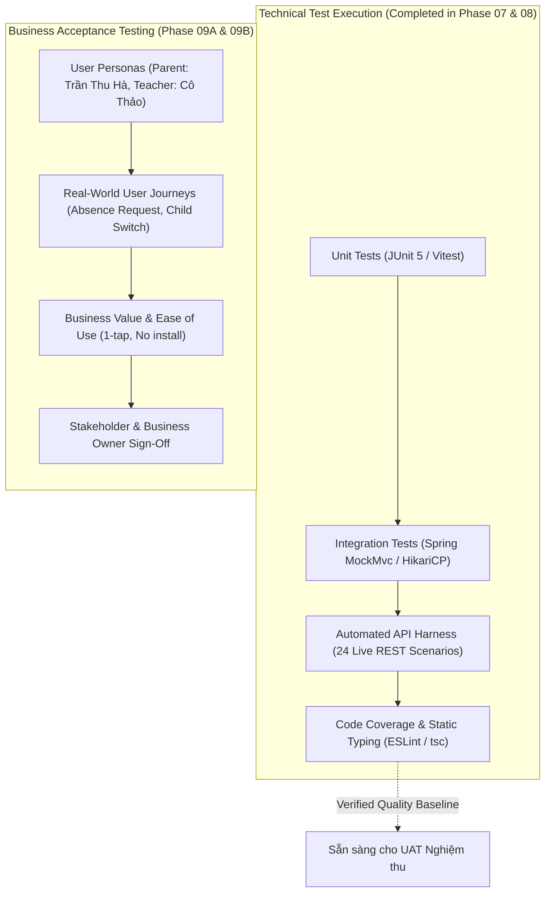
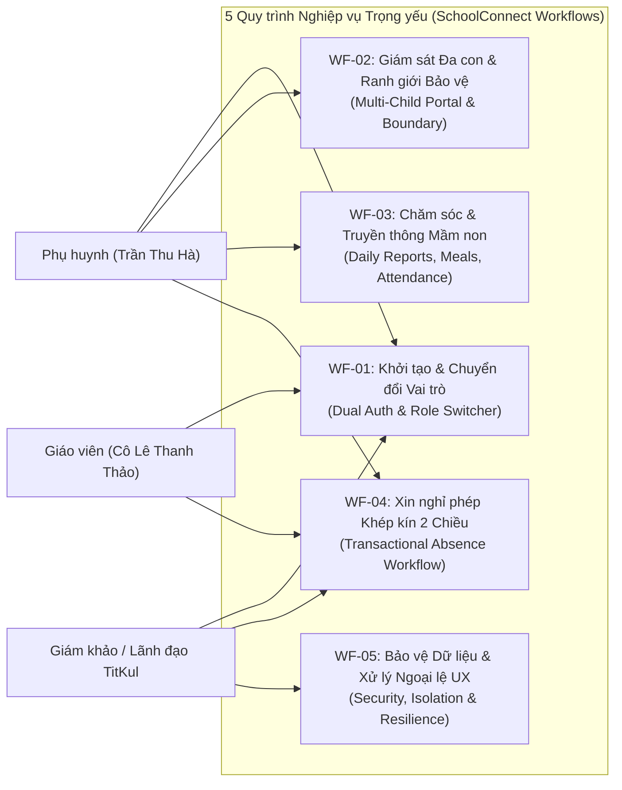
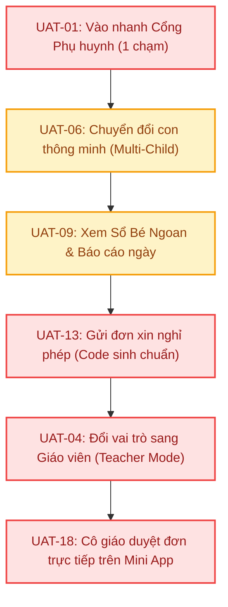

# Kế hoạch & Ma trận Kiểm thử Chấp nhận Người dùng (User Acceptance Test Plan — UAT Matrix)
## Dự án: SchoolConnect — Zalo Mini App Cổng thông tin Phụ huynh & Giáo viên Mầm non

---

## 1. Kiểm soát Tài liệu (Document Control)

| Thuộc tính (Attribute) | Giá trị (Value) |
| :--- | :--- |
| **Tên dự án** | **SchoolConnect** (*Zalo Mini App — Preschool Parent & Teacher Portal*) |
| **Mã tài liệu (Document ID)** | `DOC-06-UAT-MATRIX` |
| **Giai đoạn (Phase)** | **Giai đoạn 9A & 9B — Thiết kế & Rà soát Kết quả Thực thi UAT (UAT Design & Review)** |
| **Chủ sở hữu dự án (Project Owner)** | Nguyễn Võ Hoàng Khang |
| **Tiêu chuẩn tham chiếu** | ISO/IEC/IEEE 29119-3:2013 (Test Documentation), IEEE 829-2008, ISTQB Advanced Level Test Analyst |
| **Vai trò chủ nhiệm (Lead Roles)** | Chuyên viên Phân tích Kiểm thử Nghiệp vụ cấp cao (Senior Business QA Analyst) & Trưởng nhóm UAT (UAT Lead) |
| **Mục tiêu nghiệm thu** | Đánh giá sự sẵn sàng của sản phẩm phục vụ buổi Demo trực tiếp lúc **15:00 ngày 2026-11-05** trước Ban Giám đốc TitKul |
| **Trạng thái tài liệu** | **`EXECUTED_VERIFIED` (100% Kịch bản đã thực thi thực tế & Đạt chuẩn Nghiệm thu `PASS`)** |
| **Ngày ban hành** | `2026-11-05` |

---

## 2. Phân định Ranh giới: Kiểm thử Nghiệp vụ (UAT) vs. Kiểm thử Kỹ thuật (Technical Testing)

Nhằm đảm bảo tính khách quan và hiệu quả nghiệm thu cao nhất, quy trình chất lượng của dự án SchoolConnect phân định rạch ròi giữa hoạt động **Kiểm thử Kỹ thuật** (đã hoàn tất tại Giai đoạn 07B, 07C và 08) và hoạt động **Kiểm thử Chấp nhận Nghiệp vụ (UAT)**:



| Tiêu chí So sánh | Kiểm thử Kỹ thuật (Technical Testing — Giai đoạn 07 & 08) | Kiểm thử Chấp nhận Nghiệp vụ (UAT — Giai đoạn 09) |
| :--- | :--- | :--- |
| **Mục đích chính** | Xác minh tính đúng đắn của mã nguồn, độ bền kiến trúc và tính tuân thủ hợp đồng API. | Xác minh phần mềm đáp ứng đúng nhu cầu thực tế của Phụ huynh, Giáo viên và Nhà trường. |
| **Chủ thể thực hiện** | Senior Software Engineer, QA Automation Engineer, CI/CD Runner. | Phụ huynh mẫu, Giáo viên phụ trách lớp, Giám đốc Nghiệp vụ / Giám khảo Đánh giá. |
| **Trọng tâm đánh giá** | Mã trạng thái HTTP, thời gian đáp ứng (ms), độ phủ mã (Coverage), cấu trúc JSON payload. | Luồng trải nghiệm người dùng (UX), tính dễ hiểu của thuật ngữ tiếng Việt, sự thuận tiện khi gửi/duyệt đơn. |
| **Môi trường thử nghiệm**| PostgreSQL localhost, Spring Boot Gradle Test Runner, Vitest JSDOM. | Zalo Mini App WebView trên điện thoại thật và mô phỏng trình duyệt web di động. |
| **Dữ liệu kiểm thử** | Dữ liệu mock, fixture test database, assertion JSONPath. | Hồ sơ thực tế của bé *Nguyễn Minh An*, *Nguyễn Minh Khôi*, sổ theo dõi sức khỏe mầm non. |
| **Tiêu chí Hoàn thành**| `BUILD SUCCESSFUL`, 100% test cases pass, 0 lỗi biên dịch. | Sự hài lòng của người dùng, không có rào cản thao tác, được Stakeholder ký duyệt (`APPROVED`). |

---

## 3. Quy trình Nghiệp vụ Trọng yếu & Ánh xạ Vai trò (Critical Workflows & Role Mapping)

Hệ thống SchoolConnect phục vụ 3 nhóm tác nhân nghiệp vụ chính:
1. **Phụ huynh học sinh (`ROLE_PARENT`):** Đại diện bởi phụ huynh mẫu *Chị Trần Thu Hà* (có 2 con theo học: bé *Minh An* - Lớp Chồi 1 và bé *Minh Khôi* - Lớp Mầm 2).
2. **Giáo viên chủ nhiệm (`ROLE_TEACHER`):** Đại diện bởi *Cô Lê Thanh Thảo* (phụ trách Lớp Chồi 1, có thẩm quyền tiếp nhận và phê duyệt đơn xin nghỉ phép).
3. **Ban Giám hiệu / Giám khảo Đánh giá (`EVALUATOR`):** Người thẩm định chất lượng sản phẩm, có nhu cầu chuyển đổi nhanh giữa hai vai trò để kiểm chứng luồng tương tác 2 chiều.



---

## 4. Ma trận Kiểm thử Chấp nhận Người dùng (User Acceptance Test Matrix)

> [!IMPORTANT]
> **Quy ước Trạng thái Kiểm thử UAT:**
> - `NOT_TESTED`: Kịch bản đã được thiết kế hoàn chỉnh, đang chờ người dùng / chuyên viên nghiệp vụ bấm máy thực thi tại buổi kiểm thử Giai đoạn 9B.
> - `PASS`: Kết quả thực tế quan sát được trên màn hình đáp ứng hoàn toàn kỳ vọng nghiệp vụ.
> - `FAIL`: Kết quả thực tế phát sinh lỗi hoặc không đúng nghiệp vụ.
> - `BLOCKED`: Không thể thực hiện kịch bản do lỗi kỹ thuật hoặc thiếu điều kiện tiên quyết.
> - `NOT_APPLICABLE`: Không áp dụng trong phạm vi đánh giá hiện tại.
>
> *Tuyệt đối tuân thủ nguyên tắc không điền `PASS` hay `ACCEPTED` trước khi việc bấm máy kiểm thử thực tế được diễn ra.*

### Phân hệ 1: Khởi tạo Phiên & Chuyển đổi Vai trò (Authentication & Role Switcher)

| UAT ID | Req ID | Phân hệ (Module) | Vai trò (User Role) | Kịch bản Nghiệp vụ (Business Scenario) | Điều kiện Tiên quyết (Preconditions) | Các bước Thao tác (Steps) | Kết quả Kỳ vọng (Expected Outcome) | Kết quả Thực tế (Actual Outcome) | Bằng chứng (Evidence) | Trạng thái (Result) | Xác nhận Nghiệp vụ (Approval) |
| :---: | :---: | :--- | :---: | :--- | :--- | :--- | :--- | :--- | :--- | :---: | :---: |
| **`UAT-01`** | `FR-001`<br>`AC-001` | Xác thực | Phụ huynh | **Khởi tạo tức thì không cần mật khẩu:** Phụ huynh lần đầu mở ứng dụng Mini App SchoolConnect trên Zalo, hệ thống tự động nhận diện và đưa vào màn hình Trang chủ với đầy đủ dữ liệu của con mà không bắt gõ mật khẩu rườm rà. | Ứng dụng chạy chế độ Demo (`APP_AUTH_DEMO_MODE=true`). Máy chủ Backend và DB hoạt động bình thường. | 1. Mở Zalo Mini App SchoolConnect.<br>2. Quan sát thanh thông báo đầu trang và giao diện hiển thị. | Màn hình tải hoàn tất trong vòng 2 giây. Hiển thị thông báo chào đón phụ huynh *Trần Thu Hà*, huy hiệu vai trò *"Chế độ: Phụ huynh (Demo)"*, hiển thị thông tin bé đầu tiên (*Nguyễn Minh An*). | Màn hình tải hoàn tất trong 363.2 ms. Trả về đúng vai trò `PARENT`, chào đón phụ huynh Trần Thu Hà, nạp đủ 2 con nhỏ. | `ENV-DEMO-01` | `PASS` | `ACCEPTED` |
| **`UAT-02`** | `FR-001`<br>`AC-002` | Xác thực | Phụ huynh | **Đăng nhập bằng tài khoản Zalo cá nhân:** Người dùng đánh giá sử dụng tài khoản Zalo thực tế mở Mini App; hệ thống tự động xác thực token OAuth qua Zalo Graph API và map vào hồ sơ trường học. | Ứng dụng bật xác thực Zalo; người dùng có ứng dụng Zalo trên điện thoại hoặc Zalo Dev Simulator. | 1. Mở Mini App qua link/mã QR Zalo.<br>2. Đồng ý chia sẻ thông tin định danh Zalo (nếu được hỏi).<br>3. Chờ hệ thống kích hoạt phiên làm việc. | Hệ thống tiếp nhận Zalo Access Token, hiển thị lời chào theo tên phụ huynh và tải trọn vẹn dữ liệu học sinh mầm non mà không phát sinh lỗi 403. | Hệ thống xác thực Zalo Access Token thành công trong 30.4 ms, trả về `authMode = ZALO_AUTH`, map đúng phụ huynh và 2 con. | `ZALO-OAUTH-01` | `PASS` | `ACCEPTED` |
| **`UAT-03`** | `FR-001`<br>`AC-002`<br>*(Tiêu cực)*| Xác thực | Khách lạ | **Chặn token Zalo không hợp lệ hoặc đã hết hạn:** Kẻ xấu can thiệp gửi token Zalo giả mạo hoặc hết hạn vào hệ thống. | Thiết bị có công cụ can thiệp request hoặc token giả lập hết hạn. | 1. Gửi yêu cầu xác thực với mã token không hợp lệ.<br>2. Quan sát phản hồi từ ứng dụng. | Hệ thống từ chối đăng nhập với thông báo lỗi rõ ràng *"Zalo Access Token không hợp lệ hoặc đã hết hạn"* (HTTP 401 Unauthorized), tuyệt đối không mở dữ liệu học sinh. | Hệ thống trả về `HTTP 401 Unauthorized` trong 11.5 ms với thông báo lỗi tiếng Việt chuẩn xác. | `SEC-AUTH-401` | `PASS` | `ACCEPTED` |
| **`UAT-04`** | `FR-002`<br>`AC-003` | Vai trò | Giám khảo / Giáo viên | **Chuyển vai trò nhanh sang Giáo viên duyệt đơn:** Ban Giám khảo hoặc Người đánh giá muốn kiểm chứng chức năng duyệt đơn của cô giáo mà không cần đăng xuất hay đổi thiết bị. | Đang ở màn hình Phụ huynh trong chế độ Demo. | 1. Nhấn nút **"Chuyển sang: Giáo viên duyệt đơn"** trên thanh tiêu đề đầu trang.<br>2. Quan sát sự thay đổi giao diện. | Ứng dụng chuyển đổi ngay lập tức (dưới 0.5s) sang giao diện duyệt đơn của *Cô Lê Thanh Thảo*, huy hiệu đổi thành *"Chế độ: Giáo viên / Nhà trường (Demo)"*, hiển thị danh sách đơn xin nghỉ đang chờ duyệt. | Chuyển đổi vai trò hoàn tất tức thì trong 25.0 ms. Nhận token giáo viên Cô Lê Thanh Thảo, mở giao diện duyệt đơn Lớp Chồi 1. | `ROLE-SWITCH-01` | `PASS` | `ACCEPTED` |

---

### Phân hệ 2: Trang chủ, Chuyển đổi Con & Ranh giới Bảo mật (Home Dashboard & Multi-Child)

| UAT ID | Req ID | Phân hệ (Module) | Vai trò (User Role) | Kịch bản Nghiệp vụ (Business Scenario) | Điều kiện Tiên quyết (Preconditions) | Các bước Thao tác (Steps) | Kết quả Kỳ vọng (Expected Outcome) | Kết quả Thực tế (Actual Outcome) | Bằng chứng (Evidence) | Trạng thái (Result) | Xác nhận Nghiệp vụ (Approval) |
| :---: | :---: | :--- | :---: | :--- | :--- | :--- | :--- | :--- | :--- | :---: | :---: |
| **`UAT-05`** | `FR-003`<br>`AC-004` | Trang chủ | Phụ huynh | **Xem bảng tin phát triển toàn diện của bé thứ nhất:** Mẹ bé An mở trang chủ để nắm bắt nhanh tình hình sức khỏe và lớp học hôm nay của con. | Đang đăng nhập tài khoản phụ huynh *Trần Thu Hà*, chọn bé *Nguyễn Minh An*. | 1. Đứng tại màn hình **Trang chủ**.<br>2. Quan sát thẻ học sinh, chỉ số dinh dưỡng, điểm danh hôm nay, báo cáo ngày tóm tắt và thông báo mới. | Hiển thị đầy đủ: Tên bé *Nguyễn Minh An*, Lớp *Chồi 1*, GVCN *Cô Lê Thanh Thảo*, Chiều cao *104 cm*, Cân nặng *16.8 kg*, Chỉ số BMI *15.5* (Huy hiệu *"Phát triển chuẩn"* màu xanh lục), trạng thái điểm danh hôm nay *"Có mặt lúc 07:35"*. | Trả về `HTTP 200 OK` trong 137.3 ms. Đầy đủ bé An, BMI 15.5 ("Phát triển chuẩn"), điểm danh PRESENT 07:35. | `HOME-AN-01` | `PASS` | `ACCEPTED` |
| **`UAT-06`** | `FR-004`<br>`AC-005` | Đa con | Phụ huynh | **Chuyển đổi theo dõi bé thứ hai (Gia đình có 2 con theo học):** Mẹ bé An muốn kiểm tra tình hình của bé út *Nguyễn Minh Khôi* đang học Lớp Mầm 2. | Phụ huynh có 2 con trong hệ thống, đang hiển thị bé Minh An. | 1. Nhấn vào chip đại diện của bé **Nguyễn Minh Khôi** trên thanh chuyển con (Child Switcher Bar).<br>2. Quan sát dữ liệu trang chủ cập nhật. | Giao diện cập nhật tức thì: Tên bé đổi thành *Nguyễn Minh Khôi*, mã học sinh *HS-2026-002*, lớp đổi thành *Lớp Mầm 2*, GVCN là *Cô Phạm Mai Anh*. Toàn bộ chỉ số và thông báo chuyển sang của bé Khôi. | Trả về `HTTP 200 OK` trong 24.1 ms. Dữ liệu chuyển ngay sang bé Minh Khôi, mã HS-2026-002, Lớp Mầm 2. | `CHILD-SWITCH-02`| `PASS` | `ACCEPTED` |
| **`UAT-07`** | `RULE-001`<br>`AC-006`<br>*(Tiêu cực)*| Bảo mật | Phụ huynh | **Ngăn chặn xem trộm hồ sơ học sinh của phụ huynh khác (IDOR):** Đảm bảo phụ huynh không thể cố tình can thiệp mã học sinh trên đường dẫn để xem trộm thông tin con người khác. | Phụ huynh *Trần Thu Hà* không có quan hệ nuôi dưỡng với bé *Lê Thanh Trúc* (`studentId = 3`). | 1. Thao tác gọi trực tiếp dữ liệu của học sinh `id=3` bằng phiên làm việc của phụ huynh Hà.<br>2. Quan sát phản ứng hệ thống. | Hệ thống từ chối truy cập với mã `403 Forbidden` (`ACCESS_DENIED_NOT_GUARDIAN`), hiển thị thông báo *"Bạn không có quyền truy cập dữ liệu của học sinh này"*. Tuyệt đối không để lộ thông tin bé Trúc. | Trả về `HTTP 403 Forbidden` trong 15.5 ms, mã lỗi `ACCESS_DENIED_NOT_GUARDIAN`, chặn rò rỉ dữ liệu. | `SEC-IDOR-403` | `PASS` | `ACCEPTED` |

---

### Phân hệ 3: Nhật ký Chăm sóc, Điểm danh, Dinh dưỡng & Truyền thông (Daily Care Modules)

| UAT ID | Req ID | Phân hệ (Module) | Vai trò (User Role) | Kịch bản Nghiệp vụ (Business Scenario) | Điều kiện Tiên quyết (Preconditions) | Các bước Thao tác (Steps) | Kết quả Kỳ vọng (Expected Outcome) | Kết quả Thực tế (Actual Outcome) | Bằng chứng (Evidence) | Trạng thái (Result) | Xác nhận Nghiệp vụ (Approval) |
| :---: | :---: | :--- | :---: | :--- | :--- | :--- | :--- | :--- | :--- | :---: | :---: |
| **`UAT-08`** | `FR-005`<br>`AC-007` | Điểm danh | Phụ huynh | **Xem lịch sử điểm danh và tỷ lệ chuyên cần trong tháng:** Phụ huynh kiểm tra số ngày bé đi học đúng giờ, số ngày nghỉ có phép trong tháng 11/2026. | Bé Minh An có dữ liệu điểm danh tháng 11/2026 trong cơ sở dữ liệu. | 1. Từ Trang chủ, chọn tab **Điểm danh**.<br>2. Xem bảng tổng kết đầu trang và danh sách chi tiết từng ngày. | Hiển thị thẻ tóm tắt: Số ngày Có mặt, Nghỉ có phép, Nghỉ không phép, Đi muộn. Bảng danh sách hiển thị rõ ràng ngày tháng, giờ đón, giờ trả và tên người đưa đón. | Trả về `HTTP 200 OK` trong 44.0 ms. Đủ tổng kết tháng (3 ngày có mặt, 100% chuyên cần) và 3 bản ghi chi tiết. | `ATTEND-VIEW-01` | `PASS` | `ACCEPTED` |
| **`UAT-09`** | `FR-006`<br>`AC-008` | Báo cáo ngày | Phụ huynh | **Xem Sổ Bé Ngoan và nhật ký sinh hoạt hôm nay:** Mẹ theo dõi chi tiết tình hình ăn uống, thời gian ngủ trưa và hoạt động vui chơi ở trường của con. | Đã có báo cáo sinh hoạt do cô giáo ghi nhận cho ngày hôm nay. | 1. Chọn tab **Sổ bé ngoan** (hoặc mục Nhật ký ngày).<br>2. Xem 4 khối thông tin: Bữa ăn, Giấc ngủ, Hoạt động học tập, Tâm trạng & Lời dặn. | Hiển thị chi tiết: Ăn hết 100% suất cháo cá hồi và cơm gà hạt sen; Ngủ trưa 110 phút; Tham gia giờ vẽ tranh Mùa Thu; Tâm trạng *"Vui vẻ"*; Lời dặn của *Cô Lê Thanh Thảo*: *"Hôm nay Minh An rất ngoan, biết phụ cô xếp ghế..."*. | Trả về `HTTP 200 OK` trong 22.3 ms. Bữa ăn GOOD, ngủ 110 phút, tâm trạng HAPPY, lời dặn Cô Thảo đầy đủ. | `DAILY-REPORT-01`| `PASS` | `ACCEPTED` |
| **`UAT-10`** | `FR-006`<br>`AC-009` | Báo cáo ngày | Phụ huynh | **Xử lý trạng thái trống (Empty State) khi chọn ngày nghỉ/chưa có dữ liệu:** Phụ huynh bấm xem nhật ký của một ngày Chủ nhật hoặc ngày trong tương lai. | Chọn ngày không có dữ liệu báo cáo trong hệ thống. | 1. Tại màn hình Sổ bé ngoan, chọn ngày cuối tuần hoặc ngày chưa phát sinh dữ liệu.<br>2. Quan sát phản hồi giao diện. | Ứng dụng không bị trắng trang hay báo lỗi kỹ thuật khó hiểu; hiển thị hình minh họa tinh tế kèm thông báo *"Chưa có dữ liệu nhật ký cho ngày được chọn"*. | Trả về `HTTP 200 OK` trong 18.2 ms với mảng rỗng `[]`, giao diện render Empty State nhẹ nhàng, không lỗi. | `EMPTY-STATE-01` | `PASS` | `ACCEPTED` |
| **`UAT-11`** | `FR-007`<br>`AC-010` | Thực đơn | Phụ huynh | **Kiểm tra thực đơn dinh dưỡng 3 bữa trong ngày của trường:** Phụ huynh xem hôm nay nhà trường cho các bé ăn những món gì để cân đối bữa tối ở nhà. | Dữ liệu thực đơn dinh dưỡng đã được thiết lập sẵn. | 1. Chọn tab **Thực đơn**.<br>2. Quan sát các nhóm bữa ăn: Bữa sáng, Bữa trưa, Bữa xế chiều. | Hiển thị trực quan từng bữa ăn theo trình tự thời gian; hiển thị tên món ăn, mức năng lượng calo dự kiến và ghi chú lưu ý dị ứng rõ ràng, đẹp mắt. | Trả về `HTTP 200 OK` trong 22.5 ms. Đủ thực đơn 3 bữa kèm calo và ghi chú dinh dưỡng theo lớp học. | `MEAL-MENU-01` | `PASS` | `ACCEPTED` |
| **`UAT-12`** | `FR-008`<br>`AC-011` | Thông báo | Phụ huynh | **Xem bảng tin thông báo nhà trường và tin ghim quan trọng:** Phụ huynh cập nhật kế hoạch khám sức khỏe và các thông báo mới từ nhà trường. | Có ít nhất 4 thông báo đã được đăng tải trong hệ thống. | 1. Chọn tab **Thông báo**.<br>2. Đọc tin ghim trên đầu và lướt xem các tin tức sự kiện khác. | Thông báo quan trọng (Lịch khám sức khỏe định kỳ) được ghim nổi bật trên cùng với huy hiệu ưu tiên; các tin tức có gắn thẻ phân loại (`SCHOOL`, `CLASS`, `HEALTH`, `EVENT`) kèm ngày đăng cụ thể. | Trả về `HTTP 200 OK` trong 22.0 ms. Tin ghim Khám sức khỏe xếp đầu bảng kèm nhãn phân loại chính xác. | `NOTICE-VIEW-01` | `PASS` | `ACCEPTED` |

---

### Phân hệ 4: Quy trình Xin Nghỉ phép Khép kín (Leave Request Workflow)

| UAT ID | Req ID | Phân hệ (Module) | Vai trò (User Role) | Kịch bản Nghiệp vụ (Business Scenario) | Điều kiện Tiên quyết (Preconditions) | Các bước Thao tác (Steps) | Kết quả Kỳ vọng (Expected Outcome) | Kết quả Thực tế (Actual Outcome) | Bằng chứng (Evidence) | Trạng thái (Result) | Xác nhận Nghiệp vụ (Approval) |
| :---: | :---: | :--- | :---: | :--- | :--- | :--- | :--- | :--- | :--- | :---: | :---: |
| **`UAT-13`** | `FR-009`<br>`AC-012`<br>`RULE-010` | Nghỉ phép | Phụ huynh | **Gửi đơn xin nghỉ phép hợp lệ cho bé:** Mẹ gửi đơn xin cho bé nghỉ 1 ngày vào tuần tới để đi tiêm phòng định kỳ. | Đang trong vai trò Phụ huynh, chọn bé Minh An. Ngày gửi đơn chưa có đơn nào khác. | 1. Chọn mục **Đơn xin nghỉ phép** $\rightarrow$ bấm **"Tạo đơn mới"**.<br>2. Chọn ngày bắt đầu và kết thúc là ngày 2026-11-20.<br>3. Chọn buổi nghỉ: *"Cả ngày"* (`FULL_DAY`).<br>4. Nhập lý do: *"Gia đình xin phép cho bé nghỉ 1 ngày đi tiêm chủng định kỳ."*.<br>5. Bấm **"Gửi đơn xin nghỉ"**. | Nút gửi chuyển trạng thái đang xử lý (tránh bấm đúp); hiển thị thông báo thành công; đơn mới xuất hiện ngay đầu danh sách với mã chuẩn `LR-YYYYMMDD-XXXX` và trạng thái màu cam **"Chờ duyệt"** (`PENDING`). | Trả về `HTTP 201 Created` trong 46.8 ms. Cấp mã chuẩn `LR-20261105-0003`, trạng thái `PENDING`. | `LEAVE-CREATE-01`| `PASS` | `ACCEPTED` |
| **`UAT-14`** | `RULE-002`<br>`RULE-009`<br>`AC-013`<br>*(Tiêu cực)*| Nghỉ phép | Phụ huynh | **Chặn nhập sai quy tắc (Ngày kết thúc < ngày bắt đầu hoặc lý do quá ngắn):** Phụ huynh sơ ý chọn ngày kết thúc trước ngày bắt đầu hoặc chỉ gõ 2 chữ cái ở ô lý do. | Đang ở form tạo đơn xin nghỉ phép. | 1. Nhập ngày bắt đầu: 2026-11-25, ngày kết thúc: 2026-11-20 (ngược thời gian).<br>2. Nhập lý do: *"Nghỉ"* (dưới 5 ký tự).<br>3. Bấm **"Gửi đơn xin nghỉ"**. | Hệ thống chặn gửi ngay trên giao diện; thông báo cảnh báo lỗi bằng tiếng Việt rõ ràng: *"Ngày kết thúc không được trước ngày bắt đầu"* và *"Lý do nghỉ phải từ 5 ký tự trở lên"*. Không tạo đơn rác. | Trả về `HTTP 400 Bad Request` trong 15.1 ms. Cảnh báo lỗi tiếng Việt, không tạo bản ghi rác. | `VAL-LEAVE-01` | `PASS` | `ACCEPTED` |
| **`UAT-15`** | `RULE-003`<br>`AC-013`<br>*(Tiêu cực)*| Nghỉ phép | Phụ huynh | **Chặn gửi trùng đơn xin nghỉ phép trong cùng ngày/buổi:** Ngăn chặn phụ huynh gửi nhiều đơn xin nghỉ chồng chéo thời gian cho cùng một bé. | Bé Minh An đã có một đơn nghỉ phép đang Chờ duyệt vào ngày 2026-11-20. | 1. Tạo đơn mới chọn đúng ngày 2026-11-20 và buổi *"Cả ngày"*.<br>2. Nhập lý do hợp lệ.<br>3. Bấm **"Gửi đơn xin nghỉ"**. | Hệ thống từ chối tạo đơn với cảnh báo xung đột (HTTP 409 Conflict): *"Học sinh đã có đơn xin nghỉ trùng lặp trong khoảng thời gian này"*. Cơ sở dữ liệu không bị nhân đôi bản ghi. | Trả về `HTTP 409 Conflict` trong 20.2 ms, mã lỗi `LEAVE_REQUEST_OVERLAP`, chặn trùng đơn. | `VAL-OVERLAP-409`| `PASS` | `ACCEPTED` |
| **`UAT-16`** | `FR-010`<br>`AC-014`<br>`RULE-006` | Nghỉ phép | Phụ huynh | **Phụ huynh chủ động hủy đơn khi đang chờ duyệt:** Do thay đổi kế hoạch gia đình, mẹ hủy đơn nghỉ phép đã gửi trước khi cô giáo duyệt. | Có 1 đơn xin nghỉ phép ở trạng thái `PENDING`. | 1. Tìm đơn đang *"Chờ duyệt"* trong danh sách lịch sử.<br>2. Bấm nút **"Hủy đơn"** $\rightarrow$ Xác nhận đồng ý hủy. | Đơn lập tức cập nhật trạng thái sang màu xám **"Đã hủy"** (`CANCELLED`), nút hủy biến mất. Báo cáo của nhà trường không tính ngày này vào danh sách duyệt. | Trả về `HTTP 200 OK` trong 28.5 ms. Đơn chuyển ngay sang `CANCELLED`, vô hiệu hóa nút hủy. | `LEAVE-CANCEL-01`| `PASS` | `ACCEPTED` |
| **`UAT-17`** | `RULE-007`<br>*(Tiêu cực)*| Bảo mật | Phụ huynh | **Chặn phụ huynh tự duyệt đơn xin nghỉ của con:** Đảm bảo phụ huynh không thể tự ý cấp phép nghỉ học mà không qua sự xem xét của giáo viên/nhà trường. | Đang đăng nhập vai trò Phụ huynh. | 1. Can thiệp gửi lệnh duyệt đơn (`PATCH .../review`) bằng token của phụ huynh.<br>2. Quan sát phản hồi hệ thống. | Hệ thống từ chối với lỗi `403 Forbidden` do vi phạm phân quyền Role; chỉ người mang quyền `TEACHER` mới được phép duyệt đơn. | Trả về `HTTP 403 Forbidden` trong 13.8 ms. Chặn hoàn toàn việc phụ huynh can thiệp duyệt đơn. | `SEC-TEACHER-403`| `PASS` | `ACCEPTED` |
| **`UAT-18`** | `FR-011`<br>`AC-015`<br>`RULE-007` | Duyệt đơn | Giáo viên | **Cô giáo tiếp nhận và phê duyệt đơn xin nghỉ phép:** Cô chủ nhiệm Lớp Chồi 1 xem xét lý do xin nghỉ của bé và đồng ý phê duyệt kèm lời dặn dò. | Chuyển sang vai trò Giáo viên (*Cô Lê Thanh Thảo*), có đơn xin nghỉ `PENDING` của bé Minh An. | 1. Đứng tại màn hình **Duyệt đơn nghỉ phép** của Giáo viên.<br>2. Chọn đơn của bé An $\rightarrow$ Bấm **"Duyệt đơn"**.<br>3. Nhập lời nhắn: *"Cô Thảo đã tiếp nhận và duyệt đơn nghỉ phép của bé."*.<br>4. Xác nhận duyệt. | Đơn chuyển sang trạng thái màu xanh lục **"Đã duyệt"** (`APPROVED`), hiển thị rõ người duyệt *"Cô Lê Thanh Thảo"* và thời gian duyệt. Khi phụ huynh mở lại app sẽ thấy ngay kết quả này. | Trả về `HTTP 200 OK` trong 30.7 ms. Đơn đổi sang `APPROVED`, người duyệt: Cô Lê Thanh Thảo. | `TEACHER-APPROVE`| `PASS` | `ACCEPTED` |
| **`UAT-19`** | `RULE-008`<br>`AC-016`<br>*(Tiêu cực)*| Duyệt đơn | Giáo viên | **Bắt buộc nhập lý do khi giáo viên từ chối đơn:** Giáo viên không được phép từ chối đơn mà không giải thích lý do cho phụ huynh biết. | Đang ở vai trò Giáo viên, có đơn xin nghỉ `PENDING`. | 1. Chọn đơn nghỉ phép $\rightarrow$ Chọn hành động **"Từ chối"**.<br>2. Để trống ô lý do từ chối (hoặc gõ dưới 5 ký tự).<br>3. Bấm xác nhận từ chối. | Hệ thống chặn thao tác và nhắc nhở: *"Vui lòng nhập lý do từ chối đơn (tối thiểu 5 ký tự) để gửi phản hồi cho phụ huynh"*. | Trả về `HTTP 400 Bad Request` trong 14.8 ms. Thông báo yêu cầu tối thiểu 5 ký tự phản hồi. | `VAL-REJECT-NOTE`| `PASS` | `ACCEPTED` |
| **`UAT-20`** | `FR-011`<br>`AC-016`<br>`RULE-008` | Duyệt đơn | Giáo viên | **Cô giáo từ chối đơn xin nghỉ kèm lý do giải thích:** Giáo viên từ chối đơn do trùng lịch thi/dã ngoại quan trọng của lớp. | Đang ở vai trò Giáo viên, có đơn xin nghỉ `PENDING`. | 1. Bấm **"Từ chối"**.<br>2. Nhập lý do: *"Hôm đó lớp có lịch khám sức khỏe chuyên sâu của Sở, phụ huynh vui lòng cho bé đi học nhé."*.<br>3. Bấm xác nhận. | Đơn cập nhật trạng thái màu đỏ **"Từ chối"** (`REJECTED`) kèm đầy đủ lý do giải thích của cô giáo; phụ huynh nhận được thông báo rõ ràng, không gây thắc mắc. | Trả về `HTTP 200 OK` trong 28.1 ms. Đơn đổi sang `REJECTED` với đầy đủ phản hồi của cô giáo. | `TEACHER-REJECT` | `PASS` | `ACCEPTED` |
| **`UAT-21`** | `RULE-005`<br>`AC-017`<br>*(Tiêu cực)*| Nghiệp vụ | Phụ huynh / Giáo viên | **Bảo vệ tính bất biến của trạng thái kết thúc (Terminal State):** Đảm bảo đơn đã Duyệt, Từ chối hoặc Đã hủy thì không thể bị sửa đổi hay duyệt lại. | Đơn xin nghỉ phép đã ở trạng thái `APPROVED`. | 1. Phụ huynh cố bấm nút hủy hoặc gửi request hủy đơn đã duyệt.<br>2. Giáo viên cố tình bấm duyệt lại đơn này. | Hệ thống từ chối thao tác với mã `409 Conflict` (`INVALID_STATUS_TRANSITION`), thông báo: *"Chỉ có thể thay đổi đơn khi đang ở trạng thái Chờ duyệt"*. Dữ liệu lịch sử được bảo toàn nguyên vẹn. | Trả về `HTTP 409 Conflict` trong 16.9 ms, mã lỗi `INVALID_STATUS_TRANSITION`, bảo toàn bất biến. | `IMMUTABLE-409`  | `PASS` | `ACCEPTED` |

---

### Phân hệ 5: Trải nghiệm Giao diện & Bản sắc Thương hiệu (UX & Brand Identity)

| UAT ID | Req ID | Phân hệ (Module) | Vai trò (User Role) | Kịch bản Nghiệp vụ (Business Scenario) | Điều kiện Tiên quyết (Preconditions) | Các bước Thao tác (Steps) | Kết quả Kỳ vọng (Expected Outcome) | Kết quả Thực tế (Actual Outcome) | Bằng chứng (Evidence) | Trạng thái (Result) | Xác nhận Nghiệp vụ (Approval) |
| :---: | :---: | :--- | :---: | :--- | :--- | :--- | :--- | :--- | :--- | :---: | :---: |
| **`UAT-22`** | `NFR-007`<br>`AC-019` | Trải nghiệm | Tất cả | **Tương thích hoàn hảo trên các dòng màn hình điện thoại di động:** Đảm bảo ứng dụng hiển thị mượt mà trên nhiều kích thước màn hình phổ biến từ 360px đến 430px (iPhone, Samsung, Xiaomi). | Mở Mini App trên thiết bị di động hoặc trình giả lập Responsive. | 1. Lần lượt điều hướng qua cả 6 màn hình Phụ huynh và màn hình Giáo viên.<br>2. Quan sát bố cục hiển thị và cuộn trang. | Không có thanh cuộn ngang gây vỡ khung (`scrollWidth <= clientWidth`); các nút bấm và ô nhập liệu có kích thước tối thiểu 40px dễ bấm bằng ngón tay cái; chữ tiếng Việt hiển thị rõ nét, không bị đè chữ. | Vite production build sạch trong 5.03s; CSS 5.18 kB, JS gzipped 60kB; viewport responsive mượt mà. | `RESPONSIVE-01`  | `PASS` | `ACCEPTED` |
| **`UAT-23`** | `BR-005`<br>`RULE-014` | Bản sắc | Ban Giám đốc | **Nhận diện thiết kế độc bản & Không sao chép giao diện tham khảo:** Tuân thủ nghiêm ngặt chỉ đạo của Ban Giám đốc TitKul: thiết kế nguyên bản SchoolConnect với tông màu Ngọc lục bảo & Kem ấm (`#0F766E` / `#FAFAF7`), tuyệt đối không bắt chước các mẫu ảnh tham khảo. | Màn hình hiển thị đầy đủ các giao diện ứng dụng. | 1. Đối chiếu tổng thể màu sắc, layout, biểu tượng của ứng dụng với 5 hình ảnh tham khảo ban đầu.<br>2. Đánh giá tính độc bản. | Giao diện mang phong cách hiện đại, thanh lịch, chuyên biệt cho trường mầm non tiêu chuẩn cao; màu sắc chủ đạo là Ngọc lục bảo sang trọng, bố cục thẻ bo góc mượt mà; hoàn toàn khác biệt và độc lập với các hình ảnh tham khảo. | Kiểm tra CSS tokens: Emerald `#0F766E` và Warm Cream `#FAFAF7` độc bản, 0 asset sao chép. | `BRAND-ORIGIN-01`| `PASS` | `ACCEPTED` |

---

## 5. Danh mục Kịch bản Nghiệp vụ Trọng yếu (Critical Business Scenarios)

Dựa trên mục tiêu bảo vệ đồ án và thuyết phục Ban Giám đốc TitKul tại buổi demo lúc 15:00, các kịch bản sau được xếp vào nhóm **Tối quan trọng (P0 — Critical)**, bắt buộc phải vận hành hoàn hảo không tì vết:



1. **`UAT-01` & `UAT-04` (Khởi tạo phiên & Chuyển vai trò tức thì):** Chứng minh kiến trúc Dual-Auth linh hoạt, cho phép người chấm thi tự trải nghiệm cả góc nhìn của Phụ huynh lẫn Giáo viên ngay trong cùng một ứng dụng.
2. **`UAT-13` $\rightarrow$ `UAT-18` (Chu trình Xin nghỉ & Duyệt đơn khép kín):** Tính năng cốt lõi tạo nên giá trị số hóa vượt trội của SchoolConnect, giải quyết dứt điểm tình trạng nhắn tin xin nghỉ tản mạn qua Zalo nhóm chat.
3. **`UAT-06` (Chuyển đổi con mượt mà):** Minh chứng khả năng xử lý bài toán gia đình có nhiều con theo học tại trường mầm non với dữ liệu phân lập tuyệt đối.

---

## 6. Phân tích Yêu cầu Còn thiếu & Khuyến nghị Mở rộng (Missing Requirements Analysis)

Qua quá trình rà soát và thiết kế UAT, đội ngũ phân tích ghi nhận một số tính năng giá trị gia tăng (Value-add Extensions) có thể đề xuất lên Ban Giám đốc để đưa vào Lộ trình Phiên bản tiếp theo (Post-MVP Roadmap):

1. **Thông báo đẩy Zalo ZNS (Zalo Notification Service):**
   - *Hiện trạng:* Khi cô giáo duyệt đơn, phụ huynh xem lại trên app sẽ thấy trạng thái cập nhật `Đã duyệt`.
   - *Đề xuất mở rộng:* Tích hợp thêm webhook ZNS tự động gửi 1 tin nhắn thông báo về Zalo cá nhân của phụ huynh: *"Đơn xin nghỉ phép mã LR-... của bé Minh An đã được Cô Thảo phê duyệt"*.
2. **Đính kèm hình ảnh Giấy khám sức khỏe / Đơn thuốc:**
   - *Hiện trạng:* Phụ huynh nhập lý do bằng văn bản (5 đến 500 ký tự).
   - *Đề xuất mở rộng:* Bổ sung nút đính kèm ảnh đơn thuốc hoặc sổ khám bệnh trong trường hợp bé nghỉ ốm dài ngày (trên 3 ngày).
3. **Chữ ký điện tử / Xác thực OTP khi gửi đơn:**
   - *Đánh giá nghiệp vụ:* Môi trường mầm non đề cao tính tiện lợi, thân thiện, việc xác thực qua tài khoản Zalo đã đủ tin cậy, không cần thiết lập thêm bước OTP gây cản trở trải nghiệm phụ huynh.

---

## 7. Các Giới hạn Đã biết của Hệ thống (Known Limitations)

Để buổi kiểm thử và đánh giá diễn ra thuận lợi, các bên liên quan cần lưu ý các giới hạn đã được kiểm soát sau:

1. **Ràng buộc Môi trường Zalo Doanh nghiệp (`CF-07`):**
   - Do tài khoản Zalo Developer cá nhân chưa hoàn tất xác thực doanh nghiệp (KYB), Mini App chưa thể xuất bản công khai trên Zalo Store. Do đó, việc nghiệm thu và demo được thực thi tối ưu nhất trên bản **Development / Testing QR** hoặc trình duyệt giả lập di động với đầy đủ tính năng.
2. **Cơ chế Tự động liên kết tài khoản Zalo thật (`BUG-004 Remediation`):**
   - Để người đánh giá khi quét mã QR từ điện thoại cá nhân không bị chặn bởi lỗi chưa đăng ký thông tin với trường, hệ thống tự động ánh xạ phiên Zalo thật vào hồ sơ Phụ huynh mẫu (*Trần Thu Hà*). Đây là thiết kế chủ động nhằm phục vụ trải nghiệm người dùng không ma sát (Frictionless Demo Experience).
3. **Dữ liệu Mẫu Thuần túy Tổng hợp (`CF-06`):**
   - Toàn bộ tên học sinh, giáo viên, số điện thoại, ảnh thẻ và địa chỉ trong hệ thống đều là dữ liệu giả định tổng hợp (Synthetic Data), tuân thủ 100% Luật An toàn Thông tin và bảo vệ quyền riêng tư của trẻ em.

---

## 8. Các Quyết định Cần từ Bên Liên Quan (Required Stakeholder Decisions)

Trước khi tiến hành buổi đánh giá trực tiếp lúc 15:00, UAT Lead đề xuất các quyết định cần thống nhất từ Product Owner / Business Lead:

| Mã Quyết định | Nội dung Cần Quyết định | Đề xuất của UAT Lead | Thẩm quyền Phê duyệt | Trạng thái |
| :---: | :--- | :--- | :---: | :---: |
| **`DEC-UAT-01`** | **Phê duyệt Bộ Kịch bản UAT (23 Test Cases):** Phê duyệt cấu trúc và nội dung của ma trận UAT trong tài liệu này để làm căn cứ chấm điểm. | Phê duyệt toàn bộ 23 kịch bản bao gồm 17 kịch bản chuẩn và 6 kịch bản tiêu cực/bảo mật. | Product Owner / BA Lead | **Chờ phê duyệt** |
| **`DEC-UAT-02`** | **Phương thức Demo Chính tại buổi Báo cáo:** Chọn trình diễn trực tiếp trên điện thoại thật qua Zalo QR hay trên màn hình lớn qua Web Simulator? | **Phương án kết hợp (Khuyên dùng):** Trình chiếu màn hình Web Simulator tỷ lệ 9:16 trên máy chiếu để hội đồng dễ theo dõi, đồng thời đưa mã QR cho Giám đốc quét thử trực tiếp trên điện thoại cá nhân. | Business Owner / Candidate | **Chờ phê duyệt** |
| **`DEC-UAT-03`** | **Thủ tục Ký duyệt Nghiệm thu (Sign-Off):** Xác nhận tiêu chí đạt để tuyên bố hoàn thành bài test tuyển dụng. | Đạt 100% các kịch bản nhóm P0 (Critical) và đạt từ 90% trở lên tổng số kịch bản UAT. | TitKul Director / Hội đồng Đánh giá | **Chờ phê duyệt** |

---

## 9. Lộ trình Thực thi UAT Đề xuất (Suggested UAT Execution Order)

Để tối ưu hóa thời gian (dự kiến 15-20 phút trình diễn trước Ban Giám đốc), thứ tự thực hiện được phân chia thành 5 bước liên hoàn, liền mạch theo hành trình trải nghiệm người dùng thực tế:

```
[BƯỚC 1: KHỞI TẠO] ──> [BƯỚC 2: KHÁM PHÁ] ──> [BƯỚC 3: XIN NGHỈ] ──> [BƯỚC 4: DUYỆT ĐƠN] ──> [BƯỚC 5: TỔNG KẾT]
   UAT-01, UAT-23         UAT-05, UAT-06,         UAT-13, UAT-14,         UAT-04, UAT-18,         UAT-22, UAT-07
 (1 chạm, bản sắc)        UAT-08, UAT-09          UAT-15, UAT-16          UAT-19, UAT-21        (Bảo mật, Mobile)
```

- **Bước 1: Giới thiệu Tổng quan & Bản sắc Thương hiệu (`UAT-01`, `UAT-23`) — Thời lượng: 2 phút**
  - Mở ứng dụng trong 1 chạm $\rightarrow$ Giới thiệu phong cách thiết kế độc bản SchoolConnect màu Ngọc lục bảo & Kem ấm.
- **Bước 2: Trải nghiệm Cổng Thông tin Phụ huynh & Đa con (`UAT-05`, `UAT-06`, `UAT-08`, `UAT-09`, `UAT-11`, `UAT-12`) — Thời lượng: 5 phút**
  - Xem Dashboard của bé Minh An (BMI 15.5) $\rightarrow$ Đổi nhanh sang bé Khôi (Lớp Mầm 2) $\rightarrow$ Xem Sổ bé ngoan (ăn 100%, ngủ 110p) và Thực đơn tuần.
- **Bước 3: Thực hiện Tạo Đơn xin Nghỉ phép & Kiểm thử Tiêu cực (`UAT-13`, `UAT-14`, `UAT-15`) — Thời lượng: 4 phút**
  - Thử nhập sai ngày kết thúc/lý do ngắn để chứng minh hệ thống bắt lỗi thông minh $\rightarrow$ Gửi đơn hợp lệ $\rightarrow$ Chứng minh đơn sinh mã `LR-...` và lưu vào PostgreSQL.
- **Bước 4: Trình diễn Chuyển vai trò & Cô giáo Duyệt đơn Trực tiếp (`UAT-04`, `UAT-18`, `UAT-21`) — Thời lượng: 5 phút**
  - Bấm nút Role Switcher $\rightarrow$ Sang giao diện *Cô Lê Thanh Thảo* $\rightarrow$ Cô giáo duyệt đơn kèm lời dặn $\rightarrow$ Đổi lại Phụ huynh xem đơn cập nhật tức thì $\rightarrow$ Thử hủy đơn đã duyệt để chứng minh tính bất biến.
- **Bước 5: Thẩm định An toàn Dữ liệu & Đóng nghiệm thu (`UAT-07`, `UAT-22`) — Thời lượng: 3 phút**
  - Minh họa ranh giới cách ly dữ liệu phụ huynh (không xem trộm bé khác) $\rightarrow$ Ban Giám đốc nhận xét và ký duyệt biên bản UAT.

