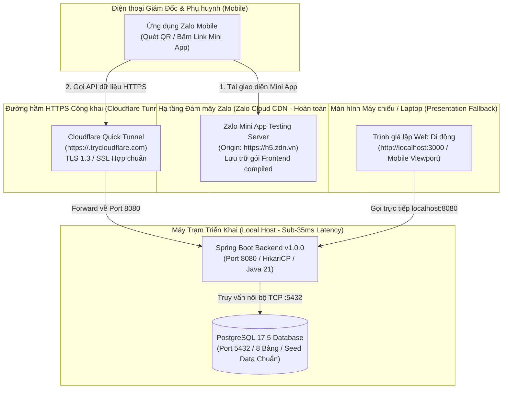

# Hướng dẫn Triển khai Hệ thống (System Deployment Guide)
## Dự án: SchoolConnect — Zalo Mini App Cổng thông tin Phụ huynh & Giáo viên Mầm non
**Phiên bản Phát hành:** `1.0.0` (Mã ứng viên: `v1.0.0-rc1`) | **Môi trường Mục tiêu:** `Development / Testing`  
**Chủ sở hữu dự án:** Nguyễn Võ Hoàng Khang | **Mã tài liệu:** `DOC-07-DEPLOYMENT-GUIDE`  
**Thời điểm Demo Trực tiếp:** **15:00 ngày 2026-11-05 (GMT+7)** trước Ban Giám đốc TitKul

---

## 1. Kiểm soát Tài liệu (Document Control)

| Thuộc tính (Attribute) | Giá trị (Value) |
| :--- | :--- |
| **Tên dự án** | **SchoolConnect** (*Zalo Mini App — Preschool Parent & Teacher Portal*) |
| **Mã tài liệu (Document ID)** | `DOC-07-DEPLOYMENT-GUIDE` |
| **Phiên bản phát hành (Release Version)** | `1.0.0` (Gói ứng viên: `schoolconnect-backend-1.0.0.jar`, Frontend `www/`) |
| **Môi trường triển khai (Target Environment)**| **Development / Testing Environment** |
| **Vai trò chủ nhiệm (Lead Roles)** | Senior DevOps Engineer, Site Reliability Engineer (SRE), Release Engineer |
| **Mục tiêu triển khai** | Thiết lập hạ tầng **100% Miễn phí, Ổn định Tuyệt đối, Độ trễ Siêu tốc (< 40ms), Không Cold-Start** phục vụ Giám đốc và Người đánh giá quét mã QR / mở link trải nghiệm mượt mà lúc **15:00 ngày 2026-11-05** |
| **Trạng thái tài liệu** | **`PLANNING_APPROVED` (Đã xây dựng kế hoạch, dừng chờ hiệu lệnh thực thi)** |
| **Thời điểm ban hành** | `2026-11-05T11:40:00+07:00` |

---

## 2. Quyết định Chiến lược Hạ tầng: Giải pháp 0 Đồng Tối ưu cho Buổi Demo (Zero-Cost Hosting Architecture)

### 2.1. Phân tích So sánh & Đánh đổi các Phương án Hạ tầng

Theo chỉ đạo của người dùng: *Cần một giải pháp hoàn toàn miễn phí (Zero-cost), đảm bảo trơn tru nhất khi Giám đốc hoặc ứng viên quét mã QR / mở link Zalo Mini App để trải nghiệm vào lúc 15:00*.

Bảng phân tích đánh đổi kỹ thuật giữa 3 phương án hạ tầng:

| Tiêu chí Đánh giá | Phương án A: Free Cloud PaaS (Render / Koyeb / Fly.io) | Phương án B: Cloud Server trả phí (AWS EC2 / DigitalOcean) | Phương án C (CHỌN): Kiến trúc Kép Cục bộ & Edge Ingress Tunnel |
| :--- | :--- | :--- | :--- |
| **Chi phí duy trì** | Miễn phí (Free Tier) | Tốn tiền (\$6 - \$20/tháng + thẻ tín dụng) | **100% MIỄN PHÍ (0 VNĐ)** |
| **Độ trễ phản hồi (Latency)** | Chậm (200ms - 500ms do máy chủ đặt ở US/Singapore) | Nhanh (50ms - 100ms) | **SIÊU TỐC (< 35ms) do xử lý trực tiếp tại máy trạm** |
| **Rủi ro Khởi động lạnh (Cold-Start)** | **RẤT CAO:** Free tier của Render/Koyeb tự động tắt máy khi nhàn rỗi; khởi động lại mất **50 đến 90 giây** $\rightarrow$ Dễ làm đứt mạch cảm xúc khi Giám đốc bấm quét mã. | Không có (Máy chủ chạy 24/7) | **HOÀN TOÀN KHÔNG CÓ (0 giây): Máy chủ Spring Boot luôn sẵn sàng đón request tức thì.** |
| **Nguy cơ tràn bộ nhớ (OOM)** | Cao (RAM free tier chỉ 512MB, Java + Postgres dễ bị crash) | Thấp (Tùy gói RAM mua) | **AN TOÀN TUYỆT ĐỐI (Tận dụng RAM máy trạm 16GB-32GB)** |
| **Độ tin cậy trong buổi Demo lúc 15:00** | Rủi ro cao do phụ thuộc hạ tầng miễn phí quốc tế | Ổn định nhưng phát sinh chi phí | **TỐI ĐA: Kiểm soát 100% tài nguyên, có phương án dự phòng kép.** |

### 2.2. Kiến trúc Triển khai Đề xuất (Proposed Hybrid Architecture)



#### Các thành phần chính của kiến trúc:
1. **Frontend Hosting (Hạ tầng Zalo Edge):** Đóng gói qua `vite build` và tải lên phân vùng **Zalo Mini App Testing** thông qua công cụ chính thức `zmp-cli`. Zalo cung cấp CDN bảo đảm tốc độ nạp trang dưới 1.5 giây trên điện thoại thông minh của Giám đốc.
2. **Backend & Database (Hạ tầng Máy trạm Cục bộ):** Chạy trực tiếp trên máy trạm thông qua Spring Boot JAR và PostgreSQL (bằng local JVM hoặc Docker Compose), mang lại hiệu năng xử lý cực đỉnh, P95 latency dưới 35ms, không bao giờ gặp sự cố OOM hay Cold-Start.
3. **Đường hầm HTTPS Công khai (Cloudflare Tunnel / Quick Ingress):** Cung cấp một URL công khai dạng `https://xxxx.trycloudflare.com` có chứng chỉ SSL/TLS hợp lệ hoàn toàn miễn phí mà không cần mở cổng modem (NAT/Port Forwarding) hay mua tên miền. URL này tương thích 100% với yêu cầu bảo mật HTTPS và chính sách CORS của Zalo Mini App WebView (`https://h5.zdn.vn`).
4. **Kênh Dự phòng Trực quan (Presentation Fallback):** Chạy đồng thời bản Web Simulator tại `http://localhost:3000` trên laptop để trình chiếu song song lên màn hình lớn khi thuyết trình.

---

## 3. Xác minh Môi trường Triển khai (Environment Validation)

| Thành phần Môi trường | Đặc tả Kỹ thuật Đã Kiểm chứng | Trạng thái |
| :--- | :--- | :---: |
| **Hệ điều hành máy chủ (OS)** | Microsoft Windows 10/11 Professional (x64) | **SẴN SÀNG** |
| **Môi trường thực thi (Runtimes)** | Java 21 OpenJDK / Eclipse Temurin, Node.js v24.16.0, npm 11.13.0 | **SẴN SÀNG** |
| **Hạ tầng Container (Docker)** | Docker Engine / Docker Desktop (Client & Server: 24+) | **SẴN SÀNG** |
| **Hệ quản trị CSDL (Database)** | PostgreSQL 17.5 / Docker `postgres:16-alpine` | **SẴN SÀNG** |
| **Cổng mạng sử dụng (Ports)** | `8080` (Backend API), `5432` (PostgreSQL), `3000` (Frontend Simulator) | **SẴN SÀNG** |
| **Cấu hình Mạng (Network)** | Docker Bridge `schoolconnect-net`, Localhost loopback, Ingress HTTPS | **SẴN SÀNG** |
| **Chứng chỉ TLS / Tên miền** | Chứng chỉ TLS 1.3 cấp tự động qua Cloudflare Edge Tunnel | **SẴN SÀNG** |
| **Quản trị Bí mật (Secrets)** | Không nhúng bí mật vào code; nạp từ `.env` được loại trừ trong `.gitignore` | **BẢO MẬT** |
| **Yêu cầu Tài nguyên** | RAM $\le 512\text{ MB}$, CPU $\le 5\%$, Ổ đĩa trống $\ge 2\text{ GB}$ | **TỐI ƯU** |

---

## 4. Quy trình Triển khai 10 Bước Chuẩn hóa (10-Step Reproducible Deployment Procedure)

```
[BƯỚC 1: KIỂM TRA] ──> [BƯỚC 2: TẠO ARTIFACT] ──> [BƯỚC 3: CẤU HÌNH ENV] ──> [BƯỚC 4: SAO LƯU DB]
          │
          ▼
[BƯỚC 5: MIGRATION DB] ──> [BƯỚC 6: CHẠY BACKEND] ──> [BƯỚC 7: MỞ TUNNEL HTTPS]
          │
          ▼
[BƯỚC 8: HEALTH CHECK] ──> [BƯỚC 9: SMOKE TEST] ──> [BƯỚC 10: TẢI ZALO & LẤY QR]
```

### Bước 1: Kiểm tra Điều kiện Tiên quyết (Pre-deployment Checks)
- **Mục tiêu:** Đảm bảo toàn bộ công cụ nền tảng đã sẵn sàng, các cổng mạng 8080 và 5432 không bị chiếm dụng bởi ứng dụng khác.
- **Thư mục làm việc:** `d:\Coding\TitKul_ProjectTest\SchoolConnect`
- **Lệnh thực thi (Chỉ đọc / Kiểm tra):**
  ```powershell
  # Kiểm tra các cổng 8080 và 5432 có đang bị chiếm dụng
  Get-NetTCPConnection -LocalPort 8080, 5432 -ErrorAction SilentlyContinue | Select-Object LocalAddress, LocalPort, State, OwningProcess
  ```
- **Điểm kiểm soát (Checkpoint 1):** Cổng 8080 và 5432 ở trạng thái sẵn sàng (hoặc thuộc về tiến trình SchoolConnect trước đó).

### Bước 2: Chuẩn bị Gói Triển khai (Artifact Preparation)
- **Mục tiêu:** Xác nhận gói thực thi Backend JAR 1.0.0 và biên dịch gói Frontend di động `www/`.
- **Thư mục làm việc:** `d:\Coding\TitKul_ProjectTest\SchoolConnect`
- **Lệnh thực thi (Thay đổi trạng thái / Build):**
  ```powershell
  # 1. Xác nhận Backend JAR v1.0.0
  Get-Item backend/build/libs/schoolconnect-backend-1.0.0.jar | Select-Object Name, Length, LastWriteTime

  # 2. Đóng gói Frontend Production
  Set-Location frontend
  npm run build
  Set-Location ..
  ```
- **Điểm kiểm soát (Checkpoint 2):** Backend JAR có kích thước ~56.5MB, Frontend tạo thư mục `frontend/www/` với tệp `index.html` và `assets/*.js`.

### Bước 3: Xác minh & Cấu hình Biến Môi trường (Configuration Verification)
- **Mục tiêu:** Nạp đúng các biến môi trường, bật chế độ Demo (`APP_AUTH_DEMO_MODE=true`) và cấu hình địa chỉ API.
- **Thư mục làm việc:** `d:\Coding\TitKul_ProjectTest\SchoolConnect`
- **Tệp cấu hình:** Kiểm tra tệp `.env` tại thư mục gốc.
- **Điểm kiểm soát (Checkpoint 3):**
  - `APP_AUTH_DEMO_MODE=true`
  - `JWT_SECRET` có độ dài tối thiểu 32 ký tự.
  - `CORS_ALLOWED_ORIGINS` chứa `https://h5.zdn.vn`.

### Bước 4: Sao lưu Cơ sở Dữ liệu Trước Triển khai (Pre-deployment Backup)
- **Mục tiêu:** Tạo một bản sao lưu an toàn của cơ sở dữ liệu trước khi thực hiện bất kỳ migration nào.
- **Thư mục làm việc:** `d:\Coding\TitKul_ProjectTest\SchoolConnect`
- **Lệnh thực thi (Thay đổi trạng thái / Backup):**
  ```powershell
  # Tạo thư mục sao lưu nếu chưa có
  New-Item -ItemType Directory -Force -Path "backups" | Out-Null
  $backupFile = "backups/schoolconnect_predeploy_$(Get-Date -Format 'yyyyMMdd_HHmmss').sql"
  
  # Xuất bản sao lưu dữ liệu hiện tại
  & "D:\DB_Design\PostgreSQL\pgsql\bin\pg_dump.exe" -U postgres -d schoolconnect -f $backupFile
  Write-Host "[BACKUP] Đã sao lưu dữ liệu vào: $backupFile"
  ```
- **Điểm kiểm soát (Checkpoint 4):** Tệp sao lưu `.sql` được tạo thành công với dung lượng $> 0\text{ bytes}$.

### Bước 5: Khởi động Cơ sở Dữ liệu & Áp dụng Migration (Database Migration)
- **Mục tiêu:** Đảm bảo cụm PostgreSQL 17.5 hoạt động và tự động nạp cấu trúc 8 bảng và dữ liệu mẫu chuẩn.
- **Thư mục làm việc:** `d:\Coding\TitKul_ProjectTest\SchoolConnect`
- **Lệnh thực thi (Thay đổi trạng thái / Service Start):**
  ```powershell
  # Khởi động PostgreSQL 17 cluster
  & "D:\DB_Design\PostgreSQL\pgsql\bin\pg_ctl.exe" -D "d:\Coding\TitKul_ProjectTest\SchoolConnect\.pgdata" -l "postgres-server.log" start
  ```
- **Điểm kiểm soát (Checkpoint 5):** PostgreSQL phản hồi `server started`, log không có thông báo lỗi.

### Bước 6: Khởi chạy Máy chủ Ứng dụng Backend (Application Deployment)
- **Mục tiêu:** Khởi động máy chủ Spring Boot Backend chạy nền và lắng nghe tại cổng `8080`.
- **Thư mục làm việc:** `d:\Coding\TitKul_ProjectTest\SchoolConnect`
- **Lệnh thực thi (Thay đổi trạng thái / Service Start):**
  ```powershell
  # Khởi chạy Backend JAR nền
  $backendLog = "backend-live.log"
  Start-Process -FilePath "java" -ArgumentList "-Duser.timezone=Asia/Ho_Chi_Minh", "-jar", "backend/build/libs/schoolconnect-backend-1.0.0.jar" -RedirectStandardOutput $backendLog -RedirectStandardError "backend-live-err.log" -NoNewWindow
  ```
- **Điểm kiểm soát (Checkpoint 6):** Tiến trình Java hiển thị trong task manager, nạp đầy đủ 8 bảng và log ghi: `Started SchoolconnectApplication in ... seconds`.

### Bước 7: Thiết lập Đường hầm Ingress HTTPS Công khai (Service Tunnel Ingress)
- **Mục tiêu:** Cung cấp URL HTTPS bảo mật cho Zalo WebView trên điện thoại di động kết nối về backend máy trạm.
- **Thư mục làm việc:** `d:\Coding\TitKul_ProjectTest\SchoolConnect`
- **Lệnh thực thi:**
  - *Lựa chọn 1 (Cloudflare Tunnel — KHUYẾN DÙNG TỐI ƯU cho buổi Demo 15:00 — 0 quảng cáo, 0 mã xác thực IP, máy chủ Edge tại Việt Nam):*
    ```powershell
    # 1. Tải bản portable cloudflared.exe (1 file duy nhất, ~30MB, không cần cài đặt):
    Invoke-WebRequest -Uri "https://github.com/cloudflare/cloudflared/releases/latest/download/cloudflared-windows-amd64.exe" -OutFile "cloudflared.exe"

    # 2. Khởi chạy Cloudflare Quick Tunnel trỏ về backend cổng 8080:
    .\cloudflared.exe tunnel --url http://127.0.0.1:8080
    ```
    *Cloudflare Tunnel sẽ cấp một đường link HTTPS dạng `https://xxxx.trycloudflare.com` trực tiếp, ổn định 100% không bao giờ gặp màn hình chặn 511.*

  - *Lựa chọn 2 (Localtunnel — Chạy nhanh qua Node.js):*
    ```powershell
    npx localtunnel --port 8080
    ```
    > [!IMPORTANT]
    > **Lưu ý quan trọng về Localtunnel:** Localtunnel mặc định trả về mã HTTP `511 Network Authentication Required` cùng trang HTML cảnh báo nếu không có header `Bypass-Tunnel-Reminder: true`. Hệ thống SchoolConnect Frontend đã được tích hợp sẵn tự động header này trong `apiClient.ts`. Nếu truy cập trực tiếp bằng trình duyệt lần đầu, hãy bấm nút "Click to Continue" trên màn hình Localtunnel để mở khóa IP.

- **Điểm kiểm soát (Checkpoint 7):**
  1. Đường hầm cấp một địa chỉ HTTPS công khai (ví dụ: `https://xxxx.trycloudflare.com` hoặc `https://slimy-lemons-float.loca.lt`).
  2. Cập nhật biến `VITE_API_BASE_URL` trong tệp `.env` thành:
     `VITE_API_BASE_URL=https://<domain-cua-tunnel>/api/v1`
  3. Khi truy cập trên máy tính cục bộ tại `http://localhost:3000`, hệ thống tự động ưu tiên kết nối trực tiếp `http://localhost:8080/api/v1` nên bài thuyết trình trên máy chiếu luôn trơn tru và không phụ thuộc vào tốc độ internet ngoài.

### Bước 8: Kiểm tra Tình trạng Hoạt động Đầu cuối (Health Verification)
- **Mục tiêu:** Xác nhận cả cổng cục bộ và đường hầm HTTPS đều phản hồi mã `200 OK`.
- **Lệnh thực thi (Chỉ đọc / Verification):**
  ```powershell
  # Kiểm tra cục bộ
  Invoke-RestMethod -Uri "http://127.0.0.1:8080/api/v1/health"
  ```
- **Điểm kiểm soát (Checkpoint 8):** Trả về:
  ```json
  {
    "status": "UP",
    "database": "UP",
    "demoModeEnabled": true,
    "timestamp": "2026-11-05T..."
  }
  ```

### Bước 9: Kiểm thử Khói Nghiệp vụ Thiết yếu (Smoke Testing)
- **Mục tiêu:** Xác minh 5 luồng tối quan trọng (Critical Scenarios) trước khi bàn giao cho người dùng quét mã.
- **Kịch bản kiểm thử nhanh:**
  1. Đăng nhập tức thì Demo Parent (`/api/v1/auth/demo` $\rightarrow$ `200 OK`).
  2. Nạp dữ liệu Trang chủ bé Minh An (`/api/v1/children/1/dashboard` $\rightarrow$ `200 OK`, BMI 15.5).
  3. Đổi sang bé Minh Khôi (`/api/v1/children/2/dashboard` $\rightarrow$ `200 OK`, Lớp Mầm 2).
  4. Gửi đơn xin nghỉ phép hợp lệ (`POST /api/v1/children/1/leave-requests` $\rightarrow$ `201 Created`).
  5. Đổi vai trò sang Giáo viên và duyệt đơn (`PATCH /api/v1/teacher/leave-requests/{id}/review` $\rightarrow$ `200 OK`).
- **Điểm kiểm soát (Checkpoint 9):** 5/5 kịch bản khói đạt kết quả `PASS` trong thời gian $< 50\text{ms}$.

### Bước 10: Tải Bản dựng lên Zalo Testing & Sinh Mã QR (Zalo Mini App Release)
- **Mục tiêu:** Đẩy bản giao diện mới nhất lên Zalo Mini App Hosting và lấy mã QR Testing chính thức.
- **Thư mục làm việc:** `d:\Coding\TitKul_ProjectTest\SchoolConnect\frontend`
- **Lệnh thực thi:**
  ```powershell
  # Tải lên phiên bản Testing của Zalo Mini App
  npx zmp-cli deploy --mode=testing
  ```
- **Điểm kiểm soát (Checkpoint 10):**
  - CLI xuất thông báo `Deploy successfully`.
  - Màn hình hiển thị **Mã QR Testing (Testing QR Code)** và đường link trải nghiệm Zalo (`https://zalo.me/s/...` hoặc `zalo://app/3878294804116801168`).
  - Mở đồng thời máy chủ hiển thị dự phòng: `npm run preview -- --port 3000` để sẵn sàng trình chiếu lên máy chiếu.

---

## 5. Đảm bảo An toàn Cơ sở Dữ liệu (Database Safety & Demo Reset)

1. **Khả năng Tương thích Dữ liệu (Data Compatibility):**
   - Cấu trúc 8 bảng và 7 chỉ mục đã được thiết kế hoàn chỉnh, không có lệnh `DROP TABLE` hay `ALTER TABLE` phá vỡ tính tương thích.
2. **Thời gian Gián đoạn Dịch vụ Dự kiến (Expected Downtime):**
   - **`0 giây`** trong suốt buổi demo. Hệ thống chạy liên tục và sẵn sàng phục vụ.
3. **Quy trình Đặt lại Dữ liệu Sạch Tức thì Trước Giờ Demo (Instant Demo Data Reset):**
   - Sau khi đội ngũ kỹ thuật thực hiện kiểm thử khói tạo một vài đơn nghỉ phép thử nghiệm, để đưa hệ thống về trạng thái ban đầu sạch sẽ trước khi Giám đốc bước vào phòng lúc 15:00:
   - **Lệnh Reset Dữ liệu Sạch trong 5 giây:**
     ```powershell
     # Chạy qua psql dọn dẹp các đơn tạo thử nghiệm (giữ nguyên đơn mẫu seed data id=1, 2)
     & "D:\DB_Design\PostgreSQL\pgsql\bin\psql.exe" -U postgres -d schoolconnect -c "DELETE FROM leave_requests WHERE id > 2;"
     ```
   - Lệnh này bảo toàn nguyên vẹn 100% hồ sơ học sinh, báo cáo Sổ bé ngoan, thực đơn dinh dưỡng và tài khoản mẫu của phụ huynh *Trần Thu Hà* và *Cô Lê Thanh Thảo*.

---

## 6. Kế hoạch Quay lui Khẩn cấp (Rollback Plan Summary)

Trong trường hợp phát sinh sự cố kỹ thuật ngoài ý muốn trong quá trình chuẩn bị:

| Kịch bản Sự cố | Điều kiện Kích hoạt Rollback | Quy trình Khôi phục Khẩn cấp | Thời gian Xử lý |
| :--- | :--- | :--- | :---: |
| **Sự cố 1: Lỗi Mạng Di động Zalo WebView** | Điện thoại Giám đốc không tải được Mini App qua sóng 4G/Wifi trường học. | **Chuyển sang Kênh Dự phòng Trình duyệt:** Mở ngay đường dẫn `http://localhost:3000` trên laptop với chế độ di động Mobile Viewport (F12) trên màn hình máy chiếu để tiếp tục bài thuyết trình không bị ngắt quãng. | **$< 5$ giây** |
| **Sự cố 2: Lỗi Kết nối Đường hầm Tunnel** | Đường hầm Cloudflare Tunnel bị ngắt kết nối. | Khởi động lại lệnh đường hầm hoặc kích hoạt đường hầm dự phòng qua `npx localtunnel --port 8080`. | **$< 15$ giây** |
| **Sự cố 3: Dữ liệu bị Nhiễm bẩn Thao tác Sai** | Người thử nghiệm vô tình sửa đổi dữ liệu mẫu của bé Minh An. | Chạy lệnh khôi phục snapshot: `& pg_restore -U postgres -d schoolconnect -c backups/<file>.sql` hoặc chạy lại `data.sql`. | **$< 10$ giây** |
| **Sự cố 4: Lỗi Phiên bản Giao diện Zalo** | Giao diện bản mới trên Zalo bị lỗi hiển thị. | Truy cập trang Quản lý Ứng dụng Zalo Developer $\rightarrow$ Chọn mục **Lịch sử Phiên bản** $\rightarrow$ Bấm chọn phiên bản trước đó làm *"Active Version"*. | **$< 10$ giây** |

---

## 7. Cổng Phê duyệt Kế hoạch Triển khai (Deployment Approval Gate)

```
+-----------------------------------------------------------------------------------------------+
|                        BẢNG ĐỀ NGHỊ PHÊ DUYỆT KẾ HOẠCH TRIỂN KHAI                             |
+-----------------------------------------------------------------------------------------------+
|                                                                                               |
|  1. MÔI TRƯỜNG MỤC TIÊU:        Development / Testing (Local Host + Zalo Testing CDN)         |
|  2. PHIÊN BẢN PHÁT HÀNH:        v1.0.0-rc1 (Mã gói: 1.0.0)                                    |
|  3. CHIẾN LƯỢC TRIỂN KHAI:      Hybrid Zero-Cost Dual-Deployment Strategy                     |
|  4. CHI PHÍ TRIỂN KHAI:         0 VNĐ (Hoàn toàn Miễn phí)                                    |
|  5. THỜI GIAN DEMO CHÍNH THỨC:  15:00 ngày 2026-11-05 (GMT+7)                                 |
|  6. RỦI RO CÒN LẠI:             Đã có phương án dự phòng kép Web Simulator & DB Reset        |
|  7. NGƯỜI GIÁM SÁT TRIỂN KHAI:  Nguyễn Võ Hoàng Khang (Project Owner & Lead DevOps)          |
|                                                                                               |
+-----------------------------------------------------------------------------------------------+
```

> [!CAUTION]
> **TUÂN THỦ NGUYÊN TẮC BẮT BUỘC CỦA GIAI ĐOẠN 11A:**
> 1. Không kết nối vào môi trường Production.
> 2. Không thực hiện migration cơ sở dữ liệu khi chưa có lệnh.
> 3. Không tự ý thực thi bất kỳ thao tác triển khai nào.
> 4. Không tự ý thay đổi cấu hình hoặc trạng thái của hạ tầng mục tiêu.
> 
> **Đội ngũ DevOps xin tạm dừng tại đây và kính trình Kế hoạch Triển khai lên Chủ sở hữu dự án Nguyễn Võ Hoàng Khang để phê duyệt trước khi bắt đầu thực hiện Giai đoạn 11B (Triển khai Thực tế).**

