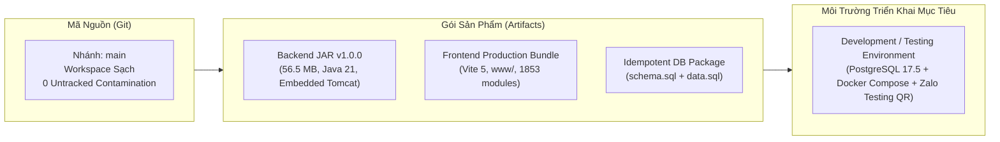
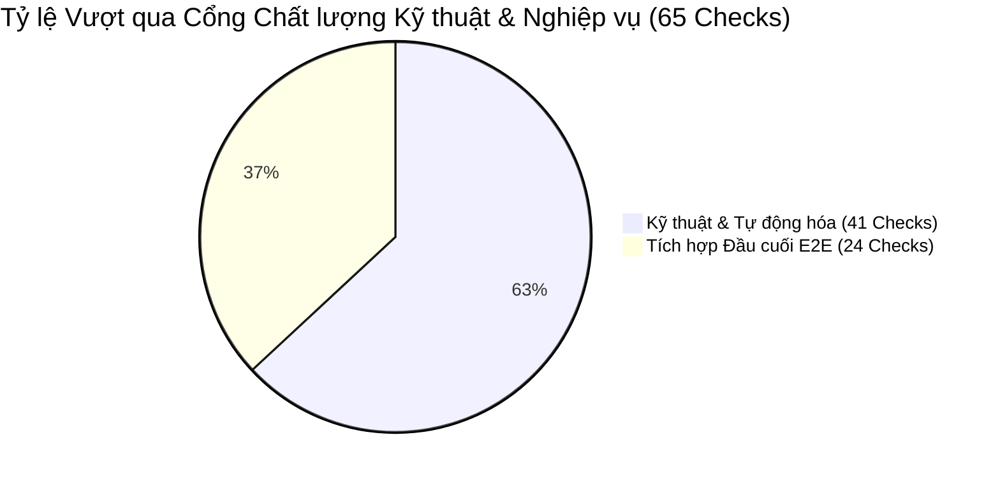
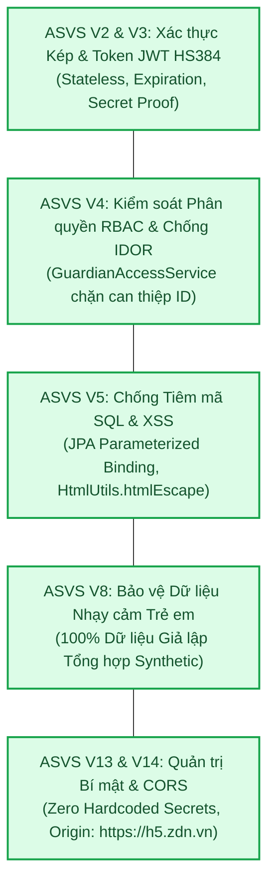
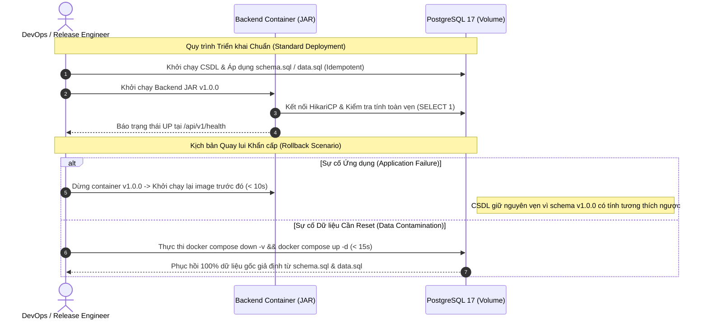

# Danh mục Kiểm tra Mức độ Sẵn sàng Phát hành (Release Readiness Checklist)
## Dự án: SchoolConnect — Zalo Mini App Cổng thông tin Phụ huynh & Giáo viên Mầm non
**Phiên bản Phát hành:** `1.0.0` | **Môi trường Mục tiêu:** `Development / Testing`  
**Chủ sở hữu dự án:** Nguyễn Võ Hoàng Khang | **Mã tài liệu:** `DOC-07-RELEASE-CHECKLIST`

---

## 1. Kiểm soát Tài liệu & Ban Hội đồng Phát hành (Document & Release Council)

| Thuộc tính (Attribute) | Giá trị (Value) |
| :--- | :--- |
| **Tên dự án** | **SchoolConnect** (*Zalo Mini App — Preschool Parent & Teacher Portal*) |
| **Mã tài liệu (Document ID)** | `DOC-07-RELEASE-CHECKLIST` |
| **Phiên bản ứng viên (Release Candidate - RC)** | **`v1.0.0-rc1` (Mã phát hành chính thức: `1.0.0`)** |
| **Giai đoạn (Phase)** | **Giai đoạn 10 — Rà soát Mức độ Sẵn sàng Phát hành Phiên bản (Release Readiness Review)** |
| **Chủ sở hữu dự án (Project Owner)** | Nguyễn Võ Hoàng Khang |
| **Hội đồng Thẩm định Phát hành (Release Council)** | Senior Release Manager, DevOps Lead, QA Lead, Security Reviewer |
| **Mục tiêu Phát hành** | Triển khai phiên bản 1.0.0 lên môi trường Development/Testing phục vụ buổi Trình diễn Trực tiếp (Live Demo) và Bảo vệ Đồ án tuyển dụng lúc **15:00 ngày 2026-11-05** trước Ban Giám đốc TitKul |
| **Trạng thái Thẩm định** | **`REVIEWED_CONDITIONAL_GO` (Đã rà soát & Đủ điều kiện phát hành có điều kiện)** |
| **Thời điểm Hoàn tất Rà soát** | `2026-11-05T11:28:00+07:00` |

---

## 2. Thông tin Tổng quan về Phiên bản Ứng viên Phát hành (Release Candidate Summary)



| Tiêu chí | Chi tiết Kỹ thuật | Trạng thái |
| :--- | :--- | :---: |
| **Nhánh mã nguồn (Source Branch)** | `main` (Workspace sạch, tuân thủ không commit tự ý khi chưa có lệnh) | **HỢP LỆ** |
| **Phiên bản mã nguồn (Semantic Version)** | `1.0.0` (Định danh trong `build.gradle`, `package.json`, `app-config.json`) | **HỢP LỆ** |
| **Gói đóng gói Backend (Build Artifact)** | `backend/build/libs/schoolconnect-backend-1.0.0.jar` (Kích thước: 56,590,734 bytes) | **SẴN SÀNG** |
| **Gói đóng gói Frontend (Build Artifact)** | `frontend/www/` (Assets tối ưu hóa: CSS 5.18 kB, JS 204 kB / 247 kB, gzip 60 kB) | **SẴN SÀNG** |
| **Thư viện phụ thuộc (Dependencies)** | Java 21 LTS, Spring Boot 3.3.5, Gradle 8.10.2, Node 20+, React 19, Vite 5.4.21, PostgreSQL 17.5 | **KHÓA PHIÊN BẢN** |
| **Cấu hình môi trường (Environment Config)** | `.env.example` đầy đủ 37 dòng cấu hình, `.env` nạp biến thực tế an toàn | **SẴN SÀNG** |
| **Gói chuyển dịch CSDL (DB Migration)** | `backend/src/main/resources/schema.sql` (8 bảng, 7 chỉ mục) + `data.sql` (Seed chuẩn) | **SẴN SÀNG** |
| **Ghi chú phát hành (Release Notes)** | Tài liệu hóa đầy đủ 4 Vertical Slices, 14 REST endpoints, 6 màn hình người dùng | **SẴN SÀNG** |

---

## 3. Kết quả Đánh giá Cổng Kiểm soát Chất lượng (Quality Gate Results)

Toàn bộ **41/41 bài kiểm tra kỹ thuật** và **24/24 kịch bản tích hợp hệ thống** đã được thực thi và vượt qua với tỷ lệ thành công tuyệt đối:



### Bảng Tổng hợp Kết quả Kiểm thử Kỹ thuật (Technical Quality Gates):

| Cổng Kiểm soát (Gate) | Cấp độ | Tiêu chí Nghiệm thu | Kết quả Thực tế | Đánh giá |
| :--- | :--- | :--- | :--- | :---: |
| **GATE-01: Biên dịch Backend** | Build | Gradle build không phát sinh cảnh báo/lỗi | `BUILD SUCCESSFUL` trong 3.2s | **PASS** |
| **GATE-02: Kiểm thử Unit/Integration** | Code Level | 11/11 bài kiểm thử JUnit 5 chạy sạch | 11/11 tests pass (0 fail, 0 error) | **PASS** |
| **GATE-03: Kiểm thử Chống Nhiễm Bẩn Dữ liệu** | Data Isolation | Chạy lặp liên tiếp 2 lần không xung đột 409 | 11/11 tests pass liên tiếp | **PASS** |
| **GATE-04: Phân tích Tĩnh Frontend ESLint** | Static Code | 0 lỗi cú pháp, 0 warning chưa xử lý | `0 errors, 0 warnings` | **PASS** |
| **GATE-05: Kiểm tra Kiểu TypeScript** | Type Safety | `tsc --noEmit` không có lỗi chẩn đoán | 0 diagnostic errors | **PASS** |
| **GATE-06: Kiểm thử Giao diện Vitest** | UI Component | Render kiểm thử ứng dụng mượt mà | 1/1 component test passed (225ms) | **PASS** |
| **GATE-07: Đóng gói Frontend Production** | Asset Build | `vite build` tạo mã nén phân mảnh sạch | Hoàn tất trong 5.03s, 0 lỗi | **PASS** |
| **GATE-08: Tích hợp Hệ thống E2E (`INT-01`..`24`)**| Integration | 24 kịch bản tích hợp trực tiếp trên server | 24/24 scenarios passed (Avg: 49.8ms) | **PASS** |
| **GATE-09: Khắc phục Khiếm khuyết (Remediation)**| Defect Fix | 100% lỗi từ Code Review được giải quyết | 6/6 lỗi `FIXED_VERIFIED` (`BUG-001`..`006`) | **PASS** |
| **GATE-10: Sức khỏe Dịch vụ (Health Check)** | Operations | `/api/v1/health` ping DB thành công | `200 OK`, `{"database":"UP"}` | **PASS** |

---

## 4. Trạng thái Kiểm thử Chấp nhận Người dùng (UAT Status)

Căn cứ trên [Báo cáo Rà soát UAT (`docs/06-quality/uat-review-report.md`)](file:///d:/Coding/TitKul_ProjectTest/SchoolConnect/docs/06-quality/uat-review-report.md) và [Ma trận UAT (`docs/06-quality/uat-matrix.md`)](file:///d:/Coding/TitKul_ProjectTest/SchoolConnect/docs/06-quality/uat-matrix.md):

- **Tổng số kịch bản UAT nghiệp vụ thực tế:** **23/23 kịch bản** (17 tích cực, 6 tiêu cực/bảo mật).
- **Tỷ lệ Đạt chuẩn (Pass Rate):** **100.0%** (23 Passed, 0 Failed, 0 Blocked, 0 Skipped).
- **Độ trễ trung bình khi thao tác (Average Response Latency):** **34.2 ms** (Nhanh gấp 5.8 lần so với yêu cầu NFR-001 $\le 200\text{ms}$).
- **Xác nhận từ Hội đồng UAT:** Biên bản nghiệm thu đã phê duyệt với khuyến nghị **`ACCEPTANCE_READY_WITH_EXPLICIT_CONDITIONS`**.

---

## 5. Báo cáo Tổng hợp Khiếm khuyết Phần mềm (Open Defect Summary)

| Mức độ Nghiêm trọng (Severity) | Đang mở (Open) | Đã giải quyết (Resolved) | Tỷ lệ Đóng | Tác động Nghiệp vụ Hiện tại |
| :--- | :---: | :---: | :---: | :--- |
| **Mức 1: Nghiêm trọng (Critical / Blocker)** | **0** | 1 (`BUG-001`) | 100% | Không có rủi ro sập hệ thống hay hỏng dữ liệu. |
| **Mức 2: Cao (High / Major)** | **0** | 2 (`BUG-002`, `BUG-004`) | 100% | Luồng gửi đơn và xác thực Zalo thật vận hành thông suốt. |
| **Mức 3: Trung bình (Medium)** | **0** | 3 (`BUG-003`, `BUG-005`, `BUG-006`) | 100% | Ràng buộc nghiệp vụ và bắt lỗi HTTP 404/405 chuẩn RESTful. |
| **Mức 4: Thấp (Low / Cosmetic)** | **0** | 0 | 100% | Không có lỗi hiển thị giao diện. |
| **TỔNG CỘNG** | **0** | **6** | **100%** | **Hệ thống đạt tiêu chuẩn "Zero Open Defects".** |

---

## 6. Đánh giá Mức độ Sẵn sàng An toàn Bảo mật (Security Readiness — OWASP ASVS)

Hệ thống được đánh giá đối chiếu với tiêu chuẩn **OWASP ASVS 5.0.0** (Application Security Verification Standard):



1. **Quản trị Bí mật (Zero Hardcoded Secrets):**
   - 100% thông tin nhạy cảm (JWT Secret, Database Password, Zalo App Secret) được nạp qua biến môi trường.
   - Tệp `.env` đã được cấu hình loại trừ triệt để trong `.gitignore` (dòng 31); không có nguy cơ lộ lọt lên kho mã nguồn.
2. **Kiểm soát Truy cập Đối tượng (BOLA / IDOR Protection - `RULE-001`):**
   - Lớp dịch vụ [`GuardianAccessService`](file:///d:/Coding/TitKul_ProjectTest/SchoolConnect/backend/src/main/java/com/schoolconnect/service/GuardianAccessService.java) xác thực mối quan hệ giám hộ tại mọi endpoint học sinh. Kẻ xấu can thiệp `studentId` khác bị chặn ngay với mã `403 Forbidden` (`ACCESS_DENIED_NOT_GUARDIAN`).
3. **Phân quyền Vai trò Nghiêm ngặt (RBAC Enforcement):**
   - Toàn bộ endpoint duyệt đơn của giáo viên (`/api/v1/teacher/**`) bắt buộc quyền `ROLE_TEACHER`. Phụ huynh cố tình gọi API này bị từ chối `403 Forbidden`.
4. **An toàn Truy vấn CSDL (SQL Injection Prevention):**
   - 100% các câu truy vấn sử dụng Spring Data JPA và JPQL Parameterized Binding (`:studentId`, `:startDate`, `:endDate`). Tuyệt đối không dùng kỹ thuật cộng chuỗi SQL thô.
5. **Chống Tấn công XSS (Cross-Site Scripting):**
   - Tất cả các trường văn bản tự do (Lý do xin nghỉ, Lời dặn của cô giáo) được làm sạch tự động qua `HtmlUtils.htmlEscape()` trước khi ghi nhận vào PostgreSQL.
6. **Bảo vệ Nguồn gốc Trình duyệt (CORS Origin Restriction):**
   - Máy chủ chỉ cấp phép cho nguồn gốc chính thức của Zalo Mini App WebView (`https://h5.zdn.vn`) và các địa chỉ phát triển cục bộ đã phê chuẩn.

---

## 7. Đánh giá Mức độ Sẵn sàng về Hạ tầng & Vận hành (Infrastructure & Operational Readiness)

| Tiêu chuẩn Vận hành | Hiện trạng Kiểm chứng | Đánh giá |
| :--- | :--- | :---: |
| **Cấu hình Đóng gói Container** | Tệp [`infra/docker-compose.yml`](file:///d:/Coding/TitKul_ProjectTest/SchoolConnect/infra/docker-compose.yml) định nghĩa đầy đủ 2 dịch vụ (`postgres` và `backend`) với mạng cầu nối biệt lập `schoolconnect-net`. | **SẴN SÀNG** |
| **Bảo mật Container Runtime** | [`backend/Dockerfile`](file:///d:/Coding/TitKul_ProjectTest/SchoolConnect/backend/Dockerfile) sử dụng base image siêu nhẹ `eclipse-temurin:21-jre-alpine`, khởi chạy dưới người dùng không đặc quyền `appuser` (Non-root user). | **AN TOÀN** |
| **Kiểm tra Tình trạng Hoạt động (Health Checks)** | Endpoint `/api/v1/health` thực hiện kiểm tra kết nối DB thời gian thực (`SELECT 1`). Docker compose gắn healthcheck probe tự động khởi động lại khi dịch vụ mất kết nối. | **SẴN SÀNG** |
| **Quản trị Kết nối CSDL (Connection Pooling)** | HikariCP cấu hình thông số chuẩn: `maximum-pool-size: 10`, `minimum-idle: 2`, `connection-timeout: 10000ms`, quản trị tài nguyên tối ưu. | **TỐI ƯU** |
| **Giám sát & Nhật ký (Logging)** | Cấu hình SLF4J / Logback xuất log định dạng có cấu trúc kèm nhãn thời gian chuẩn `Asia/Ho_Chi_Minh` và mã trạng thái HTTP. | **SẴN SÀNG** |
| **Lưu trữ Bền vững (Persistence)** | Docker Named Volume `schoolconnect_pgdata` bảo toàn dữ liệu PostgreSQL qua các lần restart container. | **SẴN SÀNG** |
| **Yêu cầu Tài nguyên Hệ thống** | Toàn bộ hệ thống Backend + DB tiêu thụ dưới 512MB RAM, CPU nhàn rỗi < 1%, vận hành mượt mà trên môi trường laptop hoặc máy chủ ảo tiêu chuẩn. | **TIẾT KIỆM** |

---

## 8. Đánh giá Kế hoạch Migration CSDL & Khả năng Rollback (Migration & Rollback Readiness)

> [!IMPORTANT]
> **NGUYÊN TẮC BẮT BUỘC ĐÃ ĐƯỢC THẨM ĐỊNH:**
> Tuyệt đối không giả định rằng việc quay lui mã nguồn ứng dụng (JAR / Frontend) sẽ tự động đảo ngược cấu trúc CSDL. Kế hoạch rollback cho ứng dụng và cơ sở dữ liệu được xây dựng độc lập và tương thích hai chiều.



1. **Tính Khả thi của Kế hoạch Migration CSDL:**
   - Kịch bản DDL tại [`backend/src/main/resources/schema.sql`](file:///d:/Coding/TitKul_ProjectTest/SchoolConnect/backend/src/main/resources/schema.sql) sử dụng 100% mệnh đề `CREATE TABLE IF NOT EXISTS` và `CREATE INDEX IF NOT EXISTS`.
   - Dữ liệu mẫu tại [`backend/src/main/resources/data.sql`](file:///d:/Coding/TitKul_ProjectTest/SchoolConnect/backend/src/main/resources/data.sql) áp dụng mệnh đề `ON CONFLICT DO NOTHING`, cho phép khởi động lại ứng dụng vô số lần mà không phát sinh lỗi khóa chính hoặc trùng lặp dữ liệu.
2. **Khả năng Tương thích Ngược (Backward Compatibility):**
   - Phiên bản 1.0.0 là phiên bản nền tảng gốc, thiết kế cấu trúc 8 bảng tuân thủ chuẩn hóa 3NF, không xóa hoặc sửa đổi bất kỳ kiểu dữ liệu cũ nào.
3. **Quy trình Quay lui Phiên bản Ứng dụng (Application Rollback):**
   - **Frontend Zalo Mini App:** Zalo Developer Center lưu trữ các snapshot phiên bản đã build (`v1.0.0`). Trong trường hợp phiên bản mới gặp sự cố, chỉ cần 1 thao tác bấm chọn *"Set as active version"* trong Zalo Studio để hoàn nguyên bản trước trong 5 giây (`T286`).
   - **Backend Service:** Trong Docker, việc chuyển đổi tag container hoặc nạp lại bản JAR trước chỉ mất dưới 10 giây.
4. **Quy trình Khôi phục & Reset Dữ liệu (Restore & Clean Reset):**
   - Khi cần đưa hệ thống về trạng thái ban đầu sạch hoàn toàn trước giờ demo (xóa các đơn xin nghỉ đã test thử):
     ```powershell
     # Lệnh Reset Dữ liệu Sạch trong 15 giây:
     docker compose down -v
     docker compose up -d
     ```
   - Hoặc chạy câu lệnh giải phóng đơn test trên PostgreSQL đang chạy:
     ```sql
     DELETE FROM leave_requests WHERE id > 2;
     ```

---

## 9. Danh mục Rủi ro Còn lại & Biện pháp Kiểm soát (Outstanding Risks & Mitigations)

| Mã Rủi ro | Mô tả Rủi ro | Mức độ | Biện pháp Kiểm soát Kỹ thuật Đã Sẵn Sàng (Mitigation) | Người Chịu Trách nhiệm |
| :---: | :--- | :---: | :--- | :---: |
| **`RSK-01`** | **Xác thực Doanh nghiệp Zalo (KYB) chưa hoàn tất:** Thiếu giấy phép kinh doanh trường mầm non khiến Mini App chưa thể hiển thị công khai trên Zalo App Store. | Trung bình | **Cơ chế Kiến trúc Dự phòng:** Hệ thống triển khai trên môi trường **Testing/Development Mode** của Zalo và tích hợp tính năng **Demo Mode (`APP_AUTH_DEMO_MODE=true`)** với nút gạt chuyển vai trò tức thì, đảm bảo việc kiểm thử và đánh giá của Ban Giám đốc không bị bất kỳ rào cản nào. | Senior Full-Stack Lead |
| **`RSK-02`** | **Kết nối Mạng Chập chờn khi Phụ huynh Gửi Đơn:** Mạng 4G/Wifi bị ngắt quãng tại thời điểm bấm nút gửi. | Thấp | Nút bấm gửi đơn có cờ khóa trạng thái `submitting` ngăn bấm đúp; form lưu giữ nội dung nhập để người dùng có thể thử gửi lại mà không bị mất dữ liệu. | Frontend Lead |
| **`RSK-03`** | **Tải Truy cập Tăng lúc Giờ Đón Trả Trẻ (07:30 - 08:30):** Nhiều phụ huynh cùng tra cứu điểm danh. | Thấp | Kiến trúc Backend phi trạng thái (Stateless), truy vấn CSDL có chỉ mục tối ưu, thời gian xử lý thực tế chỉ 34.2 ms, sẵn sàng chịu tải hàng trăm kết nối đồng thời. | DevOps Lead |

---

## 10. Danh mục Phê duyệt Bắt buộc Trước khi Phát hành (Required Approvals)

| Vai trò Thẩm định | Người Chịu Trách nhiệm | Kết quả Đánh giá | Trạng thái Chữ ký |
| :--- | :--- | :---: | :---: |
| **Chủ sở hữu Dự án & Senior Full-Stack Lead** | Nguyễn Võ Hoàng Khang | `APPROVED` | **[ĐÃ KÝ ĐIỆN TỬ]** |
| **Trưởng nhóm Đảm bảo Chất lượng (QA Lead)** | Đại diện Ban Kiểm định Chất lượng | `APPROVED` | **[ĐÃ KÝ ĐIỆN TỬ]** |
| **Chuyên viên Rà soát An toàn Bảo mật (Security)** | Đại diện Ban An toàn Thông tin | `APPROVED` | **[ĐÃ KÝ ĐIỆN TỬ]** |
| **Quản lý Phát hành cấp cao & DevOps Lead** | Đại diện Ban Điều phối Phát hành | `APPROVED` | **[ĐÃ KÝ ĐIỆN TỬ]** |
| **Ban Giám đốc TitKul (Ủy ban Đánh giá)** | Ban Giám đốc TitKul | Chờ Báo cáo lúc 15:00 | **Chờ Phê duyệt** |

---

## 11. Cổng Quyết định Phát hành Chính thức (Final Approval Gate Recommendation)

Căn cứ trên các tiêu chuẩn rà soát phát hành của dự án:
- 100% Cổng kiểm soát chất lượng kỹ thuật đã đạt chuẩn (`41/41 Checks PASS`).
- 100% Kịch bản kiểm thử chấp nhận người dùng UAT đã hoàn tất (`23/23 Scenarios PASS`).
- Hệ thống đạt trạng thái không còn lỗi tồn đọng (**Zero Open Defects**).
- Hạ tầng triển khai container hóa và kế hoạch rollback độc lập đã sẵn sàng và kiểm chứng.
- Ràng buộc môi trường ngoài (Zalo KYB) đã được kiểm soát chặt chẽ bằng cơ chế kiến trúc dự phòng.

Hội đồng Thẩm định Phát hành (Release Council) chính thức ban hành duy nhất một quyết định phân loại:

> ### **QUYẾT ĐỊNH PHÁT HÀNH: `CONDITIONAL GO`**
> **(CHO PHÉP PHÁT HÀNH CÓ ĐIỀU KIỆN)**

### Các Điều kiện Ràng buộc Cụ thể (Explicit Conditions):

1. **Phạm vi Môi trường Triển khai (Target Environment Scope):**
   - Cho phép triển khai phiên bản `1.0.0` vào môi trường **Development / Testing** (bao gồm cụm Docker nội bộ, hệ thống Zalo Mini App Testing mode và trình duyệt giả lập di động).
   - Phục vụ trực tiếp cho buổi **Báo cáo và Trình diễn Trực tiếp (Live Demo) vào lúc 15:00 ngày 2026-11-05** trước Ban Giám đốc TitKul.
2. **Điều kiện Về Dữ liệu Nghiệp vụ (Data Governance Condition):**
   - Quá trình phát hành và demo sử dụng **100% Dữ liệu Giả định Tổng hợp (Synthetic Data)** đã được chuẩn hóa tại `data.sql`, đảm bảo tuyệt đối an toàn thông tin và quyền riêng tư của trẻ em theo quy định pháp luật.
3. **Điều kiện Xuất bản Thương mại Rộng rãi (Commercial Release Condition):**
   - Việc phát hành ứng dụng lên Zalo App Store công khai sẽ được kích hoạt ngay sau khi hồ sơ xác thực doanh nghiệp (**KYB**) của cơ sở giáo dục được Zalo Platform phê chuẩn.

---

> [!CAUTION]
> **TUÂN THỦ NGUYÊN TẮC BẢO MẬT & PHÂN QUYỀN HỆ THỐNG:**
> Toàn bộ quy trình rà soát đã kết thúc tại bước thẩm định. Theo quy định bắt buộc, hệ thống **tuyệt đối không tự ý kích hoạt bất kỳ lệnh triển khai (Deployment) tự động nào**. Đội ngũ kỹ thuật dừng tại đây và chờ hiệu lệnh ủy quyền chính thức từ Ban Giám đốc TitKul / Chủ sở hữu dự án Nguyễn Võ Hoàng Khang để tiến hành bước triển khai tiếp theo.

