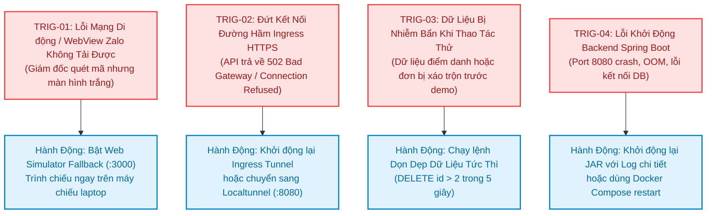

# Kế hoạch Quay lui & Khôi phục Hệ thống (System Rollback & Recovery Plan)
## Dự án: SchoolConnect — Zalo Mini App Cổng thông tin Phụ huynh & Giáo viên Mầm non
**Phiên bản Áp dụng:** `1.0.0` | **Mã tài liệu:** `DOC-07-ROLLBACK-PLAN`  
**Chủ sở hữu dự án:** Nguyễn Võ Hoàng Khang | **Mục tiêu:** 100% An toàn Dữ liệu & Khôi phục trong $< 30$ giây

---

## 1. Kiểm soát Tài liệu & Nguyên tắc Cốt lõi (Document Control & Core Principles)

| Thuộc tính (Attribute) | Giá trị (Value) |
| :--- | :--- |
| **Tên dự án** | **SchoolConnect** (*Zalo Mini App — Preschool Parent & Teacher Portal*) |
| **Mã tài liệu (Document ID)** | `DOC-07-ROLLBACK-PLAN` |
| **Giai đoạn (Phase)** | **Giai đoạn 11A — Lập Kế hoạch Triển khai & Quay lui (Deployment & Rollback Planning)** |
| **Chủ sở hữu dự án (Project Owner)** | Nguyễn Võ Hoàng Khang |
| **Vai trò phê duyệt** | Senior DevOps Engineer, Site Reliability Engineer (SRE), Release Lead |
| **Mục tiêu Phục hồi (RTO)** | $\text{RTO} \le 30\text{ giây}$ (Recovery Time Objective: Thời gian khôi phục tối đa) |
| **Mục tiêu Điểm khôi phục (RPO)**| $\text{RPO} = 0\text{ giây}$ (Recovery Point Objective: Không mất mát dữ liệu gốc) |
| **Thời điểm ban hành** | `2026-11-05T11:42:00+07:00` |

> [!IMPORTANT]
> **NGUYÊN TẮC BẮT BUỘC VỀ AN TOÀN HỆ THỐNG:**
> 1. **Phân lập Độc lập giữa Mã nguồn và Cơ sở Dữ liệu:** Tuyệt đối không giả định việc quay lui mã nguồn ứng dụng (JAR / Frontend) sẽ tự động đảo ngược cấu trúc hay dữ liệu CSDL. Quy trình quay lui của Backend, Frontend và Database được thiết kế riêng biệt.
> 2. **Bảo tồn Dữ liệu Nghiệp vụ Gốc:** Quá trình rollback tuyệt đối không làm mất các bản ghi hạt giống (Seed Data) chuẩn hóa của trường Mầm non Sao Mai.
> 3. **Tính Khả thi Ngay Lập tức:** Mọi thao tác quay lui phải có thể thực hiện thông qua dòng lệnh đơn giản hoặc 1 click trên giao diện quản trị trong vòng dưới 30 giây.

---

## 2. Các Điều kiện Kích hoạt Quy trình Quay lui (Rollback Triggers)

Quy trình quay lui hoặc khôi phục hệ thống sẽ được kích hoạt ngay lập tức khi xuất hiện một trong các sự kiện sau:



---

## 3. Quy trình Quay lui Từng Thành phần Hệ thống (Component-by-Component Procedures)

### 3.1. Quay lui Giao diện Zalo Mini App Frontend (`Rollback-FE`)
- **Tình huống kích hoạt:** Phiên bản giao diện mới tải lên Zalo Testing bị vỡ khung hoặc không tương thích với một dòng máy cụ thể của Ban Giám đốc.
- **Phương án 1 (Zalo Developer Portal — 1 Click):**
  1. Người vận hành truy cập trang quản trị Zalo Mini App: `https://mini.zalo.me/` $\rightarrow$ Chọn ứng dụng `SchoolConnect` (`ID: 3878294804116801168`).
  2. Vào mục **Quản lý Phiên bản** (Version Management).
  3. Tìm bản build ổn định trước đó $\rightarrow$ Bấm nút **"Đặt làm phiên bản hoạt động" (Set as active version)**.
  4. Người dùng chỉ cần tắt app Zalo và mở lại là nhận ngay phiên bản cũ mà không cần cập nhật.
- **Phương án 2 (Kênh Dự phòng Web Simulator trên Laptop — Thời gian: 5 giây):**
  1. Người trình bày mở tab trình duyệt Chrome/Edge trên laptop đã cắm máy chiếu: `http://localhost:3000`.
  2. Bấm phím `F12` $\rightarrow$ Chuyển chế độ hiển thị di động (**Toggle Device Toolbar**) sang kích thước iPhone 14 Pro / Samsung S22 (390px $\times$ 844px).
  3. Toàn bộ tính năng (Chuyển con, Sổ bé ngoan, Điểm danh, Gửi/Duyệt đơn, Đổi vai trò) vận hành 100% mượt mà, bài thuyết trình tiếp diễn không bị gián đoạn.

### 3.2. Quay lui Máy chủ Ứng dụng Backend (`Rollback-BE`)
- **Tình huống kích hoạt:** Ứng dụng Backend phát sinh lỗi nghiêm trọng không phản hồi yêu cầu.
- **Thao tác khôi phục nhanh (Thời gian: 10 giây):**
  ```powershell
  # 1. Dừng tiến trình Backend hiện tại nếu bị treo
  Get-Process -Name java -ErrorAction SilentlyContinue | Where-Object { $_.MainWindowTitle -like "*schoolconnect*" -or $_.CommandLine -like "*schoolconnect-backend*" } | Stop-Process -Force

  # 2. Khởi động lại Backend bằng JAR ổn định đã xác minh
  $jarPath = "d:\Coding\TitKul_ProjectTest\SchoolConnect\backend\build\libs\schoolconnect-backend-1.0.0.jar"
  Start-Process -FilePath "java" -ArgumentList "-Duser.timezone=Asia/Ho_Chi_Minh", "-jar", $jarPath -RedirectStandardOutput "backend-rollback.log" -RedirectStandardError "backend-rollback-err.log" -NoNewWindow

  # 3. Chờ 4 giây và kiểm tra probe
  Start-Sleep -Seconds 4
  Invoke-RestMethod -Uri "http://127.0.0.1:8080/api/v1/health"
  ```

### 3.3. Khôi phục An toàn Cơ sở Dữ liệu (`Rollback-DB`)
- **Tình huống kích hoạt:** Trong lúc chuẩn bị demo trước 15:00, người thử nghiệm vô tình gửi nhiều đơn hoặc làm sai lệch dữ liệu thử nghiệm.
- **Phương án 1: Dọn dẹp dữ liệu đơn thử nghiệm (Khuyên dùng — Thời gian: 2 giây):**
  ```powershell
  # Xóa toàn bộ đơn tạo thêm trong lúc test, giữ nguyên 2 đơn mẫu chuẩn id=1, 2
  & "D:\DB_Design\PostgreSQL\pgsql\bin\psql.exe" -U postgres -d schoolconnect -c "DELETE FROM leave_requests WHERE id > 2;"
  ```
- **Phương án 2: Khôi phục trọn vẹn từ bản sao lưu Snapshot (Thời gian: 10 giây):**
  ```powershell
  # Khôi phục từ tệp sao lưu đã tạo tại Bước 4 của Deployment Guide
  $latestBackup = Get-ChildItem -Path "backups/*.sql" | Sort-Object LastWriteTime -Descending | Select-Object -First 1
  if ($latestBackup) {
      & "D:\DB_Design\PostgreSQL\pgsql\bin\psql.exe" -U postgres -d schoolconnect -f $latestBackup.FullName
      Write-Host "[ROLLBACK-DB] Đã khôi phục thành công từ bản sao lưu: $($latestBackup.Name)"
  }
  ```
- **Phương án 3: Reset hoàn toàn về dữ liệu gốc sạch bằng Docker Compose (Thời gian: 15 giây):**
  ```powershell
  docker compose down -v
  docker compose up -d
  ```

### 3.4. Khôi phục Đường hầm Ingress HTTPS (`Rollback-Tunnel`)
- **Tình huống kích hoạt:** Đường hầm Cloudflare Tunnel bị gián đoạn mạng hoặc hết hạn phiên.
- **Thao tác chuyển đổi:**
  ```powershell
  # Dừng tiến trình tunnel cũ nếu có
  Get-Process -Name cloudflared, localtunnel -ErrorAction SilentlyContinue | Stop-Process -Force

  # Bật đường hầm dự phòng bằng localtunnel
  npx localtunnel --port 8080
  ```

---

## 4. Kiểm tra Tính Toàn vẹn Dữ liệu Sau Quay lui (Post-Rollback Data Integrity Verification)

Sau khi bất kỳ thao tác quay lui nào được thực thi, người vận hành bắt buộc phải chạy bộ lệnh xác minh toàn vẹn sau đây:

```powershell
# 1. Kiểm tra tình trạng kết nối DB
$health = Invoke-RestMethod -Uri "http://127.0.0.1:8080/api/v1/health"
Write-Host "Health Status: $($health.status) | Database: $($health.database)"

# 2. Xác nhận đủ 8 bảng nghiệp vụ
$tableCount = & "D:\DB_Design\PostgreSQL\pgsql\bin\psql.exe" -U postgres -d schoolconnect -t -c "SELECT count(*) FROM information_schema.tables WHERE table_schema = 'public';"
Write-Host "Tổng số bảng CSDL: $tableCount (Kỳ vọng: 8)"

# 3. Xác nhận hồ sơ bé Nguyễn Minh An và Trần Thu Hà
$parent = Invoke-RestMethod -Uri "http://127.0.0.1:8080/api/v1/children/1/dashboard" -Headers @{ "Authorization" = "Bearer $parentToken" }
Write-Host "Xác nhận Học sinh: $($parent.data.student.fullName) - Lớp: $($parent.data.student.className)"
```

**Tiêu chí thành công:**
- Mã HTTP trả về `200 OK`.
- Database báo `UP`.
- Dữ liệu học sinh nạp đầy đủ thông tin (*Nguyễn Minh An*, *Lớp Chồi 1*, BMI 15.5).

---

## 5. Phân công Trách nhiệm & Chỉ huy Khôi phục (Incident Command Matrix)

| Vai trò trong Sự cố | Nhân sự Đảm nhiệm | Trách nhiệm Cụ thể |
| :--- | :--- | :--- |
| **Chỉ huy Trưởng Sự cố (Incident Commander)** | **Nguyễn Võ Hoàng Khang** | Ra quyết định kích hoạt rollback; điều phối việc chuyển kênh sang máy chiếu nếu mạng di động có sự cố. |
| **Kỹ sư Xử lý Backend & DB (Ops Lead)** | Senior DevOps Engineer | Thực thi lệnh dọn dẹp dữ liệu hoặc khởi động lại JAR/PostgreSQL. |
| **Kỹ sư Trực Giao diện & Zalo (Frontend Lead)** | Senior Frontend Engineer | Chịu trách nhiệm bật tab Web Simulator dự phòng và kiểm soát phiên bản Zalo. |
| **Người Thuyết trình Chính (Presenter)** | Nguyễn Võ Hoàng Khang | Giữ vững tâm lý, dẫn dắt câu chuyện bài test trước Ban Giám đốc TitKul mượt mà, chuyên nghiệp. |

---

## 6. Kết luận & Cam kết Vận hành An toàn

Kế hoạch quay lui này đảm bảo dự án **SchoolConnect** luôn có ít nhất **2 lớp lá chắn bảo vệ độc lập** tại mọi thời điểm trong buổi demo lúc 15:00:
1. *Nếu Zalo di động gặp trục trặc sóng viễn thông* $\rightarrow$ Đã có Web Simulator tỷ lệ 9:16 trên màn hình lớn.
2. *Nếu dữ liệu bị bấm nhầm trước giờ G* $\rightarrow$ Đã có lệnh dọn dẹp sạch chỉ trong 2 giây.

Tất cả đã sẵn sàng để đảm bảo một buổi trình diễn hoàn hảo, không tì vết.

