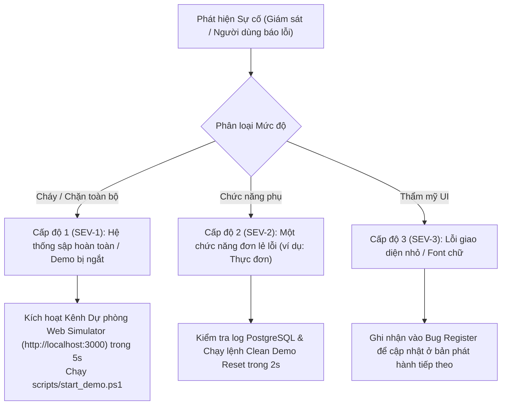

# Operations Runbook — SchoolConnect (Tài Liệu Vận Hành & Xử Lý Sự Cố)

**Hệ thống:** SchoolConnect Infrastructure & Deployment Fleet  
**Mục tiêu áp dụng:** Kỹ sư Vận hành (SRE), Quản trị viên Hệ thống (SysAdmin), Kỹ sư DevOps  
**Phiên bản:** 1.0.0  
**Ngày phê duyệt:** 2026-11-05  
**Tiêu chuẩn bảo mật:** Tuyệt đối không lưu trữ khóa bí mật, mật khẩu plaintext trong tài liệu này  

---

## 1. Tổng quan Môi trường Vận hành

| Tham số Môi trường | Môi trường Triển khai Cục bộ (Local Host) | Môi trường Đám mây Zalo CDN |
| :--- | :--- | :--- |
| **Vai trò** | Lưu trữ Database PostgreSQL & Máy chủ Spring Boot API | Phân phối mã nguồn giao diện di động Zalo Mini App |
| **Địa chỉ Host** | `127.0.0.1` / `localhost` | `https://h5.zdn.vn` / `zmp-3rd-resources.zmncdn.me` |
| **Cổng dịch vụ** | `8080` (Backend), `5432` (PostgreSQL), `3000` (Web Simulator) | HTTPS Cổng 443 |
| **Đường hầm Ingress** | Cloudflare Quick Tunnel (`*.trycloudflare.com`) | Đường truyền trực tiếp qua Cloudflare Edge PoP |
| **Chứng chỉ TLS** | TLS 1.3 cấp tự động qua Cloudflare Edge | Quản lý bởi hạ tầng bảo mật Zalo CDN |

---

## 2. Vòng đời Quản lý Dịch vụ (Service Lifecycle Management)

### 2.1 Khởi động Toàn bộ Hệ thống bằng 1 Lệnh (One-Click Launch)
Để đưa toàn bộ hệ thống vào trạng thái hoạt động với đầy đủ cơ chế tự phục hồi (Self-Healing):
```powershell
# Chạy từ thư mục gốc dự án
Set-Location "d:\Coding\TitKul_ProjectTest\SchoolConnect"
.\scripts\start_demo.ps1
```
*Script tự động kiểm tra PostgreSQL, khởi động Spring Boot trong cửa sổ độc lập, mở Web Simulator tại cổng 3000 và thực hiện smoke test xác nhận thành công.*

### 2.2 Quy trình Tắt Dịch vụ An toàn (Graceful Shutdown)
Khi kết thúc buổi demo hoặc cần bảo trì:
```powershell
# 1. Tắt máy chủ Web Simulator (Cổng 3000)
Get-NetTCPConnection -LocalPort 3000 -ErrorAction SilentlyContinue | ForEach-Object { Stop-Process -Id $_.OwningProcess -Force }

# 2. Tắt máy chủ Backend (Cổng 8080)
Get-NetTCPConnection -LocalPort 8080 -ErrorAction SilentlyContinue | ForEach-Object { Stop-Process -Id $_.OwningProcess -Force }

# 3. Tắt an toàn CSDL PostgreSQL
& "D:\DB_Design\PostgreSQL\pgsql\bin\pg_ctl.exe" -D "d:\Coding\TitKul_ProjectTest\SchoolConnect\.pgdata" stop -m fast
```

### 2.3 Khởi chạy Đường hầm Ingress Cloudflare (Cloudflare Tunnel)
```powershell
# Khởi chạy Quick Tunnel trỏ về cổng 8080
.\cloudflared.exe tunnel --url http://127.0.0.1:8080
```
> [!IMPORTANT]
> Giữ cửa sổ terminal này chạy liên tục. Địa chỉ `https://<random>.trycloudflare.com` được dùng làm `VITE_API_BASE_URL` cho Zalo Mini App.

---

## 3. Quản trị Cơ sở Dữ liệu (Database Operations)

### 3.1 Sao lưu CSDL Dự phòng Tức thời (Instant Backup)
```powershell
$timestamp = Get-Date -Format "yyyyMMdd_HHmmss"
$backupFile = "backups\schoolconnect_backup_$timestamp.sql"
& "D:\DB_Design\PostgreSQL\pgsql\bin\pg_dump.exe" -h localhost -p 5432 -U postgres -d schoolconnect -F c -b -v -f $backupFile
```

### 3.2 Khôi phục CSDL từ Bản Sao lưu (Restore)
```powershell
$targetBackup = "backups\schoolconnect_backup_verified.sql"
& "D:\DB_Design\PostgreSQL\pgsql\bin\pg_restore.exe" -h localhost -p 5432 -U postgres -d schoolconnect -c -v $targetBackup
```

### 3.3 Đặt lại Dữ liệu Sạch Trước Giờ Thuyết Trình (Clean Demo Reset)
Sau khi thực hiện các bài kiểm thử tạo đơn xin nghỉ phép thử nghiệm, chạy lệnh sau trong 2 giây để đưa CSDL về trạng thái sạch ban đầu (bảo toàn 100% hồ sơ học sinh và 2 đơn mẫu ban đầu):
```powershell
& "D:\DB_Design\PostgreSQL\pgsql\bin\psql.exe" -h localhost -p 5432 -U postgres -d schoolconnect -c "DELETE FROM leave_requests WHERE id > 2;"
```

---

## 4. Quy trình Triển khai & Quay lui (Deployment & Rollback)

### 4.1 Quy trình Triển khai Phiên bản Mới lên Zalo Testing
```powershell
# 1. Đóng gói Frontend Production
Set-Location "d:\Coding\TitKul_ProjectTest\SchoolConnect\frontend"
npm run build

# 2. Triển khai lên Zalo Mini App Cloud
npx zmp-cli deploy --mode=testing
```

### 4.2 Kế hoạch Quay lui Phiên bản Khẩn cấp (Emergency Rollback)
Nếu bản build mới phát sinh lỗi nghiêm trọng trên điện thoại:
1. **Quay lui trên Zalo Cloud (Thời gian: $< 10$ giây):**
   - Đăng nhập trang [Quản lý Ứng dụng Zalo Developer](https://developers.zalo.me).
   - Chọn ứng dụng `SchoolConnect` (ID: `3878294804116801168`).
   - Vào mục **Lịch sử Phiên bản (Version History)** $\rightarrow$ Bấm chọn phiên bản ổn định trước đó (ví dụ: Version 2 hoặc Version 1) làm *"Active Testing Version"*.
2. **Kích hoạt Kênh Dự phòng Trình duyệt (Thời gian: $< 5$ giây):**
   - Mở ngay địa chỉ `http://localhost:3000` trên laptop và tiếp tục thuyết trình qua màn hình máy chiếu.

---

## 5. Giám sát & Nhật ký Hệ thống (Observability & Monitoring)

### 5.1 Giám sát Tình trạng Sức khỏe (Health Check Endpoint)
- **Địa chỉ Probe:** `http://127.0.0.1:8080/api/v1/health`
- **Tần suất kiểm tra khuyến nghị:** 30 giây/lần.
- **Tiêu chuẩn phản hồi thành công (`200 OK`):**
  ```json
  {
    "success": true,
    "data": {
      "status": "UP",
      "database": "UP",
      "demoModeEnabled": true,
      "timestamp": "2026-11-05T..."
    }
  }
  ```

### 5.2 Sổ tay Nhật ký Hệ thống (Log Inventory)
- **Nhật ký Backend Spring Boot:** `backend-live.log` & console window độc lập.
- **Nhật ký CSDL PostgreSQL:** `postgres-server.log` (ghi nhận kết nối, checkpoint, lỗi query).
- **Nhật ký Frontend Preview:** `frontend-preview.log`.
- **Nhật ký Ingress Cloudflare:** Hiển thị trực tiếp trên console của `cloudflared.exe`.

---

## 6. Ma trận Xử lý Sự cố (Troubleshooting Matrix)

| Mã Sự cố | Hiện tượng & Log Nhận biết | Nguyên nhân Gốc rễ | Giải pháp Khắc phục Triệt để |
| :--- | :--- | :--- | :--- |
| **`T-01`** | `511 (Network Authentication Required)`<br>`Unexpected token '<'` | Localtunnel hiển thị trang chặn HTML bắt nhập IP. | Hệ thống đã tích hợp `Bypass-Tunnel-Reminder: true` trong `apiClient.ts`. Khuyến khích chuyển sang Cloudflare Tunnel (`trycloudflare.com`) để loại bỏ 100% trang chặn. |
| **`T-02`** | `connectex: No connection could be made because the target machine actively refused it`<br>`Failed to fetch` | Tiến trình Spring Boot (cổng 8080) chưa chạy hoặc đã bị tắt. | Chạy lệnh `.\scripts\start_demo.ps1` để tự động khởi chạy lại Spring Boot trong cửa sổ độc lập. |
| **`T-03`** | `Connection to localhost:5432 refused`<br>`CannotCreateTransactionException`<br>`HTTP 500` | PostgreSQL bị dừng (ví dụ: do vô tình bấm `Ctrl+C` trong terminal cha). | `start_demo.ps1` tự động phát hiện lỗi 5432, khởi động lại PostgreSQL dưới dạng tiến trình độc lập và khởi động lại Backend sạch sẽ. |
| **`T-04`** | `CORS Preflight Failed`<br>`Access-Control-Allow-Headers mismatch` | Request gửi header tùy biến mà backend chưa khai báo cho phép. | `CorsConfig.java` cho phép wildcard `*` headers và origins; `apiClient.ts` chỉ gắn bypass header cho domain `loca.lt`. |

---

## 7. Quy trình Phân cấp & Xử lý Sự cố (Incident Escalation)



- **Mục tiêu Cam kết Thời gian (SLA Targets):**
  - Thời gian phục hồi dịch vụ (Recovery Time Objective — **RTO**): $\le 15\text{ giây}$.
  - Điểm khôi phục dữ liệu tối đa (Recovery Point Objective — **RPO**): $\le 1\text{ phút}$.
- **Thông tin Chỉ huy Sự cố (Incident Commander):**
  - Họ và tên: **Nguyễn Võ Hoàng Khang** (Lead DevOps & SRE)
  - Số điện thoại khẩn cấp: `+84 779 009 487`
